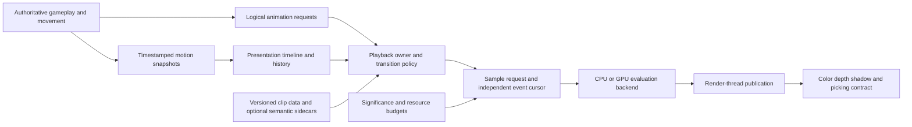

# Next-generation creature animation proposal

Date: 2026-11-19. Original status: architectural proposal. Implementation evidence on `feat/animation-next-generation` is recorded in section 13; section 14 consolidates every N01–N18 status and the remaining work. Historical investigation statements below describe the original proposal, not subsequent implementation validation.

## 1. Recommended direction

Make motion coherent before making deformation more elaborate. OpenKeeper should first render creature transforms, clip phase and presentation events on one explicitly timestamped timeline. Then introduce significance-based animation budgets and a measured GPU vertex-animation backend. Preserve the existing CPU sampler as the compatibility reference and fallback.

Cross-clip blending, foot placement and layered motion can improve selected creatures, but require more asset preparation than their skeletal-engine equivalents. A new structural screen of eight creature types found **zero identical ordered mesh signatures in 44 WALK-to-other-clip comparisons**. The current importer produces vertex animation, not a rigged character. A universal blend tree or IK controller would therefore conceal prerequisites rather than solve them.

The ambitious path is still worthwhile: build verified mesh correspondence, introduce short transitions and contact annotations, and experiment with a derived proxy rig or skinning decomposition. Those are separate quality experiments, not prerequisites for moving existing vertex playback to the GPU. Distinguish three independent choices:

- **Motion policy:** faithful authored timing by default; optional enhanced transitions and procedural motion.
- **Evaluation backend:** CPU, vertex texture fetch, and possibly a future compute or derived-skinning path.
- **Budget policy:** importance-based quality selection with explicit exemptions for interaction and close views.

A faithful GPU backend must reproduce the same motion as the CPU reference. Enabling GPU playback must not silently enable gait warping, alternate timing or procedural realism.

## 2. Baseline, evidence and uncertainty

### Repository and pending integration

This proposal was written in the canonical checkout at `a63005ab362a55540b67daeadaf2eeb00a8ba73a` (`fix/dungeon-heart-startup`). That checkout is not the animation implementation baseline. Animation source and implementation evidence were inspected in the clean `feat/character-animation` worktree at **`09bdf79b3bb684d4fff15df331d2303e8d5e87a5`**, using **jMonkeyEngine 3.9.0-stable**. Source links below are pinned to that revision to avoid attributing pending behavior to the canonical tree.

Live GitHub inspection found these changes **open and unmerged** during this investigation:

| Change | Relevant boundary |
|---|---|
| [Animation PR #1325](https://github.com/tonihele/OpenKeeper/pull/1325), head `09bdf79b3` | Timing, vertex interpolation, ownership, pause, cache and validation baseline |
| [Material lifecycle PR #1310](https://github.com/tonihele/OpenKeeper/pull/1310), head `d2f96a799` | Retained material registration, shared lighting and owner-local parameters |
| [Texture filtering PR #1311](https://github.com/tonihele/OpenKeeper/pull/1311), head `a385e4032` | World surface texture policy; future pose textures must remain data textures |
| [Dungeon Heart PR #1312](https://github.com/tonihele/OpenKeeper/pull/1312), head `a63005ab3` | Independent scene work; not an animation integration baseline |

The animation PR's reported base was `cd78e565462bd3ab50ef99c86cac7b54c3bee04e`. Integration testing must use the actual combined revisions when these branches land; this document does not claim they have been tested together.

Read baseline documentation:

- [Original assessment and implementation checklist](https://github.com/adrian-andrzjewski/OpenKeeper/blob/09bdf79b3bb684d4fff15df331d2303e8d5e87a5/docs/character-creature-animation-architecture-assessment-2026-11-18.md).
- [Independent review, remediation and publication evidence](https://github.com/adrian-andrzjewski/OpenKeeper/blob/09bdf79b3bb684d4fff15df331d2303e8d5e87a5/docs/character-animation-code-review-2026-11-19.md).
- [Current maintenance guide and verification entry points](https://github.com/adrian-andrzjewski/OpenKeeper/blob/09bdf79b3bb684d4fff15df331d2303e8d5e87a5/docs/character-animation.md).

### Evidence labels

**Confirmed** means source inspection or a diagnostic executed for this investigation. **Recorded baseline** means evidence in the existing implementation documentation, not a test rerun here. **Proposal** means a design or experiment. **Target** means a suggested acceptance threshold, not an achieved improvement. Native DK2 semantics remain **unverified** unless supported by a versioned original-executable trace. Naming a resource or enum does not establish its native behavior.

### What the pending baseline already solves

Do not restart these improvements as if missing: finite endpoint handling; interpolation between sparse vertex frames; conservative animated bounds; invalidation of stale precise-picking data; authored frame-rate mapping; complete request identity; a single unwrapped Start/Main/End playback clock; pause-aware pose/atlas/event age; transactional detached clip preparation; missing-art lifecycle handling; retained material-state restoration; alpha/black-key color and shadow consistency; owned Position values; serialized fall/planar movement; policy-aware prewarming; explicitly hidden and unchanged pose-write suppression; and opt-in bounded owner-local prepared-clip reuse.

The prepared cache still defaults to **zero retained clips**. Its position-byte budget is not a bound on original sparse assets, materials, scene nodes, global asset caches, native buffers or GPU memory. “Hidden” optimization currently covers explicit ancestor visibility, not a complete multi-camera animation scheduler. The guide and review above distinguish these scopes.

### Recorded performance and validation baseline

These figures were checked against existing records. They were **not rerun** for this architecture-only task.

| Recorded workload | Result | What it establishes |
|---|---|---|
| Final `build --rerun-tasks` | 1,471 tests; zero failures/errors; four minimap asset skips | Build/test baseline; four skipped cases separately passed against installed assets |
| Strict installed corpus | 944 resources, 1,888 fresh/cached loads, 1,745,788 samples; zero nonfinite/outside | Broad decoder and bound coverage; not native timing parity |
| GL coverage/gallery | Four synthetic coverage cases, 39 gallery pose hashes; pause images identical | Those fixed views and alpha/shadow cases; not all camera/lighting combinations |
| Real local Alcatraz session | 48 creatures, 1,092 active frames; actual pause freezes all owner ages and presentation clock; resume advances | Small integration and lifecycle acceptance; not crowd scalability |
| 500 visible owners, two standalone runs | Median 1.5232–1.7497 ms; P95 3.6849–4.3004 ms; P99 4.2016–4.6008 ms | CPU owner benchmark variation; no established total-frame speedup |
| 1,000 visible owners, recorded repeat | Median/P95/P99 3.8424/7.3896/8.7362 ms | Isolated CPU scaling at that workload |
| 500 explicitly hidden / unchanged owners, repeat | Median 0.0720 / 0.0290 ms; zero measured dirty bytes/allocations | Existing suppression is effective within its scope |
| 3,000 transitions, cache off / three clips | 137.643 / 55.075 ms; allocation 72,824,352 / 6,192,432 bytes | Strong transition-burst opportunity; retained position accounting 18,234,000 bytes, not total residency |
| Same transition test, repeat | 173.756 / 50.869 ms | Timing variability; do not turn the first pair into a whole-game claim |

The final local smoke's 5.600/7.927/11.192 ms median/P95/P99 CPU submission times include a cap, observer work and a pause scenario. They exclude asynchronous GPU completion and have no paired reference. Existing records do not rank animation against lighting, shadows, navigation, UI, picking or driver cost in a representative visible crowd. This is a missing measurement, not evidence that GPU animation is unnecessary.

## 3. Current pipeline and fundamental limits

### Asset to pixel

1. DK2 map/catalog `ArtResource` entries identify whole animation resources and their frame-rate/segment metadata. `Anim` represents KMF frame/sprite/geometry/index tables and offsets; the imported path has no bone hierarchy or skin weights. `AnimControl` is explicitly documented as having an unknown purpose; its name is not proof of a hidden skeletal rig. [Anim.java](https://github.com/adrian-andrzjewski/OpenKeeper/blob/09bdf79b3bb684d4fff15df331d2303e8d5e87a5/src/main/java/toniarts/openkeeper/tools/convert/kmf/Anim.java#L27), [AnimControl.java](https://github.com/adrian-andrzjewski/OpenKeeper/blob/09bdf79b3bb684d4fff15df331d2303e8d5e87a5/src/main/java/toniarts/openkeeper/tools/convert/kmf/AnimControl.java#L21).
2. `KmfModelLoader` expands DK2 table references into geometry parts and sparse vertex poses. Its source time grid begins at `(i+1)/30`; `TimedClip` maps authored playback timing onto that representation. Conversion produces J3O scenes, not a common creature rig. The animated path uses LOD0, dynamic positions and static authored normals. [KmfModelLoader.java:252](https://github.com/adrian-andrzjewski/OpenKeeper/blob/09bdf79b3bb684d4fff15df331d2303e8d5e87a5/src/main/java/toniarts/openkeeper/tools/convert/KmfModelLoader.java#L252), [LOD/normals:440](https://github.com/adrian-andrzjewski/OpenKeeper/blob/09bdf79b3bb684d4fff15df331d2303e8d5e87a5/src/main/java/toniarts/openkeeper/tools/convert/KmfModelLoader.java#L440), [TimedClip.java](https://github.com/adrian-andrzjewski/OpenKeeper/blob/09bdf79b3bb684d4fff15df331d2303e8d5e87a5/src/main/java/toniarts/openkeeper/view/animation/TimedClip.java#L1).
3. Gameplay selects a logical request. `CreatureViewSystem` prioritizes exceptional states and uses actual displacement for WALK/STAND; possession selects supported run/stealth art. This is not a continuous speed/turn locomotion blend space. The request carries creature/state/start/sequence identity. [CreatureViewSystem.java:111](https://github.com/adrian-andrzjewski/OpenKeeper/blob/09bdf79b3bb684d4fff15df331d2303e8d5e87a5/src/main/java/toniarts/openkeeper/game/logic/CreatureViewSystem.java#L111), [CreatureViewState.java](https://github.com/adrian-andrzjewski/OpenKeeper/blob/09bdf79b3bb684d4fff15df331d2303e8d5e87a5/src/main/java/toniarts/openkeeper/game/component/CreatureViewState.java#L1).
4. `CreatureViewControl` resolves presentation and lifecycle. `AnimationLoader` prepares detached segment models and publishes a replacement transactionally. `AnimationPlayback` owns segment/loop time and manually samples disabled composers. It replaces clip models; it does not blend corresponding outgoing/incoming vertices or evaluate procedural layers. [CreatureViewControl.java](https://github.com/adrian-andrzjewski/OpenKeeper/blob/09bdf79b3bb684d4fff15df331d2303e8d5e87a5/src/main/java/toniarts/openkeeper/view/control/CreatureViewControl.java#L1), [AnimationLoader.java:73](https://github.com/adrian-andrzjewski/OpenKeeper/blob/09bdf79b3bb684d4fff15df331d2303e8d5e87a5/src/main/java/toniarts/openkeeper/view/animation/AnimationLoader.java#L73), [AnimationPlayback.java:117](https://github.com/adrian-andrzjewski/OpenKeeper/blob/09bdf79b3bb684d4fff15df331d2303e8d5e87a5/src/main/java/toniarts/openkeeper/view/animation/AnimationPlayback.java#L117).
5. `PoseTrack` decodes adjacent CPU frames into owner-local arrays, linearly interpolates positions, dirties the position buffer and clears collision data. Explicitly hidden/unchanged samples avoid the write. Static normals do not follow deformation. The GPU receives the deformed positions for rendering, rather than evaluating this custom pose track. [PoseTrack.java:243](https://github.com/adrian-andrzjewski/OpenKeeper/blob/09bdf79b3bb684d4fff15df331d2303e8d5e87a5/src/main/java/toniarts/openkeeper/animation/PoseTrack.java#L243).
6. DK lighting shaders transform positions and evaluate lighting; the vertex shader already imports jME instancing support. Custom shadow techniques enforce coverage. Animation acceleration must preserve all these passes, fog, material variants, hover/charred state, bounds and picking. It will not remove the lighting loop or automatically reduce draw submissions. [Vertex.vert:53](https://github.com/adrian-andrzjewski/OpenKeeper/blob/09bdf79b3bb684d4fff15df331d2303e8d5e87a5/assets/Shaders/DkLighting/Vertex.vert#L53), [AnimationShadow.vert](https://github.com/adrian-andrzjewski/OpenKeeper/blob/09bdf79b3bb684d4fff15df331d2303e8d5e87a5/assets/Shaders/AnimationShadow.vert#L1).

### Root movement can still step between snapshots

`Position` owns its vector but does not carry a source timestamp, velocity, discontinuity marker or lifetime epoch. The view applies its translation and yaw directly on updates. A continuously interpolated body pose can therefore sit on a discretely updated root. This is a confirmed architectural limitation; the magnitude of visible jitter and contact slip needs measurement. `PresentationClock`'s bounded prediction synchronizes playback age, but is not transform-history interpolation. [Position.java:26](https://github.com/adrian-andrzjewski/OpenKeeper/blob/09bdf79b3bb684d4fff15df331d2303e8d5e87a5/src/main/java/toniarts/openkeeper/game/component/Position.java#L26), [PlayerEntityViewState.java:891](https://github.com/adrian-andrzjewski/OpenKeeper/blob/09bdf79b3bb684d4fff15df331d2303e8d5e87a5/src/main/java/toniarts/openkeeper/view/PlayerEntityViewState.java#L891), [PresentationClock.java](https://github.com/adrian-andrzjewski/OpenKeeper/blob/09bdf79b3bb684d4fff15df331d2303e8d5e87a5/src/main/java/toniarts/openkeeper/view/animation/PresentationClock.java#L1).

SimEthereal services and a remote `TimeSource` already exist. Source searches found no transform-history interpolator feeding this creature view path; this is not a claim that the dependency cannot provide one. Before adding a new network protocol, trace server publication and reuse its clock/snapshot facilities where suitable. Registration of a serializer or availability of remote time alone does not timestamp every ECS Position transaction. [ConnectionState.java:92](https://github.com/adrian-andrzjewski/OpenKeeper/blob/09bdf79b3bb684d4fff15df331d2303e8d5e87a5/src/main/java/toniarts/openkeeper/game/state/ConnectionState.java#L92), [NetworkServer.java:321](https://github.com/adrian-andrzjewski/OpenKeeper/blob/09bdf79b3bb684d4fff15df331d2303e8d5e87a5/src/main/java/toniarts/openkeeper/game/network/NetworkServer.java#L321).

### New structural experiment: blending prerequisites

A read-only Java diagnostic loaded the installed `Alcatraz.kwd` catalog and existing converted models using the pending animation implementation. It selected eight archetypes and inspected WALK, RUN, STEALTH_WALK, STAND_STILL, IDLE_1, MELEE_ATTACK, DIE and DEATH_POSE when present. The signature covered ordered geometry parts, vertex counts, primitive modes, index streams and exact UV bits. It excluded positions so an ordinary animated pose change would not itself cause a mismatch.

| Archetype | WALK resource | Parts | Vertices | Track key count | Other present slots matching WALK signature |
|---|---|---:|---:|---:|---:|
| Imp | Imp_Run | 3 | 324 | 13 | 0/4 |
| Goblin | Goblin-Walk | 5 | 404 | 43 | 0/6 |
| Mistress | Mis_Walk | 5 | 492 | 49 | 0/6 |
| Knight | Knight-Walk | 5 | 483 | 28 | 0/6 |
| Warlock | Warlock-Walk | 3 | 401 | 61 | 0/6 |
| Bile Demon | Bile_Demon-Walk | 3 | 329 | 41 | 0/5 |
| Firefly | Fir-Walk | 3 | 266 | 30 | 0/6 |
| Skeleton | Skeleton-Walk | 3 | 272 | 37 | 0/5 |

Totals: **52 present resources, 44 non-WALK comparisons, 44 mismatches, 12 absent slots**. For example, Goblin WALK has 404 vertices, RUN 388 and STAND_STILL 401; Imp WALK has 324 and STAND_STILL 342. Different counts rule out direct whole-array interpolation for those pairs.

**Interpretation:** reject unconditional current-order vertex blending. A mismatch may reflect only part order, seams or UV packing; it does not prove offline correspondence is impossible. Even an equal signature would not prove anatomical vertex identity, rest-space alignment, transform compatibility or material compatibility. This screen does not cover all 944 resources, all clip pairs, Start/Main/End transitions or other DK2 releases.

Local diagnostic provenance: `D:/Temp/openkeeper-animation-architecture-20261119/{TopologyProbe.java,probe.init.gradle,probe.log,topology.csv}`. The external init-script task `proposalTopology` compiled and ran successfully in 12 seconds, with two tasks executed and three up-to-date; production sources and converted assets were not rewritten. These temporary diagnostic files are not maintained repository tooling. A reproducible maintained topology audit is an explicit action below; the recorded method and aggregate results are retained here even if temporary files expire. Map-loader override/unknown-camera-enum warnings occurred and were not treated as animation failures.

## 4. Target architecture and integration boundaries



Use small seams around current owners, not a second character framework:

| Boundary | Responsibility and invariant |
|---|---|
| Motion snapshot adapter | Publishes source time, source sequence and lifetime/discontinuity identity; owns no animation decisions |
| Presentation timeline | Selects one presentation instant; handles pause, interpolation delay and bounded correction explicitly |
| Existing playback owner | Resolves request generation, segments, phase and transition policy; completion/marker semantics stay independent of deformation backend |
| Immutable clip data | Source fingerprint, converter/schema version, topology/layout identity, timing, bounds and optional contact/mask data |
| Pose evaluator | Reads immutable data into exclusive CPU outputs or produces GPU frame/blend parameters; does not mutate ECS, materials or audio |
| Budget service | Chooses pose quality/cadence using view significance; cannot alter gameplay outcomes or silently change clip duration |
| Render publication | Updates scene, buffers, material registrations and GPU resources on the render thread; validates generation before publication |

Names are conceptual; add an interface only where there are two implementations or a meaningful test boundary. Reuse `AnimationPlayback`, current model-source injection and presentation/material ownership rather than wrapping every field in a service. Keep timing arithmetic pure enough for unit tests.

Configuration should be versioned and validated: backend `AUTO/CPU/VERTEX_TEXTURE`, motion style `CLASSIC/ENHANCED`, per-archetype permitted transition/contact policies, per-platform CPU/residency budgets and screen-size LOD thresholds. Defaults preserve the existing faithful policy. Unknown schema, invalid values, unsupported hardware or unverified topology select the compatible path and report one diagnostic per asset/generation rather than logging every frame.

## 5. Recommendations: fidelity and behavior

### N01 — Establish the motion and cost oracle first

**Why:** existing fixed captures and CPU benchmarks cannot decide whether the next bottleneck is root jitter, pose evaluation, picking, draw submission or lighting. They also cannot establish native endpoint dwell, CLAMP, retreat, drag, recoil or alternate-form semantics.

**How:** extend the maintained gallery/crowd tools with recorded authoritative trajectories and a deterministic camera. Capture constant-speed travel, acceleration/deceleration, 90/180-degree turns, blocked navigation, possession, work/combat interruption, death, hover, hand pickup/drop, hauling, teleport and removal. Record pose/root phase separately. Obtain versioned DK2 executable traces for the same actions, identifying release, speed setting, frame rate, creature and capture timing. Measure phase/marker/contact relationships, not only similar screenshots. Do not redistribute proprietary models or footage without permission.

**Benefit/verification:** a repeatable attribution and acceptance suite. Record CPU sampling, decoding, buffer writes, collision rebuilds, allocation, draw counts, GPU timestamps per pass, Java/native/GPU residency and frame-time distributions. At least three non-overlapping measured runs after warmup; report median/P95/P99 and variation. Use 50/250/500/1,000 creatures, eight archetypes, common and varied phase, near/far views, offscreen shadow casters, several camera rates and a real playable level. This is the gate for all claimed performance improvements.

### N02 — Interpolate root motion on the playback presentation timeline

**Why:** smoother vertices cannot repair a root transform that moves in discrete steps. A common time basis also gives contact and gait calibration meaningful inputs.

**How:** first map every transform producer, including fall, steering, possession, teleport, hauling and spawn/removal. Reuse SimEthereal timing/publication where applicable. Introduce a coherent motion sample with source timestamp, sequence and epoch/discontinuity identity; velocity is optional and must have defined validity. Do not label a newly received Position with receive time or assume a separately delivered clock component atomically timestamps it.

Keep a short bounded client history. Present remote/local non-controlled creatures at a deliberately delayed source time, initially one actual publisher interval rather than an assumed 60 Hz. Interpolate translation linearly and yaw along the shortest arc. Only consider velocity-aware Hermite interpolation after measuring corner overshoot; never smooth through walls or interpolate across a discontinuity. Evaluate clip phase and visible markers at the same selected time, including the historical request active at that time. Keep simulation task completion/damage on authoritative time. No available bracket means bounded hold/prediction with explicit correction policy, not unbounded extrapolation.

Local possession needs a separately tested low-latency prediction/correction policy; do not add the remote delay to its camera/input response. Pickup, hand attachment, drop, teleport, level switch and reused entity identities clear history and snap to the new epoch. Attachments must consume the same presented transform. Paused state freezes both history presentation and phase; a stale packet cannot regress time. Define delivery/reordering behavior before changing the network schema and require matching client/server versions.

**Benefit/verification:** target at least a 50% reduction in constant-path frame-to-frame velocity error versus direct snapshots at 60/120/144 Hz, without increased contact slip. Measure added presentation latency separately; target no more than one publisher interval in a controlled zero-jitter session. Test delayed, burst, coalesced, reordered and dropped samples; lifecycle changes during delay; long render stalls; pause/resume; server time correction. Compare ECS/gameplay hashes to prove the presentation change does not alter simulation.

### N03 — Add a small semantic motion catalog, not a universal graph

**Why:** enum/resource presence does not specify stance, cycle contacts, safe interruption, blend compatibility or a creature's body plan. Hard-coded guesses become fragile as enhancements accumulate.

**How:** add optional converter-versioned sidecars keyed by source fingerprint and resource identity. Start with loop/one-shot classification, transition permission, expected reference speed, contact/phase annotations and verified layout group. Keep original ArtResource timing authoritative in classic mode. Model priority and interruption rules in a compact transition table around the current playback owner: e.g. death/hand/discontinuity overrides locomotion; work/combat may require an authored end segment. Record unsupported fields explicitly. Validate sidecars at load and fall back to current playback if absent.

Use a lightweight graph only when real combinations justify it: base clip, one approved transition, and optional cosmetic correction. An arbitrary node editor, large runtime reflection system or a duplicate gameplay state machine adds maintenance without present asset support.

**Benefit/verification:** fewer per-creature code branches, explicit compatibility decisions and independently testable selection. Catalog tests must cover every registered enhanced clip, invalid/mismatched sidecars, unavailable slots and exceptional-state priority. N03 provides metadata, not a claim to know native semantics; unresolved behaviors remain classic until N01 references establish them.

### N04 — Calibrate gait, turning and phase using actual presented motion

**Why:** WALK/RUN selection alone cannot prevent foot sliding when travel speed and authored stride differ. Turning snaps can be more noticeable than low-poly deformation.

**How:** measure each permitted locomotion cycle's stride/contact relation against presented root displacement. For approved loops, use speed/reference-speed rate scaling with smoothing and initially narrow trial clamps, such as 0.9–1.1. Accumulate phase continuously; do not multiply absolute elapsed time by a changing rate. Keep attack, work, hit, death and other gameplay-timed clips at their authored timing. A decorative gait offset must also offset associated presentation markers. Flying/crawling bodies require separate policies; foot-contact assumptions do not transfer universally.

Prefer authored turn/anticipation segments when catalog evidence supports them. Otherwise test a bounded cosmetic yaw lag on a child presentation node, with immediate authoritative root/collision rotation and snap thresholds for sharp reversals. Cap angular error and reset on discontinuity. Do not synthesize an anticipation delay that changes action responsiveness or treats future navigation intent as certain motion. Deceleration and blocked movement should converge cleanly to stance rather than chatter between two states; use presentation-only thresholds/hysteresis, never a change to task movement completion.

**Benefit/verification:** target lower stance-foot world drift at constant speed, without increased attack/work timing error. Compare slip per stance and maximum root/body angular lag across turns and stops. Assess DK2's deliberately exaggerated cadence with side-by-side video; classic mode remains unchanged until native acceptance. A selected/possessed creature must not feel less responsive.

### N05 — Verify correspondence, then introduce selective transitions

**Why:** a hard whole-model replacement can create a silhouette or velocity discontinuity. The topology screen shows that simply blending two existing vertex buffers is broadly unsafe.

**How:** implement an offline topology/semantic correspondence audit first. Distinguish reordered identical meshes, duplicated UV seams, changed tessellation, added/removed geometry, differing transforms and material partitions. Preserve a mapping back to each source's UVs/materials. A common surface mapping may require a canonical mesh and resampled deformations; reject pairs with uncertain anatomy, excessive reconstruction error or incompatible appearance. Nearest-position matching in one pose is not sufficient, particularly for crossed limbs, folded wings and collapsed death poses.

For proven pairs, align transition entry using annotated contact phase or a small offline pose/velocity candidate search. Trial short 40–100 ms smooth crossfades, with creature/action-specific caps and authored Start/End preference. A new request interrupts from the current presented composite pose, not a stale outgoing clip. Preserve current request generation, terminal behavior, detached preflight and rollback. Clips without safe correspondence use the authored transition or existing cut; avoid alpha crossfades as a default because they create double silhouettes and ambiguous shadows.

**Benefit/verification:** target at least 30% reduction in projected transition pose jump on approved pairs, with no worse stance drift, no volume collapse and exact logical completion timing. Test interrupted blends, death during locomotion, missing segment, hidden transition, cache reuse, pause and large time jumps. Derive blend bounds from both poses; procedural overshoot requires additional bounds. A failed corpus correspondence experiment is a valid reason to retain cuts for that pair.

### N06 — Introduce controlled variation without synchronizing the crowd

**Why:** hundreds of identical loop phases and repeated idle selections expose the animation system more than the individual asset's polygon count.

**How:** use a stable seed from entity lifetime and request generation for approved idle/locomotion phase and available idle-variant selection. Constrain weights, repeat avoidance and cooldowns in the catalog. Respect existing authored choices and investigate native selection before changing classic policy. Do not randomly seek attacks, work strikes, death or audio-linked actions. Never independently randomize a pose and its footstep marker clock. Preserve local variation across visibility and LOD changes so re-entry does not pop or restart.

**Benefit/verification:** a measurable reduction in same-phase pairs and consecutive repeated idle selections in a synthetic crowd, with identical seeds producing identical presentation. Human comparison decides whether variation improves DK2 style. Assert no change to gameplay RNG streams, damage, work completion or simulation replay. Random variation must not masquerade as animation quality when it merely hides synchronization.

### N07 — Add terrain/contact adaptation in graduated stages

**Why:** floating/sliding feet on height changes and abrupt body orientation can break contact. Full anatomical IK is not available from the existing imported data.

**How:** first annotate semantic contact anchors and valid stance windows for selected bipeds. Footstep marker timing is a useful candidate signal, not proof of stance duration. Query the actual walkable surface, not arbitrary decorative triangles; cap query count by significance and cache stable surface results. Start with bounded child-node height/pitch/roll adjustment and a smooth return to the authored pose. This can reduce whole-body hover; it cannot independently pin two feet.

True foot placement needs derived or authored deformation controls: a small proxy rig/cage with semantic limb chains and weights, or a compatible canonical mesh with constrained local deformation. Preserve hard seams, wing joints and contact geometry; expand bounds and update normals/picking consistently. Disable corrections on flying, falling, death, hand-held and unsupported bodies. Reach limits, step height, slope and ground confidence must clamp or disable the effect rather than stretch a limb. Keep physics/navigation roots unchanged.

**Benefit/verification:** first prove lower contact-height error on actual accessible slopes/steps with no increased sliding or body penetration. Then trial true pinning on one biped with annotated two-foot contacts, measuring stance drift and deformation error. Test stairs, edges, moving attachment ownership and invalid ground. Only promote beyond opt-in near LOD if blinded DK2-style comparisons prefer it. Flat dungeon floors may yield little benefit; reject a costly general solver if that is the representative case.

### N08 — Treat head tracking and secondary motion as authored semantic layers

**Why:** restrained attention and follow-through may improve close-view expression, while indiscriminate procedural sway can erase the original caricature.

**How:** require a head/appendage anchor, local axis, influence mask and deformation mechanism from N05/N07/N15. Apply small bounded aim offsets with angular limits and critically damped response, resetting on teleport, pause and replacement. Restrict targets to relevant visible interactions; do not turn heads through torsos or rotate a whole mesh when only the head should move. Use analytic stable damping or bounded substeps for secondary motion, driven by presented acceleration, with a hard energy/displacement cap. Avoid a general cloth/rigid-body solver for every low-poly creature.

Vertex-space additive layers require a common reference pose and meaningful masks; arbitrary subtraction of unrelated clip vertices is invalid. Support at most one or two validated layers initially, with explicit precedence over/under contact correction. No new combat capability or game collision comes from a cosmetic layer.

**Benefit/verification:** near-view style preference and bounded target-angle/settling measurements, with zero added simulation nondeterminism. Test frame-rate independence, huge delta time, interruption, hidden re-entry and pause. Measure per-creature/query cost. Disable layers at lower LOD while blending their weight to zero to avoid a pop.

### N09 — Preserve linear interpolation as reference; investigate normals and higher-order motion separately

**Why:** linear interpolation is already continuous and robust, but velocities can jump at sparse keys. Static authored normals may look inconsistent under large deformation. Neither fact proves a native fidelity defect: hard holds and static shading may be part of the original look.

**How:** compare contact and silhouette velocity discontinuities before changing interpolation. Trial shape-preserving, tangent-limited cubic interpolation only on approved smooth loop segments. Preserve authored holds, impacts and boundaries. Cubic paths can overshoot the existing convex pose envelope, requiring new analytic/conservatively sampled bounds and collision validation; do not reuse linear bounds unquestioned. Prefer denser preprocessing only if it reduces runtime cost without adding a new interpretation of motion.

For normals, separately compare static authored normals with per-frame normals reconstructed using known hard-edge/smoothing groups. Avoid welding UV seams into false smooth surfaces. Interpolate and renormalize approved normal data; measure lighting changes under multiple directions. Retain static normals as the classic default. GPU normal data increases storage and fetch cost, and CPU recomputation every owner/frame is unlikely to be the right default.

**Benefit/verification:** lower measured velocity discontinuity on smooth motion with no increased overshoot/contact error; blinded preference under original-style lighting. Require color/depth/shadow silhouette and bound tests. Reject the feature if it merely smooths intentional staccato motion or changes DK2's characteristic lighting.

## 6. Recommendations: scale, data and GPU evaluation

### N10 — Budget pose work by significance, preserving logical time

**Why:** near selected creatures and tiny distant creatures do not need identical deformation work. Explicit-hidden suppression already demonstrates that avoiding writes matters; a complete policy must account for shadow-only visibility and multiple cameras.

**How:** calculate significance from projected height, selection/possession, interaction/combat relevance, recent visibility and shadow contribution. Use hysteresis and staggered fixed buckets, not a full sort and allocation every frame. Near/possessed/selected/contact-critical creatures retain full quality. Mid/far bands can reduce pose evaluation or use quantized shared phase; completely irrelevant hidden owners can retain only clock/lifecycle work. Make decisions from the union of active view requirements; a previous main-camera cull result is insufficient for shadow or secondary-camera passes.

Throttling CPU samples and linearly writing interpolated output every render frame still costs O(vertices) writes. Measure that variant against simply reduced sampling, shared immutable output poses and GPU evaluation. Keep event/request cursors on unthrottled logical time. On re-entry, seek directly to the current pose without replaying a backlog of cosmetic sounds; deliver indispensable logical completion exactly once according to the existing policy. Do not defer terminal cleanup indefinitely. An LOD switch retains phase and request generation.

**Benefit/verification:** target at least 30% lower animation CPU P95 in a 500-creature mixed-distance scene, with less than 0.5 pixel extra far-LOD silhouette error at the test camera and no missed logical completions. Check near quality, frame pacing, shadow-only motion, camera cuts and LOD boundary churn. Epic's allocator demonstrates significance and update-budget principles for skeletal components; applying them to OpenKeeper's vertex output is an engineering inference, not a directly reusable plugin. [Epic Animation Budget Allocator](https://dev.epicgames.com/documentation/en-us/unreal-engine/animation-budget-allocator-in-unreal-engine).

### N11 — Separate immutable sharing from owner-local mutable output and total residency

**Why:** retaining prepared scenes accelerates transitions but increases resident memory. Sharing decoded source frames can reduce decoding and scratch duplication without sharing unsafe mutable Mesh state.

**How:** inventory process-global `AssetUtils` caches and define asset-manager/root/schema ownership before raising retention defaults. Its static strong/weak caches and texture map are concrete starting points, not a hypothetical future cache. Scope a bounded immutable clip/frame cache to a world/asset context and key it by source fingerprint, layout, clip, frame and conversion version. Coalesce concurrent loads, cancel/reject stale generations, publish completed data atomically and clear context-owned entries on level/root changes. Do not change an AssetManager's global cache policy blindly. [AssetUtils.java:78](https://github.com/adrian-andrzjewski/OpenKeeper/blob/09bdf79b3bb684d4fff15df331d2303e8d5e87a5/src/main/java/toniarts/openkeeper/utils/AssetUtils.java#L78).

Two distinct experiments are useful:

1. Shared adjacent decoded frames: owners still interpolate and write their own output. Saves decode work/duplicate decoded arrays; does not remove per-owner O(V) blend/upload.
2. Exact shared pose buckets: owners with identical layout, phase, quality and deformation policy reference one immutable output mesh/buffer. Saves evaluation/upload per bucket; quantized phase is a distant-LOD quality trade-off. Different world transforms/material state remain owner/instance data. No owner may mutate a shared output buffer.

Keep prepared scene reuse separate from shared clip data. Account for sparse source poses, Java objects, direct buffers, GPU copies, materials, texture residency and in-flight jobs. Eviction requires reference/in-flight ownership and render-thread GPU disposal; a memory budget is not met merely because entries were removed from a Java map. Record actual application residency and engine disposal behavior.

**Benefit/verification:** measure cache hit rate, decode time, transition allocation, peak/steady Java/native/GPU bytes and load latency over at least ten level enter/exit cycles with background loading. Require a stable post-cleanup plateau and no cross-manager contamination. Test cancellation, reload, failed load, context shutdown and delayed render disposal. Epic's sharing system supplies a useful state-bucket analogy, but relies on skeletal leader poses; the two vertex-cache designs here are proposed adaptations. [Epic Animation Sharing](https://dev.epicgames.com/documentation/en-us/unreal-engine/animation-sharing-plugin-in-unreal-engine).

### N12 — Prototype vertex-texture playback before compute

**Why:** existing clips already describe vertex trajectories. Fetching adjacent frames in a vertex shader can remove CPU per-vertex interpolation and frequent position uploads while preserving authored motion. Unlike cross-clip blending, it does not require topology correspondence between different resources.

**How:** bake each clip/geometry part into versioned dense or validated reduced pose data. Start with full-precision reference data, static topology/UV/normal buffers and two frame indices plus interpolation weight. Use an explicit vertex lookup index or a verified `gl_VertexID` mapping, including indexed draws and submesh offsets; never infer texture addressing from an unstable conversion order. Decode/fetch exact frames and interpolate manually to reproduce `TimedClip`, first-frame origin, terminal dwell, cycle direction and segment behavior. A 2D texture is a simple first transport; validate texture dimensions, vertex texture units, formats and sampler limits. Use arrays/buffer textures only when they improve measured packing or limits.

Pose textures are **linear numeric data**: no sRGB conversion, world mipmaps, anisotropy or unintended bilinear mixing across vertices/frames. Use explicit integer texel fetch where supported and a separately named pose-data material parameter. The pending O3 surface-map allowlist must not be broadened to include it. [WorldTextureFiltering.java:31](https://github.com/adrian-andrzjewski/OpenKeeper/blob/a385e4032091c9d16dd1d33e61766f3ca6b78b9d/src/main/java/toniarts/openkeeper/view/texture/WorldTextureFiltering.java#L31).

Put deformation in one shader include used consistently by every technique that consumes animated positions: color, depth, pre/post-shadow and, where enabled, SSAO normals and glow. In particular, `LightingSprite.j3md` references common SSAO/glow vertex shaders that currently work because the CPU has already updated positions; a VAT-only color/shadow change would leave those techniques on the undeformed mesh. Audit the actual material/technique matrix rather than assuming one lighting shader covers every pass. Existing DK materials use GLSL150 techniques; choose matching supported shader variants and check vertex-fetch/format/unit limits rather than imposing a compute-level hardware requirement. [LightingSprite.j3md:334](https://github.com/adrian-andrzjewski/OpenKeeper/blob/09bdf79b3bb684d4fff15df331d2303e8d5e87a5/assets/MatDefs/LightingSprite.j3md#L334), [Vertex.j3md:104](https://github.com/adrian-andrzjewski/OpenKeeper/blob/09bdf79b3bb684d4fff15df331d2303e8d5e87a5/assets/MatDefs/DkLighting/Vertex.j3md#L104).

Do not add a second scene traversal each frame to discover materials. Integrate with O1 structural registration and retain owner MeshCenter, ambient/fog, hover/charred, texture variants and authored coverage. Preserve bounds conservatively on CPU. For picking, retain a broad proxy and evaluate the current CPU pose on demand for precise selected/cursor tests; cache by presented phase/generation. Never read back GPU vertices every frame. Validate that selection uses the same presented root and pose as rendering. [EntityMaterialSetup.java](https://github.com/adrian-andrzjewski/OpenKeeper/blob/d2f96a799f44cd5db6659502c6acf6e0738a085f/src/main/java/toniarts/openkeeper/view/material/EntityMaterialSetup.java#L1).

Keep immutable clip resources shared and lifetime-owned. Switching backend occurs at a safe publication boundary, preserving current clock/request state; fallback must not restart the clip or mutate a live shared buffer. Start with an opt-in gallery and crowd backend, then integrate gameplay after pass/picking/resource parity.

**Benefit/verification:** expect less CPU deformation/upload, not fewer draw calls or cheaper lighting. Require CPU/GPU position equivalence within a declared precision budget, initially a maximum 0.25 projected pixel error in near-view captures, plus no new nonfinite/outside-bound samples. Use tight world-space error tests too so a distant camera cannot hide corruption. Require exact clip/marker phase and unchanged pause/terminal semantics. Suggested promotion gate: at least 20% lower animation CPU P95 **and** either 10% lower total-frame P95 or at least 1 ms saved in a demonstrated CPU-limited 1,000-creature scene, with no more than 5% GPU-time regression and bounded residency. These are proposed gates; representative results may justify rejecting or narrowing the backend.

### N13 — Instance only compatible crowd groups after attribution

**Why:** GPU deformation does not reduce scene traversal, per-object uniforms or draw submission. Repeated creatures can still cost multiple draws per part/pass.

**How:** group by mesh/layout, clip-data binding, material/coverage technique, texture variant and LOD. Supply per-instance transform, clip frame pair/weight, presentation state, owner lighting center and approved variation values. Use the pinned jME `InstancedGeometry`/instance-data facilities rather than assuming its built-in transform stream carries animation phase. Current DK shaders already import instancing helpers, but the extra parameters and all-pass behavior need implementation. Maintain stable owner-to-instance handles with generation validation for picking/removal. Avoid creating a unique material for each phase, which defeats grouping.

Do not use static `BatchNode` merging as a substitute for animated instancing. Transparent sorting, different topology/parts and exceptional near-view layers may require separate groups or CPU fallback. Target large repeated visible groups first. jME's existing instanced geometry handles transforms/camera instance updates, not this entire animation/material contract. [Pinned InstancedGeometry](https://github.com/jMonkeyEngine/jmonkeyengine/blob/v3.9.0-stable/jme3-core/src/main/java/com/jme3/scene/instancing/InstancedGeometry.java).

**Benefit/verification:** lower measured draw submission and draw calls at fixed scene content, without worsening GPU time, selection, visibility or lighting. Report groups × parts × passes, not “one draw for all creatures.” Compare varied-phase/variant crowds as well as a best-case identical crowd. NVIDIA's crowd example supports the texture/instance/LOD principle, but uses skeletal palette skinning in DirectX 10; its reported character counts do not predict OpenKeeper performance. [GPU Gems 3, Animated Crowd Rendering](https://developer.nvidia.com/gpugems/gpugems3/part-i-geometry/chapter-2-animated-crowd-rendering).

### N14 — Improve representation, compression and geometric LOD offline

**Why:** dense GPU data can inflate a compact legacy source. Offline processing is also the right place to validate topology, not a runtime improvisation.

**How:** retain the existing KMF decoder as the reference. First measure object-heavy sparse representation versus flat primitive arrays, immutable frame deduplication and shared decoded frames. Version the derived format with source/converter fingerprints, capabilities, counts, bounds, byte limits and corruption checks; permit old J3O/CPU loading when a new cache is absent. Never silently overwrite the user's entire converted asset tree to try a new format. Build derived data in an isolated root and publish atomically.

For GPU storage compare RGBA32F, RGBA16F, and per-clip bounded 16-bit position encoding. Measure maximum position, velocity, silhouette and contact errors across every interpolated interval, not just keyframes. A bounded UNORM16 component's rounding error is at most component range divided by `2*65535`, before other arithmetic; half-float error instead depends on magnitude. Quantization can amplify under transforms. Key reduction must preserve abrupt holds/impacts and loop seams. General-purpose texture block compression is not automatically suitable for numerical vertex positions.

Audit the KMF-supplied LOD index sets before enabling the currently commented path: include LOD0, verify indices across every pose/part, silhouettes, seam behavior and materials. If unusable, generate one animation-aware collapse/remapping scheme evaluated over all poses; independent per-frame decimation would change correspondence and crack. These models are already small, so distant geometric LOD may save less than fewer updates, fewer draws or lighting work. Choose by profiling and screen-space error.

**Benefit/verification:** publish actual corpus bytes/clip, load time, decode cost and visible error versus the reference. Require all counts/offsets valid and bounds conservative for every supported representation/LOD. Use corrupt/truncated/oversized input tests and cold/warm loads. Compression or decimation is accepted only at a measured quality/memory benefit, not a format-modernization goal by itself.

### N15 — Explore derived skinning/proxy rigs as a high-value research branch

**Why:** a skeleton is absent today, but concluding that existing animations can never support one is too strong. Offline skinning decomposition can approximate mesh motion with rigid transforms and sparse weights. That might compress clips, enable cheap skeletal GPU evaluation and supply a foundation for selected procedural controls.

**How:** after N05 correspondence, fit one creature's compatible animation set to a low-bone-count model. Compare several bone/weight counts, reconstruction on held-out poses/clips, contact error and silhouette error. A residual deformation layer may preserve stylized squash/wing details, but its memory and bandwidth can erase the saving. An inferred compression palette is not automatically a semantic anatomical skeleton: usable IK/head tracking still needs validated hierarchy, joints, axes, masks and constraints. Fit each geometry variant deliberately; do not retarget arbitrary creatures by naming similar parts.

SSDR is a primary example of deriving rigid transforms and sparse convex weights from example mesh poses. Applying it to DK2 is an untested proposal, not evidence of lossless recovery or a recovered original rig. [Le and Deng, Smooth Skinning Decomposition with Rigid Bones](https://graphics.cs.uh.edu/ble/papers/2012sa-ssdr/index.html).

**Benefit/verification:** compare full delivered size, runtime bandwidth/CPU/GPU cost and reconstruction against direct vertex textures, including inference/authoring/tooling maintenance. Require held-out near-view error within the same declared fidelity budget and no contact regression. If a compact fit cannot preserve exaggerated deformation, retain direct poses for that creature. Only promote a semantic rig when its procedural benefit exceeds authoring and validation cost. Full artist-authored retargeting remains a separate new-data project, not a compatibility refactor.

### N16 — Gate CPU parallelism on large enough pure workloads

**Why:** parallel decoding/evaluation can reduce a proven CPU bottleneck, but hundreds of tiny Java jobs can cost more than a serial low-poly loop and complicate lifecycle correctness.

**How:** share immutable data and batch requests first. If profiling still justifies workers, snapshot request/epoch/phase into pooled batches and write exclusive output ranges. Validate request generation on render-thread publication; discard stale results after replacement/removal/level shutdown. Use bounded queues, a deadline and a defined previous-pose fallback. Never block the render thread waiting indefinitely. No worker touches scene graph, materials, AssetManager mutation, GPU buffers or audio callbacks. Audit any background asset decoding separately for dependency thread safety.

**Benefit/verification:** measure total-frame P95, work/queue time and allocation at 50/500/1,000 owners; require a net improvement after publication/copy overhead. Account for double-buffer output memory and latency. Stress request storms, shutdown, cancellation, asset reload and starvation; enable thread assertions and deterministic single-thread comparison. Do not add a job framework unless this workload establishes its value.

### N17 — Keep compute deformation conditional on a maintained renderer seam

**Why:** compute could deform once for reuse across multiple passes or perform more complex near-view deformation. Simple vertex interpolation may be cheaper directly in each vertex shader, especially on these small meshes.

**How:** first measure N12 and the number/cost of repeated passes. The pinned jME renderer explicitly comments that compute shaders and a ComputeShader capability are not yet supported; an SSBO capability alone does not provide a high-level dispatch path. A production compute backend needs a maintained engine/backend extension for shader compilation, dispatch, buffer binding, limits, state-cache integration and lifecycle. Do not insert raw LWJGL dispatch inside a creature control and assume jME state remains coherent. [Pinned GLRenderer](https://github.com/jMonkeyEngine/jmonkeyengine/blob/v3.9.0-stable/jme3-core/src/main/java/com/jme3/renderer/opengl/GLRenderer.java#L590).

Use a validated higher OpenGL capability tier, typically a 4.3-class path or the required supported extensions, while retaining the vertex/CPU fallback. Match memory barriers to the actual consumer (vertex attributes, shader storage, indirect commands, etc.); a fence or command order alone does not replace visibility requirements. Avoid a global CPU wait/readback. OpenGL's compute and memory-barrier specifications define the capability and synchronization requirements. [ARB_compute_shader](https://registry.khronos.org/OpenGL/extensions/ARB/ARB_compute_shader.txt), [ARB_shader_image_load_store](https://registry.khronos.org/OpenGL/extensions/ARB/ARB_shader_image_load_store.txt).

**Benefit/verification:** promote only when GPU timestamps show a repeatable total GPU/frame benefit over vertex fetch, including dispatch/barrier cost, extra output storage and all passes. Exercise context recreation, unsupported hardware, resize, missing shader and buffer disposal. If no break-even exists at representative counts, document rejection and keep N12; a rejected experiment completes this investigation item without creating a dormant production backend.

### N18 — Experiment with inertialized transitions only after ordinary blending works

**Why:** conventional transitions evaluate both clips and can look soft. Inertialization preserves a decaying displacement/velocity residual from the previous pose while evaluating the target, potentially retaining momentum at lower sustained transition cost.

**How:** only use verified corresponding vertices or a derived rig. Capture the current pose and velocity residual at interruption, decay it over a short bounded interval, clamp deformation and reset at discontinuities. A second interruption must use the currently presented residual, not a stale source pose. Separate logical clip/event ownership from the outgoing visual residual. Vertex residual arrays are additional per-transition memory; derived-bone residuals may be cheaper. Neither approach can make unrelated mesh topology blend safely.

Epic documents inertialization as a post-process alternative to continued source-pose evaluation. Extending that idea to bounded vertex-space residuals here is a proposed adaptation; it needs independent stability, bounds and fidelity work. [Epic blend nodes and inertialization](https://dev.epicgames.com/documentation/en-us/unreal-engine/animation-blueprint-blend-nodes-in-unreal-engine).

**Benefit/verification:** compare pose/velocity discontinuity, contact drift, transition CPU/GPU cost and memory against N05 at identical duration. Include repeated interruptions, extreme velocities, pause, hidden re-entry and death. Retain ordinary blending if the residual produces overshoot or distorts the silhouette. This is advanced optional scope, not a prerequisite for root smoothing or GPU playback.

## 7. Alternatives and resource implications

### Backend and technique comparison

Costs are relative expectations for this project, not measurements. Quality changes require visual acceptance independently of performance.

| Approach | Existing DK2 motion usable? | Quality / scale opportunity | Main cost and limitation | Complexity / regression risk | Recommendation |
|---|---|---|---|---|---|
| Current CPU vertex path + coherent root time | Yes | Large coherence benefit; preserves reference poses | Per-owner O(V) blend/write remains | Medium / medium at protocol boundary | First implementation priority |
| Shared decoded frames | Yes | Less decoding/scratch duplication | Still per-owner blend/upload; bounded cache required | Medium / medium | Measure before GPU migration |
| Far shared pose buckets | Yes | Fewer evaluations/uploads | Phase quantization; immutable output and per-owner state separation | Medium / medium | Optional LOD experiment |
| jME standard GPU morph targets | Converted targets required | Leverages engine morph machinery | Attribute slots/active targets; custom DK pass integration; no topology cure | Medium–high / medium | Compare in a small benchmark, not a drop-in replacement |
| Vertex animation textures | Yes, independently per clip | Removes CPU vertex writes; compatible with independent phases | Dense storage, repeated pass fetches, CPU picking policy | High / medium | Preferred first GPU PoC |
| VAT + instancing | Yes within compatible groups | Lower CPU submission and per-owner state work | Material/part/variant grouping, lighting/selection data | High / high | After draw-call attribution |
| Compute to output buffers | Yes with new backend | Amortizes complex deformation over passes | jME renderer work, barriers, output memory and dispatch overhead | Very high / high | Conditional research only |
| Canonical mesh + short blends | Offline correspondence required | Better cuts/contact phase transitions | Reconstruction and material/topology compatibility | High / high | Selected creature pairs first |
| Derived skinning / proxy rig | Offline fitting + semantic data | Compression, IK/layers, skeletal GPU path | Approximation error and tooling/annotation | Very high / high | Research branch with rejection gate |
| Fully authored rigs/new motions | New assets required | Best control over locomotion/IK/retargeting | Significant art work and style drift | Very high / very high | Separate future asset initiative |

The pinned `MorphControl` is not the custom PoseTrack's backend: it consumes MorphTargets and weights, caps morph buffers at 14, derives available target slots from vertex attributes and merges overflow targets on CPU. Its small-weight threshold and normal/tangent handling must also be checked before claiming identical playback. Two adjacent targets can be attractive in a PoC, but repeatedly rebinding a frame-sized target set and integration with custom DK shaders still need measurement. [jME 3.9 MorphControl](https://github.com/jMonkeyEngine/jmonkeyengine/blob/v3.9.0-stable/jme3-core/src/main/java/com/jme3/anim/MorphControl.java).

### Memory/bandwidth model

Let `N` be active owners, `V` vertices per owner/clip, `F` frames per clip, and `P` rendered passes. Examples below use **assumed** `N=500`, `V=500`, `F=60`, `P=3`; they are not corpus averages. MB denotes decimal million bytes.

| Item | First-order model | Example / implication |
|---|---|---|
| Current owner position + two decoded arrays | `36*N*V` bytes | 9 MB; excludes sparse source poses, scene/materials and GPU copies |
| CPU position writes | `12*N*V` bytes/update | 3 MB/update, 180 MB/s at 60 updates/s; not measured PCIe traffic |
| Dense packed Float32 clip positions | `12*V*F` bytes | 360,000 bytes/clip; format/driver alignment may differ |
| RGBA32F pose texture | `16*V*F` bytes | 480,000 bytes/clip before padding/mips/metadata; no mips intended |
| RGBA16F pose texture | `8*V*F` bytes | 240,000 bytes/clip, only if precision passes |
| 20 clips × 10 archetypes, RGBA32F / RGBA16F | Above × 200 | 96 / 48 MB; excludes normals, CPU copies and alternate geometry |
| Two RGBA32F frame reads per vertex/pass | `32*N*V*P` logical bytes/frame | 24 MB/frame, 1.44 GB/s at 60 Hz; cache reuse means this is not actual VRAM bandwidth |
| Hypothetical instance record | 96–128 bytes/owner | 96–128 kB/update at 1,000 owners; actual format to be measured |
| Extra CPU output buffer for worker publication | `12*N*V` bytes | Additional 3 MB, plus queue/request data; cannot ignore double buffering |

The recorded 500-owner benchmark has **168,918 vertices**, not the assumed 250,000. Its 1,975,483 dirty position bytes/update imply about 118.5 MB/s at 60 updates/s as arithmetic, not measured bus throughput; terminal dwell avoids some writes. Three retained position sets account for 18,234,000 bytes in that workload. Texture formats, source sharing and retained CPU fallback data can dominate any new backend's actual memory result.

VAT duplicates fetching across passes, but often reuses cached source data. Compute adds an output write, output reads per pass and barriers while potentially avoiding repeated evaluation. Shared phase buckets reduce the number of unique deformations but may reduce motion diversity. These trade-offs need GPU timestamps and residency measurements; theoretical byte counts alone do not choose a winner.

## 8. Existing motion versus new data

| Data requirement | Techniques enabled | Qualification |
|---|---|---|
| Existing clips and current metadata | Timestamped root interpolation, budgets, immutable caches, VAT, compatible instancing | Requires engineering and validation, not new authored motion |
| Derived scalar/semantic sidecars | Gait calibration, contact windows, constrained variation, phase-aligned entry | Needs per-archetype annotation/native evidence; can be made without inventing new clips |
| Verified canonical correspondence | Cross-clip vertex blend, vertex additive masks, inertialized residuals | Offline reconstruction may be impossible or too lossy for some pairs |
| Derived proxy rig/cage/weights | Selective foot/head/secondary deformation | New control data, though original motion may remain the source; semantic authoring required |
| Inferred skinning palette | Compressed approximate playback, possible residual hybrid | Not automatically an anatomical rig or retargeting solution |
| Artist-authored rig and motions | Broad IK, proper turn/anticipation clips, upper/lower body layering, retargeting | New asset production and DK2-style approval |
| Large coherent motion database | Full motion matching or learned controller | Absent from this source pipeline; poor near-term fit |

Do not introduce motion matching or neural animation simply because they are modern. They require coverage and semantic features that sparse, separately meshed legacy clips do not provide. Ubisoft's description emphasizes a motion database and trajectory/pose features; its matching cannot create an action combination absent from the data. A tiny offline entry-phase search in N05 is useful without importing that entire architecture. [Ubisoft La Forge: learned motion matching](https://www.ubisoft.com/en-us/studio/laforge/news/6xXL85Q3bF2vEj76xmnmIu/introducing-learned-motion-matching).

Likewise, full physical ragdolls, locomotion physics and cloth are not default enhancements: they need collision/rig data and may replace the authored comic death or wing behavior. Cosmetic physically inspired damping can be optional without changing authoritative outcomes. Any new death presentation must preserve corpse location, interaction and authored segment policy.

## 9. Proof-of-concept and acceptance plan

Every experiment uses a feature/configuration gate, the unchanged reference path, fixed seeds and comparable camera/lighting. Capture full provenance: commit, asset fingerprint, converter version, jME/JDK/driver/GPU, resolution, frame cap, settings, workload and sampling window. No aggregate “all tests pass” claim should substitute for a specific gate.

| PoC | Minimum implementation | Pass/reject decision |
|---|---|---|
| Root coherence | Timestamped trajectory/history fixture plus actual possession/teleport integration | N02 jitter target, bounded latency, no lifecycle smear, simulation hashes unchanged |
| Adaptive pose budget | Three importance bands, hysteresis, shadow/secondary-camera exemption | N10 CPU target and projected error/event invariants; reject visible stepping near camera |
| Shared immutable data | One context-owned cache with reference/in-flight accounting | Lower decode/allocation with stable multi-level residency; no unsafe shared writes |
| GPU vertex playback | Two archetypes including a winged creature; all lit/shadow techniques; CPU precise picking | N12 error/performance gates, hover/charred/coverage parity and valid fallback |
| Instanced crowd | Repeated archetype plus phase/texture/lighting variants | Submission improvement persists outside identical-material best case |
| Transition correspondence | Walk/stand or walk/run pair chosen after audit, plus an intentionally rejected pair | N05 jump/contact target; graceful classic cut for invalid pair |
| Contact/attention | One biped proxy and one unsupported body test | Lower contact error, accepted style, bounded cost and correct disable/reset |
| Derived skinning | One canonical creature, held-out poses/clips, several bone budgets | Measured size/performance advantage over VAT at accepted error; reject if residual erases gains |
| Compute/inertialization | Implement only after their prerequisite experiments | Net GPU benefit / better transitions respectively; rejection is preferable to dormant complexity |

Automated coverage should include:

- Pure timing/property tests for arbitrary delta sequences, pause, loop remainder, cycle direction, first/last frame, large seeks, reentrant requests and exactly-once terminal logic; backend-agnostic expected phase results.
- Motion-history tests for clock correction, delayed/reordered/coalesced samples, yaw wrap, epoch resets, stale generations, level/hand/haul ownership and local possession responsiveness.
- Corpus validation for sparse/dense/compressed data, topology maps, finite positions, declared error limits, bound containment and malformed derived files. Sampling must include fractional times and endpoints, not only baked frames.
- GL integration across Flat/Vertex/Sprite where applicable, custom color/depth/shadow paths, alpha/black-key wing silhouettes, selected/charred variants, fog, picking, LOD switches, camera cuts and CPU/GPU fallback without phase restart.
- Concurrency/lifetime fixtures for duplicate loads, cancelled jobs, removal during evaluation, context close, repeated enter/exit and disposal. Render-thread assertions around mutation; immutable-data checks around caches.

Visual acceptance needs more than pixel equality. Existing CPU/GPU faithful backends should match geometry within numerical error; enhanced transitions and contact corrections intentionally change pixels. For those, use synchronized side-by-side video, silhouette/trajectory/contact plots and blinded maintainer preference. Preserve a classic capture baseline. Original DK2 comparison must label executable version, speed setting and uncertainty; there is no native parity evidence from this investigation.

## 10. Prioritized implementation checklist and roadmap

These are the **original broad acceptance gates**, retained without silently narrowing their scope. Subsequent implementation and experiments are recorded in sections 13–14. An unchecked entry can contain verified, committed subtasks; it does not mean that none of its work exists. A numerical prototype or a rejected shortcut does not satisfy a production integration gate. Complexity: S = focused days, M = several focused changes, L = cross-system work, XL = research/asset/engine work. These are relative scope classes, not delivery promises. Performance priorities can change after N01 attribution.

### Quick wins and foundations

- [ ] **N01 — P0, M, low risk:** extend baseline attribution/capture fixtures and acquire versioned native references. Exit: repeatable CPU/GPU/memory and visual reports with clearly stated unverified behaviors. Dependencies: current pending baseline integrated or explicitly selected.
- [ ] **N03 — P1, M, medium risk:** define minimal semantic sidecar schema and validation; catalog existing slots, body plans and approved loop policies. Exit: invalid/missing metadata falls back safely; no changed classic timing. Depends on N01 fixtures, not completion of all native research.
- [ ] **N02 — P1, L, high risk:** specify and test transform publication timestamps/epochs, reuse network facilities, then add shared-time root presentation and controlled local prediction. Exit: N02 jitter/latency/lifecycle gates. Depends on N01 and a reviewed producer/protocol map.
- [ ] **N06 — P2, S–M, low–medium risk:** opt-in seeded loop/idle variation. Exit: reproducible crowd diversity, zero gameplay RNG/event changes. Depends on N03 and approved behavior references for default policy changes.
- [ ] **N11 — P1, L, medium risk:** inventory global cache ownership and residency; prototype bounded shared immutable frame data. Exit: multi-level plateau and transition/decode evidence. Depends on N01; keep prepared retention off by default until accepted.

### Medium-term visible and crowd improvements

- [ ] **N10 — P1, M–L, medium risk:** introduce importance budgets, multi-view requirements and hysteresis. Exit: mixed-crowd CPU/error/event targets. Depends on N01; integrate N02 timeline without creating a second event clock.
- [ ] **N04 — P2, M, medium risk:** measure stride/contact and trial per-archetype gait/turn policies. Exit: reduced contact drift and approved style, authored gameplay-timed actions unaffected. Depends on N02/N03/native references for classic changes.
- [ ] **N14 — P1/P2, L, medium risk:** audit derived representation, compression and supplied LOD; add isolated versioned bake/read tooling. Exit: corpus error/memory/load evidence and safe old-format fallback. Depends on N01; GPU format choice coordinates with N12.
- [ ] **N12 — P1, L, medium–high risk:** implement opt-in vertex-texture PoC, all-pass deformation/picking contract and safe fallback. Exit: fidelity and CPU/total-frame/GPU/residency gates. Depends on N01/N14 and explicit O1/O3 integration.
- [ ] **N05 — P2, L–XL, high risk:** add maintained topology/correspondence audit, select compatible pair, then phase-aligned short transitions. Exit: reconstruction/jump/contact bounds, invalid-pair rejection and interruption coverage. Depends on N03/N01; correspondence is a hard prerequisite, not a checkbox inferred from equal counts.
- [ ] **N13 — P2, L, high risk:** add animation/material instance data and compatible crowd groups only if draw attribution warrants it. Exit: measured submission improvement and per-owner lighting/selection parity. Depends on N12 plus O1 integration.
- [ ] **N09 — P3, M–L, medium–high risk:** separately trial tangent-limited interpolation and animated normals. Exit: measured quality benefit, conservative bounds and classic fallback; reject if style/contact worsens. Depends on N01/N03/N14.

### Advanced features with explicit go/no-go gates

- [ ] **N07 — P3, L–XL, high risk:** contact sidecars and bounded root terrain adaptation first; proxy/cage foot placement only after a successful near-view trial. Exit: contact/style/cost acceptance on actual dungeon surfaces. Depends on N02/N03 and N05 or a validated proxy deformation method.
- [ ] **N08 — P3, L, high risk:** selected head/secondary/additive layers with semantic masks and bounded reset behavior. Exit: style preference, frame-rate independence and LOD fallback. Depends on N03 plus N05/N07/N15 control data as applicable.
- [ ] **N15 — P3, XL, high risk:** fit and compare inferred skinning/proxy rigs against direct vertex playback. Exit: held-out error, delivered memory/performance and tooling assessment; explicitly record rejection if thresholds fail. Depends on N05/N14.
- [ ] **N18 — P3, L, high risk:** trial bounded vertex/rig inertialization against accepted short blends. Exit: better discontinuity/contact/cost result without overshoot. Depends on N05, and N15 if using a rig.
- [ ] **N16 — P3, L, high risk:** batch pure CPU evaluation on workers only if N01/N11/N12 leave a material CPU workload. Exit: net frame-time gain, bounded queue/memory and lifecycle stress acceptance. Otherwise record measured non-adoption.
- [ ] **N17 — P4, XL, high risk:** investigate maintained jME compute extension only if repeated-pass evaluation is dominant. Exit: total GPU benefit and renderer lifecycle correctness, or documented rejection. Depends on N12 profiling and upstream engine ownership agreement.

Experimental items can be closed with a documented, reproducible rejection; they must not be marked “implemented” when only investigated. No broad renderer/rig rewrite should block the first N02 coherence improvement or N10 budget experiment. Conversely, no GPU optimization should bypass pass, picking and asset-lifetime acceptance.

## 11. Relationship to unresolved original work

| Original incomplete scope | This proposal's follow-up | Acceptance still required |
|---|---|---|
| B1a: endpoint dwell, Start/End range interpretation | N01 timing oracle; backend contract in N12/N14 | Versioned native traces; preserve current mapping until justified |
| B1b: native CLAMP/cycle semantics | N01; timing property tests for all backends | Native direction/endpoint observations, not enum-name inference |
| B2: transforms, cadence and lifecycle | N02/N03/N04 | Protocol/producer engineering can proceed now; native references gate fidelity claims |
| B3: global caches and true residency | N01/N11/N14 | Asset-context ownership, repeated level lifetime and actual Java/native/GPU accounting |
| B4: retreat, drag, recoil, idle and alternate forms | N01/N03/N06, later approved transition/layer work | Per-behavior native evidence and gameplay integration tests |

Missing native references do not block designing timestamp ownership, cache lifetime, cost instrumentation or a faithful backend comparison. They do block claims that altered cadence, contact selection or new behavior reproduces DK2 exactly. Existing review remediations should not be reopened merely to replace them with a larger framework.

## 12. Decision and remaining limitations

Proceed with a **coherent timeline + bounded significance policy + faithful vertex-texture PoC** as the principal direction. Maintain the CPU implementation as the executable reference. Invest in mesh correspondence and small semantic sidecars so selected transitions and contact improvements become possible without pretending the imported models are already skeletal.

The largest near-term visual opportunity is likely root/pose coherence and selective transition/phase handling; this is a source-based hypothesis requiring N01 comparisons. The largest crowd opportunity may be CPU writes, draw submission or lighting, depending on scene composition; no current whole-game GPU attribution selects a winner. Derived skinning and procedural controls offer a credible advanced path, with higher data, style and maintenance risks than faithful GPU vertex playback.

This investigation executed the structural topology diagnostic and inspected source, pending PR state, pinned jME implementation and primary technical references. A separate document check verified the pinned repository file paths and line bounds against local Git objects, all 18 recommendation/checklist pairs, numerical example arithmetic, fenced-code balance and trailing whitespace. This was not an HTTP availability test of every external link.

The **original investigation** did not execute a new full build/test suite, launch a new visual gameplay session, benchmark a new backend, capture the original DK2 executable or establish performance gains. Its recorded validation and unchanged-code statement apply to that investigation revision. Subsequent authorized implementation changes, actual tests, measurements and their limits follow below; they supersede neither the original native-reference gaps nor the full acceptance criteria.

## 13. Implementation evidence

Implementation branch: `feat/animation-next-generation`, created from freshly fetched upstream `master` (`cd78e5654`) and fast-forwarded to the pending animation baseline `09bdf79b3`. Existing feature history is preserved. Production changes live in `D:/Project/OpenKeeper-animation-next-generation`; the canonical checkout remains on `a63005ab3`. At the user's request, the updated proposal is also synchronized to `D:/Project/OpenKeeper/docs/character-animation-next-generation-proposal-2026-11-19.md`. Its original contents are preserved in `D:/Temp/character-animation-proposal-original-96c8bd02f279.md` (SHA256 `96c8bd02f279c10f155a62cb192db9914b54d0624e68549f6f5070136f06e84a`); the other pre-existing untracked assessments are unchanged. Nothing is pushed.

### N01 — Measurement fixtures implemented; acceptance remains partial

Added `MotionTrace` synthetic authoritative inputs for constant movement, acceleration/stop, corner/reversal, blocked movement, teleport epochs and pause. Three unit tests verify deterministic serialization, finite values, lifecycle boundaries and invalid-input rejection. The existing GL gallery accepts `-PanimationMotionTrace=true`, applies scaled deterministic root trajectories and writes `build/animation-capture/motion-trace.csv` containing source time, epoch, actual root coordinates and playback age. This is a synthetic presentation fixture, not a server/network or native-DK2 trace. The original fixed gallery remains the default.

`benchmarkCharacterAnimation` accepts `animationRuns` (1–20) and comma-separated `animationModels`; the previous defaults remain supported. Added 250-owner measurements. Example reproducible invocation (quote the comma-containing property in PowerShell):

```powershell
./gradlew.bat benchmarkCharacterAnimation -PanimationWorkingDir=D:/Project/OpenKeeper -PconvertedAssets=D:/Project/OpenKeeper/assets/Converted -PanimationRuns=3 '-PanimationModels=Imp_Run,Goblin-Walk,Mis_Walk,Knight-Walk,Warlock-Walk,Bile_Demon-Walk,Fir-Walk,Skeleton-Walk' --no-daemon --console=plain
```

Validation: `test --tests toniarts.openkeeper.animation.MotionTraceTest captureCharacterAnimation` with installed DK2/converted roots, explicit canonical working directory and motion tracing enabled **passed**. Three tests pass; the GL sequence completed 600 frames, generated 39 captures and passed existing pause/hidden/re-entry assertions. Inspected frame 150 shows the eight gallery creatures and authored wing cutouts under the intentional hover tint. Renderer: RTX 2060 SUPER, OpenGL 3.3, NVIDIA 617.42, Java 25. No native style preference or full-game behavior claim follows. Log: `D:/Temp/animation-next-n01-validation.txt` (local, not committed).

Three non-overlapping eight-archetype CPU benchmark iterations passed (180 warmup/600 measured updates per workload):

| Run | 500 owner-visible median/P95/P99 ms | 1,000 owner-visible median/P95/P99 ms |
|---|---|---|
| 0 | 3.4505 / 6.0164 / 6.5249 | 8.3599 / 12.9737 / 14.2018 |
| 1 | 2.7765 / 5.3998 / 5.8908 | 7.2385 / 11.3698 / 13.5615 |
| 2 | 2.8654 / 5.4203 / 6.2808 | 6.9167 / 10.0603 / 11.2104 |

At 500 owners: 185,905 vertices and 2,194,705 dirty bytes/update; measured calling-thread allocation is 32 bytes/update. This workload differs from the older three-resource benchmark, so these figures establish a new baseline, not a regression or improvement. An initial invocation omitted `animationWorkingDir` and emitted missing local converted-root warnings; it was terminated and discarded before the valid three-run measurement. Log: `D:/Temp/animation-next-n01-benchmark.txt`.

**Still open:** versioned original-executable action traces; controlled server/network/possession/hand/haul session fixtures; per-pass GPU timestamps and Java/native/GPU level-cycle residency attribution. No reference recordings or semantic contact annotations exist in the inspected documentation/assets. The fixtures above make independent work possible but do not satisfy all of N01. Its original checklist box intentionally remains unchecked. Commit purpose: reproducible motion/crowd fixtures, not completed fidelity/performance acceptance.

Fixture commit: `e19fd86`.

The subsequently supplied installation path `C:/GOG Games/Dungeon Keeper 2` is the same source used for installed-data audits. Its GOG metadata identifies build `58102778973821641`, game `1207658959`, English; JSON field `version=1` is not proof of the original game patch level. Both DK2 executable FileVersion resources are empty. SHA256 identities are `DKII.EXE=b5e4e2f6b76335e2a2e7f43bb6903bfc6f4170eabf04598955b00f512a47b449` and primary-launch `DKII-DX.exe=a5957e8c52b6dee80ddf6cc1d3ea5079aaaad4d11b40e0f067d34ff4157ce9bb`. The directory contains 24 TGQ videos and no loose MP4/AVI/MOV/MKV action recordings, FBX/Blend/BVH rigs, JSON annotations or `.anim.properties` sidecars in the searched file inventory. WAD/KWD content is handled by the existing parsers; this extension inventory does not purport to decode every archive or prove absence of arbitrary authoring data. The installation enables source validation and future version-bound native captures; it is not itself an approved contact/stride/rig annotation set or a native action timeline.

Added `benchmarkRenderedCharacterAnimation`: an actual GL CPU-backend crowd fixture with eight archetypes, deterministic varied phases, moving/frozen comparisons, 50/250/500/1,000 active owners, 180 warmup and 600 measured frames per case, alternating order and three non-overlapping runs. Per-frame raw CSV, summary CSV and post-measurement screenshots stay in ignored `build/animation-rendered-benchmark`. A 32-slot renderer query pool polls availability; no blocking GPU result reads occur. Incomplete timing/draw data fails the fixture. Screenshots/readback/file writes occur outside measured frames. The maintained fixture uses jME's Renderer profiling API, not raw GL dispatch.

At the user's request the camera is **close perspective**: position `(0,6,10)`, target `(0,.8,0)`, 50-degree FOV, 1280×720. Large crowds extend beyond the frame; counts denote active updating owners, not all-visible creatures. Actual submitted parts are reported separately (median 181/535/861/1,397 at 50/250/500/1,000 owners). Inspected 50- and 1,000-owner screenshots show large readable foreground creatures. Scene: original materials with full-light presentation, no world/AI, shadows, SSAO, glow or picking; authored pose advances by a deterministic 1/60 second per render frame. This is a controlled rendered attribution fixture, not full gameplay or an original-DK2 comparison.

Final three-run results (`D:/Temp/animation-next-rendered-final.txt`), RTX 2060 SUPER/OpenGL 3.3/NVIDIA 617.42:

| Run | Owners | Moving frame median / P95 / P99 ms | Moving spatial-update P95 ms | Frozen frame P95 / spatial-update P95 ms | Moving render-submit CPU P95 / GPU render-scope P95 ms |
|---|---|---|---|---|---|
| 0 | 500 | 8.0284 / 8.8991 / 9.5578 | 6.0576 | 7.0252 / .2573 | 2.9845 / 2.9000 |
| 1 | 500 | 8.0231 / 9.0698 / 9.9970 | 6.2267 | 7.0003 / .2098 | 2.9487 / 2.9737 |
| 2 | 500 | 7.9436 / 10.8007 / 12.1426 | 7.6125 | 7.0293 / .2074 | 3.2967 / 2.9700 |
| 0 | 1,000 | 14.7065 / 16.0253 / 16.8179 | 11.5663 | 7.0349 / .5078 | 4.6400 / 3.9097 |
| 1 | 1,000 | 14.5146 / 16.2567 / 18.5317 | 11.8661 | 7.0144 / .4138 | 4.6977 / 3.8642 |
| 2 | 1,000 | 10.8640 / 12.5458 / 14.2516 | 8.0132 | 7.0120 / .4675 | 4.7347 / 4.0431 |

All 24 cases collected 600 complete asynchronous GPU results and frame/draw samples (**14,400 measured frames**). The adjacent motion-trace tests pass (`D:/Temp/animation-next-rendered-tests.txt`). Earlier probe attempts exposed a wrong method name and disabled/reset statistics counters; corrected before these measurements. Draw counters are now read before `ResetStatsState.postRender()` and enabled after hidden StatsAppState initialization.

The roughly 6.94 ms low-load frame floor persists despite application frame-limit/VSync disable; its compositor/driver origin is not proven. Frame metrics include presentation pacing; CPU spatial-update includes logical/geometric scene work, not only vertex decoding. GPU elapsed queries bracket render submission and can include command starvation/upload dependencies: they are not isolated shader execution time. Percentiles cannot be added or subtracted to claim an exact component saving. The large inter-run variation at 1,000 owners must be preserved in comparisons. This establishes a useful close-view baseline and substantial CPU spatial cost; it does not pass any new-backend promotion gate or justify a job/instancing framework without paired implementation evidence.

### N11 — Asset-manager cache isolation fixed; sharing/residency acceptance remains open

Confirmed defect: identical model/material names and texture-presence queries used process-global utility caches, allowing one asset manager's templates and lookup results to contaminate another. `AssetUtils` now stores its strong/weak model/material caches, texture lookup map and prewarm state in a context owned by the actual AssetManager. The context is stored through the manager's cache API, so ordinary `clearCache()` also drops it; there is no global value-to-manager reference cycle. `releaseCaches(manager)` explicitly releases utility entries without altering live cloned owners or unrelated manager entries. Root/locator replacement still needs ordinary manager cache invalidation or a new manager, and must occur after outstanding loads finish.

Validation: three new cross-manager/clone/release/weak-cache regression tests plus existing animation texture-policy and catalog tests pass (`D:/Temp/animation-next-n11-test.txt`). Production/test compilation passes. The real GL `captureAnimationCoverage` task passes all four alpha/black-key color/shadow cases (`D:/Temp/animation-next-n11-gl.txt`). No cache retention setting changed. This is a correctness/lifetime-boundary fix; no memory or FPS reduction is claimed.

**Status at the cache-isolation commit:** shared immutable decoded frames, coalesced concurrent preparation and measured ten-level Java/native/GPU residency remained open. The first two are implemented and verified by the later N11 subsections below. Automatic level release is still deliberately not inserted into `GameClientState.cleanup()`: its loading thread is asynchronous and currently has no cancellation/completed-loading boundary guaranteeing that loads have finished. Adding a render-thread blocking join would violate the proposal. N11 remains partial until session-loader ownership and residency acceptance are implemented; manager isolation is independently verified and committed.

Cache-isolation commit: `dcb9c78`.

Added opt-in `benchmarkSharedVertexClips` to test immutable packed source sharing before changing runtime policy. It bakes the eight existing templates once (shared primitive payload **1,387,104 bytes**), compares actual cloned sparse PoseTrack sampling with shared VertexClip sampling plus owner array/bulk FloatBuffer writes and collision invalidation, uses deterministic varied phase, 180 warmup/600 measured updates, alternating order and three non-overlapping runs. Each final owner buffer is compared bit-for-bit. This omits owner clocks/scene update/rendering; the packed prototype also writes during terminal dwell rather than claiming savings from reduced updates.

`benchmarkSharedVertexClips -PanimationRuns=3` passes (`D:/Temp/animation-next-n11-packed-benchmark.txt`):

| Run | 500 sparse / packed P95 ms | 1,000 sparse / packed P95 ms |
|---|---|---|
| 0 | 7.1221 / 1.7161 | 14.6180 / 3.8302 |
| 1 | 7.2859 / 1.6060 | 17.7274 / 3.5823 |
| 2 | 7.2172 / 1.3599 | 17.4488 / 3.3501 |

Measured calling-thread allocation is zero bytes/update after warmup except 11 bytes/update for the first 50-owner sparse case. Owner scratch primitive arrays decrease from 4,461,720 to 2,230,860 bytes at 500, and 8,913,000 to 4,456,500 at 1,000. Including the shared packed payload, this saves 843,756 / 3,069,396 primitive bytes respectively. At 50 owners the same shared payload instead increases that accounting by 1,164,456 bytes. These are primitive-payload calculations, not total Java/native/GPU residency. Sparse source frames, output/bind buffers, topology and materials remain present. The experiment justifies bounded opt-in integration/testing; it is not a whole-frame speedup or completed N11 cache/lifetime acceptance.

Shared-data experiment commit: `350a22a`. Close-camera rendered fixture commit: `94cacfe`.

#### Bounded optional runtime packed sampling

Integrated `AnimationDataCache`: immutable Float32 source data is prepared on private templates, shared by scene clones and weakly accounted while templates/live owners retain it. Each packed PoseTrack keeps one owner-local array and bulk-copies the interpolated output to its existing private FloatBuffer, retaining dirty-buffer, collision invalidation, hidden/re-entry, timing and bound behavior. Sparse source data remains the fallback. Retargeting/retiming discards the derived source data; J3O serialization still writes only the original compatible data. No GPU shader, skinning convention or model conversion version changes.

Configuration: `ANIMATION_PACKED_KIB` / persisted `AnimationPackedKib`, default **0**, clamped to 0–262,144 KiB. Main configures its asset context before model loading. Injected `AssetUtils.configureAnimationDataCache(manager, bytes)` has the same startup boundary; changing policy after model loading fails explicitly rather than partially converting live owners. Manager clear/release drops the utility context; reconfigure a new context before loading if enhancement is desired. Existing live clones retain their data and phase. Budgets count packed primitive payload, **not** sparse source, object overhead, temporary bake arrays, direct buffers, materials or total application/GPU residency. Over-budget clips retain sparse sampling. Preparation is synchronous on the existing private-template load path; cold preparation/transition latency remains to be profiled before default adoption.

Five new cache tests cover clone output/data ownership, strict budget/repeated preparation/foreign-context fallback, retarget/retime invalidation, manager isolation/release/live owners, configuration boundaries and serialized fallback. Hidden/re-entry and precise-picking tests now exercise both samplers. Targeted compilation/tests and the GL gallery/real Main smoke pass (`D:/Temp/animation-next-n11-packed-runtime.txt`). The 600-frame gallery repeats N06's WALK/MELEE/pause hashes exactly; the Main session passes 360 active frames / 48 sampled and paused owners with root interpolation, phase variation and a 64 MiB packed budget together. Its packed primitive payload is **7,217,144 bytes**.

Expanded paired CPU experiment includes the actual production packed PoseTrack, not just the array prototype. Three runs pass with exact final output comparisons (`D:/Temp/animation-next-n11-runtime-cpu.txt`):

| Run | 500 sparse / packed-track P95 ms | 1,000 sparse / packed-track P95 ms |
|---|---|---|
| 0 | 8.0574 / 2.0802 | 14.7090 / 4.6141 |
| 1 | 7.8641 / 2.1257 | 13.3776 / 4.4519 |
| 2 | 9.1063 / 2.1184 | 9.5833 / 4.4874 |

The first attempted rendered packed comparison was contaminated by large presentation stalls even in its frozen workload. GPU utilization remained 90% after the benchmark exited; that run (`...n11-render-packed.txt`) was stopped and **excluded**. After the user freed the GPU, utilization was 7% before restarting. Both configurations were rerun in full, three classic runs followed by three packed runs, without overlapping benchmarks. Logs: `D:/Temp/animation-next-n11-render-classic-clean.txt`, `D:/Temp/animation-next-n11-render-packed-clean.txt`. Same close camera, scene and 600 samples per case; the following are observed batch-ordered results, not randomized whole-game speedup estimates:

| Run | Owners | Classic / packed frame P95 ms | Classic / packed spatial-update P95 ms | Classic / packed GPU render-scope P95 ms |
|---|---|---|---|---|
| 0 | 500 | 13.3074 / 7.0175 | 9.5128 / 2.3142 | 3.0765 / 2.5764 |
| 1 | 500 | 11.2396 / 7.0257 | 8.1096 / 2.4273 | 3.1898 / 2.9945 |
| 2 | 500 | 11.4389 / 7.0337 | 8.3197 / 2.6501 | 3.5420 / 1.7838 |
| 0 | 1,000 | 24.1736 / 9.6789 | 18.4529 / 4.5008 | 4.7882 / 4.9972 |
| 1 | 1,000 | 20.4757 / 10.0602 | 15.4136 / 4.5765 | 4.9192 / 4.9480 |
| 2 | 1,000 | 20.0937 / 10.2909 | 15.3362 / 4.6969 | 4.6942 / 4.5752 |

All 48 clean cases collect complete 600-frame/GPU samples. In this fixture, observed frame P95 falls **37–47% at 500** and **49–60% at 1,000**; spatial-update P95 falls **68–76%** across those cases. GPU render-scope P95 at 1,000 changes by approximately +4.4%, +0.6%, −2.5%; scope/starvation and pacing caveats from N01 still apply. All four run-0 close captures (50/250/500/1,000) are **byte-identical PNGs** between samplers. Separate results/captures reside under `build/animation-rendered-benchmark/packed-0` and `packed-65536`.

This validates a useful optional CPU optimization while preserving the actual rendered output. It does not establish ten-level total residency, cold-load latency, complete gameplay/remote-session acceptance or a VAT/instancing gain. Default remains disabled; N11's broader lifetime/loading acceptance is still open.

Final runtime-integration `build --rerun-tasks` passes: **1,509 tests, zero failures/errors, four existing minimap asset skips**, packaging included (`D:/Temp/animation-next-n11-full-build.txt`). The packed audit option `auditAnimationAssets -PanimationAuditAllCreatures=true -PanimationAuditPacked=true` explicitly requires every inspected PoseTrack to use packed sampling, rather than silently passing sparse fallback. It validates cached J3O and fresh KMF across all 944 resources with **1,745,788 samples, zero nonfinite or outside-bound results**. Its 64 MiB preparation budget is per model to exercise the entire corpus, not a claim that the full corpus fits that budget simultaneously. The four real alpha/black-key color/shadow coverage cases pass in the same validation invocation (`D:/Temp/animation-next-n11-packed-corpus.txt`).

Packed-runtime commit: `632aaa7`.

#### Coalesced template preparation and guarded release

Concurrent cached requests for the same ModelKey now share one private template preparation in that AssetManager's context, including packed-data preparation. Strong/weak requesters retain their selected cache policies and receive independent clones with per-request art/texture policy. Failed futures are removed so subsequent requests retry; interrupted waiters restore interruption without cancelling other requesters. Same-thread recursion and concurrent dependency cycles fail with an asset error instead of deadlocking. A transient thread wait graph is cleaned in finally; it stores no asset data or cross-manager template entries. No new worker pool or job framework is introduced.

Model request ownership is counted through cloning and per-instance texture setup. `releaseCaches()` rejects active model requests immediately, enforcing that part of its loading-boundary precondition without blocking the render thread. Standalone material/texture loads and ordinary AssetManager `clearCache()` still require caller-managed loading/root boundaries; this is not general cancellation or automatic GameClientState shutdown.

Five regression tests exercise shared strong/weak preparation, independent clones, load failure/retry, interrupted waits, same-thread recursion, concurrent cycles and release during loading. Together with context/data-cache regressions, **13 targeted tests pass**, and the real 360-frame/48-owner/48-paused-owner enhanced Main smoke repeats successfully with 7,217,144 packed primitive bytes (`D:/Temp/animation-next-n11-coalesce-final.txt`). No hot pose/frame code changed, so earlier pose/render measurements are not rerun or reattributed to this loading fix. Ten-level total residency and GameClientState loader cancellation remain outstanding acceptance work.

Coalescing/release-boundary commit: `b4d7730`.

### N03 — Validated semantic sidecar schema and audit

Added immutable `MotionMetadata` with conservative UNKNOWN/CUT defaults, explicit body plan, loop/one-shot classification, authored transition permission, layout identity, reference speed, named normalized contact windows and explicit loop-phase-variation permission. Sidecars are limited to 16 KiB, schema-versioned, source-SHA256/resource/model-converter-bound, and reject duplicate/unknown fields, invalid intervals, nonfinite speeds and one-shot phase variation. The schema contains no FPS override and cannot change authored timing. Lists are defensively copied.

The maintained catalog audit accepts optional `-PanimationMetadataRoot=<directory>` and validates `<resource>.anim.properties` against the actual installed KMF SHA256 and current converter version before reporting its semantic kind. Missing files report ABSENT. Invalid present data fails the audit; it cannot silently certify an incompatible annotation. Example annotation syntax (identity fields must be replaced with verified source values):

```properties
schema=1
resource=Example-Walk
sourceSha256=0123456789abcdef0123456789abcdef0123456789abcdef0123456789abcdef
converterVersion=16
bodyPlan=BIPED
kind=LOOP
transition=AUTHORED
referenceSpeed=0.8
contacts=left:0.1,0.3;right:0.6,0.9
phaseVariation=false
```

Three regression tests pass after the final named-contact/schema changes (`D:/Temp/animation-next-n03-final.txt`). The installed catalog audit passed with 46 creatures / 2,208 action rows (`D:/Temp/animation-next-n03-test.txt`); no native semantic annotation was inferred from slot presence. This delivers a reusable validation seam and maintained inventory integration, not a new gameplay state machine.

**Still open:** approved shipped sidecars and runtime enhanced-policy integration. None of the inspected assets supplies contact anchors, reference stride speeds or verified anatomical layout mappings. Inventing those values would fail N03's own validation/fidelity intent. The current runtime selection/interruption policy remains authoritative; no metadata-dependent feature is enabled. N03's full checklist entry remains unchecked pending those data and integration tests.

Semantic-schema commit: `dec3834`.

### N02 — Opt-in coherent motion publication and root interpolation

Implemented an optional authoritative `CreatureMotion` component: publication time/interval, source sequence, discontinuity epoch, copied root coordinates/yaw and the animation request observed at publication. `CreatureViewSystem` publishes the selected request and observed owned Position together on its existing simulation-time basis. This avoids timestamping a separately arriving Position with client receive time. Existing SimEthereal wall/network time is not substituted for simulation time. Legacy constructors/tests retain publication disabled.

`Position` placements now create a presentation-only epoch; ordinary steering, possession and fall integration explicitly preserve it. Ordinary hauling integration also preserves the epoch; entry/exit switches the immediate presentation policy. A hauled creature follows the carrier's presented world X/Z after all root tracks are applied, preserving the victim's authoritative height. Spawn, teleport, room placement, pickup/drop and other placement constructors consequently cannot accidentally interpolate into an old placement. Epochs are never used for movement, collision, AI, task completion or gameplay RNG. Serializers include the new component/epoch; matching client/server builds are required.

The view owns an eight-snapshot `MotionHistory` per participating creature. It validates finite inputs, rejects stale sequence/time, copies wire values, interpolates translation and shortest-arc yaw without extrapolation, and selects the historical request at the same sampled time. Root/pose/atlas/marker consumers share that sampled clock. The view delays by the declared publisher interval, holds at the latest available sample on delivery stalls, and resets across epoch/model/immediate-policy changes. Missing snapshots fall back to the prior direct path; removal releases history. Possession, hauling and torture-wheel attachments use immediate root presentation. Pause freezes existing tracks even if packets arrive; resume samples current history. Failed visual holds and paused playback are retained during silent clock resynchronization, with a regression added to `CreatureAnimationRequestTest`.

Configuration: `Settings.Setting.ANIMATION_INTERPOLATION`, persisted key `AnimationInterpolation`, default **false**. Enable on the local host and client before creating the session; remote hosts must enable publication for interpolated clients. A client receiving no motion publications retains direct presentation. No game physics transform is smoothed or delayed. History sampling allocates no per-vertex or per-owner-per-render-frame objects; incoming publications require bounded owned snapshot/request copies. Wire traffic and retained history are additional costs, not an asserted optimization.

Validation:

- Five `MotionHistoryTest` cases cover interpolation/yaw/request boundaries, bounded hold, monotonic sampling, copy isolation, stale/invalid input, ring eviction, discontinuities and epoch preservation. The constant-path fixture passes the >50% velocity-error reduction criterion at 60/120/144 Hz with exactly one publisher interval of delay after warmup. This is synthetic numerical acceptance, not native foot-contact acceptance.
- `CreatureMotionPublicationTest` verifies opt-in publication, authoritative source time, unchanged gameplay Position ownership, copied request identity and removal. The network test round-trips Position epochs and the complete motion/request component through the production registrations.
- `build smokeCharacterMotion` passed after final pause/failed-hold corrections: **1,486 tests, zero failures/errors, four pre-existing minimap asset skips**; packaging passed. Log: `D:/Temp/animation-next-n02-final.txt`. The four installed-minimap cases are not claimed rerun here.
- New maintained `smokeCharacterMotion` starts the real Main/local Alcatraz session in isolated `build/motion-smoke-home`, using existing converted assets and bypassing the conversion setup dialog. It passes **360 active frames / 48 sampled owners / 48 paused playback owners**, checks unchanged root positions and ages during actual service pause, resumes playback and closes OpenAL normally. Earlier full/focused repeats also passed. It uses reflection only for bootstrap/test observation, not production logic. RTX 2060 SUPER/OpenGL 3.3; no application FPS claim.
- Inspected `build/motion-smoke-home/.OpenKeeper/SCRSHOTS/Main2.png`: the initial room/UI and visible Imps render. This fixed view does not establish inspection of every creature or original DK2 visual parity.

**Acceptance still open:** controlled remote jitter/coalescing and possession-camera latency; collision/corner/attachment visual scenarios across an entire session; representative crowd CPU/network/residency measurements and native contact comparisons. Linear root interpolation does not reconstruct unsampled path corners. The feature remains opt-in and N02's full acceptance checkbox remains open. The implementation improves coherent presentation in the verified scope without claiming all movement/gameplay acceptance complete. N01's real-session publication/pause fixture is now supplied by this task; its remaining reference/attribution requirements remain open.

Motion-publication/interpolation commit: `13e79e6`.

Follow-up self-review found that direct hauled-creature positions could separate from a delayed carrier. The coherent publication now includes its hauler identity; a second render-owned attachment pass follows the fully presented carrier (independent of track iteration order), keeps world height, and handles different parents without changing ECS coordinates. Ordinary hauling preserves the integration epoch; detachment resets immediate mode through the next snapshot. Missing/self haulers use the authoritative fallback; pause prevents attachment motion. Regression tests cover parent spaces, changing carrier transforms, hauler/job removal, publication identity, epoch ownership and network serialization. Targeted tests and the real 360-frame/48-owner/48-paused-owner smoke pass (`D:/Temp/animation-next-hauling-final.txt`). This synthetic attachment test does not establish visual coverage of every in-game hauling scenario.

Presented-hauling correction commit: `72e531c`.

### N05 — Maintained cross-clip compatibility audit; blending not yet accepted

Replaced the temporary topology screen with maintained `AnimationTopologyAudit` / `auditAnimationTopology`. It compares ordered vertex counts, primitive/index streams, UV layout/data and separately hashes ancestor transforms and material descriptors (including alpha/atlas policy). Position changes intentionally do not alter structural identity. Two synthetic regression tests verify pose independence, UV/index rejection and separate ancestor-placement reporting.

`test --tests ...AnimationTopologyAuditTest auditAnimationTopology` passed against installed assets after final signature refinements (`D:/Temp/animation-next-n05-final.txt`). Output: **52 clips, 12 absent slots, 145 pair comparisons, two structural matches; WALK comparisons remain 0/44**. The two candidates are Warlock STAND_STILL/IDLE_1 and Firefly STAND_STILL/IDLE_1; both match material descriptors but **differ in transform descriptors**. CSV: ignored `build/animation-topology.csv`. No assets were reconverted or written.

This expands the original evidence rather than asserting all cross-clip blending impossible. Matching signatures are only a necessary screen. No source supplies an anatomical correspondence map or a validated canonical actor-space mapping for these candidates. Raw ordered array blending is rejected for the 143 mismatching pairs; it is not silently enabled for the two candidates. Transform normalization, semantic/trajectory validation, interrupted transition implementation and contact/jump acceptance remain open, so N05 stays unchecked. The audit is an independently verified prerequisite, not a completion claim for blending.

Topology-audit commit: `e99cfd1`.

### N14 — Immutable packed clips, bounded derived format and isolated bake

Added immutable `VertexClip` packed primitive source-key positions with allocation-free caller-buffer sampling. `PoseTrack.copyFrame()` exposes read-only decoding without changing the live pose, bounds, collision tree or sampler cache. Existing J3O/KMF playback and conversion version remain unchanged. No dense representation is installed by default.

The optional `.okva` format has explicit magic/schema/encoding, KMF SHA256, model-converter version, geometry-part identity, dimensions, original key times, bounds and a SHA256 payload checksum. Float32 and bounded per-clip UNORM16 are supported. Readers enforce a decoded-payload budget before dimension-based allocations, validate file lengths and finite data, reject incompatible identities/parts/versions and guard integer overflow. The payload budget does not pretend to include transient encoded bytes, decoding arrays or GPU copies. Public data access copies into caller-owned arrays.

`bakeVertexAnimationClips` loads fresh KMF through the existing decoder, compares both round trips at endpoints/fractional times, and writes only isolated ignored `build/vertex-clips` data with atomic file replacement. It rejects output roots overlapping converted assets. Inputs and live converted files are never rewritten. Run with explicit `animationWorkingDir`, installed DK2 and converted roots; the first local invocation without the canonical working directory emitted path warnings and was not used as the final evidence.

Final `test --tests ...VertexClipTest --tests ...PoseTrackTest bakeVertexAnimationClips` passed (`D:/Temp/animation-next-n14-final.txt`). Five codec tests cover ownership/origin/terminal sampling, both encodings, corruption/truncation, wrong source/converter/part, over-budget and checksummed malicious dimensions, invalid coordinates and overflow ranges. A new sparse-to-packed regression proves read-only bake and exact fractional CPU sampling.

Installed eight-WALK result: **30 parts; source KMF 259,088 bytes; Float32 files 1,390,434 bytes; UNORM16 files 699,174 bytes**. Float32 samples are bit-exact to the compatibility sampler; maximum observed UNORM16 local component error is **0.00000602006912**. These sizes include file headers/checksums and exclude topology/UV/normals/materials and GPU alignment. Dense UNORM16 is still about 2.70 times the compact KMF size, so this is a GPU-friendly representation experiment, not a source-format memory improvement claim.

Source LOD index audit inspected **496 sprite LOD lists with zero out-of-range indices** in these resources. Index validity alone does not establish animated silhouette quality, seam correctness, original distance thresholds or worthwhile GPU savings. The commented runtime LOD path remains disabled. Full corpus error/size acceptance, animated geometric-LOD validation, optional normal/key reduction and runtime resource residency remain open. N14 is therefore partial, with a verified reusable bake/read seam for subsequent GPU experiments.

Packed-clip/bake commit: `c17ce79`.

Expanded validation with maintained `auditVertexAnimationCorpus`, covering all catalog ANIMATING_MESH resources and authored Start/End names in a separate ignored `build/vertex-clips-all` root. It does not change the eight-resource GPU fixture or live converted assets. Sampling now includes exact keys and quarter points of **every** interval plus clamped endpoints; the manifest records source identity and continuous-interval component-velocity error. Wrap resets are discontinuities and are not assigned a finite derivative. A regression checks analytic velocity error and mismatched time/origin rejection.

Final `test` (codec, bake metric and compatibility sampler), `auditVertexAnimationCorpus` and `validateVertexTexturePlayback` pass (`D:/Temp/animation-next-n14-corpus-final.txt`): **944 resources / 3,554 parts / zero static or silently skipped resources; KMF 42,806,733 bytes; Float32 285,145,798 bytes; UNORM16 143,208,370 bytes**. Float32 comparisons remain exact. Maximum UNORM16 local component error is **0.0000178813934**, continuous-interval component-velocity error **0.00105679136 local units/s**. Across **58,704 source LOD lists**, zero indices are invalid. The expanded eight-resource sample observes max component error **0.00000607967377**, slightly above the earlier uniform sampling screen; the expanded result supersedes that screen's coverage. GPU numerical parity repeats at 30 parts/540 cases/160,434 components, max error `2.98023224e-8`.

Dense files are approximately **6.66× / 3.35×** KMF for Float32/UNORM16 respectively (not equivalent fully delivered asset sizes). This rejects replacing compact source storage indiscriminately; bounded optional shared runtime/GPU representations still need load/residency and transformed projected-error acceptance. LOD indices being valid does not authorize runtime LOD selection: animated silhouette/seam/material tests and source distance policy remain unresolved. No animated geometric LOD, new normal interpretation or key reduction is enabled.

Full-corpus validation commit: `f1d3615`.

### N06 — Configurable seeded locomotion phase variation

Implemented `LocomotionVariation`, a stateless seed from entity identity, request generation and creature identity. It changes only initial presentation phase, not clip speed, gameplay RNG, action timing or movement. `ANIMATION_PHASE_VARIATION` / persisted `AnimationPhaseVariation` defaults **false**. Eligibility is conservative: WALK/RUN/STEALTH_WALK with current LOOP policy, a finite WRAP period, no Start/End segments and no animated-texture resource. One-shots, combat/work/death, unverified CLAMP/cycle and unsupported art retain their original origin. Animated-texture resources are excluded until their global atlas phase semantics are independently verified.

The selected offset is incorporated into the owner clock origin, so vertex playback and footstep crossing logic use the same shifted unwrapped age. Visibility/cache reuse does not reseed it. N02's timeline resynchronization preserves that origin and does not re-randomize or replay historical markers. The runtime existing idle selection is untouched; no semantic sidecar is silently inferred or registered.

Validation: deterministic 512-owner/16-bin phase distribution and eligibility tests pass, along with footstep and request regressions. An actual owner-clock test verifies the seeded offset and unchanged rate survive resynchronization. `captureCharacterAnimation -PanimationPhaseVariation=true` passes all 600 frames, 39 captures, pause and hidden/re-entry assertions (`D:/Temp/animation-next-n06-final.txt`). WALK frame-30 pose hash changes from `-1305548533951763205` to `1690219176423911869`; MELEE frame-150 remains exactly `-7849829360454608632`. Within the varied run, pause hashes at frames 450/465 remain equal (`6258592085273102040`). This demonstrates scoped phase changes and preserved sampled action playback, not native-style approval or FPS improvement.

**Still open:** approved idle variant weighting/cooldowns and native selection references; near-view style preference and audible contact acceptance. N06's full checkbox remains open. The shipped optional locomotion feature is independently tested; other variation policies fall back to classic behavior.

Locomotion-variation commit: `a77d8dc`.

### N12 — Real GPU vertex-texture numerical prototype

Added opt-in `validateVertexTexturePlayback`, consuming N14's isolated source-bound clips. Test-only GLSL150 shaders fetch adjacent RGBA32F pose texels, interpolate explicitly and emit numerical positions into a float framebuffer. The fixture checks both ordinary and reversed-index point draws, source-time origin, fractional times and pre/post-end clamps. Pose textures use linear color space and nearest/no-mipmap samplers. Capability checks require vertex texture fetch, float textures and float color buffers. No compute/SSBO or new renderer dependency is used.

Final run passes on RTX 2060 SUPER / OpenGL 3.3 / NVIDIA 617.42: **30 clip parts, 540 cases, 160,434 checked position components, maximum error 0.0000000298023224** (`D:/Temp/animation-next-n12-final.txt`). The fresh-source bake repeats successfully before the GL test. An initial probe failed because its detached test scene was not updated for rendering; a second failed because the numeric point scene was frustum-culled using its artificial CPU bounds. Both fixture defects were corrected; the numerical test scene explicitly bypasses culling and refreshes geometric state. This is not a workaround in world rendering: no world backend or world culling policy has changed.

The test intentionally reads back the float framebuffer to verify GPU arithmetic. Those synchronization costs make its frame rate unsuitable as a production performance measurement. Test shaders/resources are confined to the test classpath and do not alter shipped lighting materials.

**Production promotion is not accepted; integration engineering remains:** all world lighting/coverage/depth/pre/post-shadow/SSAO/glow techniques, conservative culling, precise-picking materialization, instance/material ownership, backend switching and CPU/GPU/full-frame/residency comparisons. Numerical success does not establish those contracts or the N12 speedup gate. In particular, enabling the numeric shader as a world material would discard required rendering behavior, and using it with untouched CPU picking geometry would be incorrect. The compatible CPU backend remains active. N12 stays unchecked until those integration and performance results exist; this commit supplies the verified GPU transport PoC only.

GPU numerical-prototype commit: `8624c6a`.

### N10 — Held-pose quality experiment: uniform rate bands rejected

Added maintained `auditAnimationUpdateError`, reading the current source-bound N14 manifest rather than discovering stale derived files. The manifest now includes each source SHA256. It models actual render-frame writes at 15/30/60 Hz with eight stagger buckets, at 60/120/144 Hz display rates, over three clip wraps including terminal dwell and the loop seam. Comparison is against the same source-time `VertexClip` sampler; logical time is never throttled. Two tests prove exact full-rate evaluation, seam coverage, static behavior, stagger handling and invalid-input rejection. An initial test exposed floating-point bucket-boundary rounding in the fixture; integer-frame scheduling arithmetic fixes it before acceptance.

Final targeted tests, bake and audit pass (`D:/Temp/animation-next-n10-final.txt`): **30 parts, 2,160 schedule cases**. The metric is a conservative orthographic error bound: maximum 3D vertex displacement divided by that part's full motion-envelope diagonal, multiplied by its projected diameter in pixels. It is not an actual camera silhouette measurement, actor height, perspective bound or shadow-camera guarantee.

At a 16-pixel part diameter, only **788/2,160** cases remain within 0.5 pixel. At 60 Hz display, 15 Hz updates pass 10/240 cases (worst bound 3.399544 px), 30 Hz pass 96/240 (1.779945 px), and full 60 Hz pass 240/240 (zero error). At 144 Hz display, 15 Hz updates pass 9/240 (4.088447 px), 30 Hz pass 52/240 (2.272242 px), and 60 Hz pass 128/240 (1.779945 px). Even 8-pixel parts do not all pass. CSV: ignored `build/animation-update-error.csv`.

**Decision:** reject unqualified fixed distance/rate bands for this corpus; they fail the proposed quality gate before any claimed CPU saving. No production throttling is enabled. A production scheduler still requires per-clip phase/error bounds and the union of main/secondary/shadow-camera requirements, with immediate full-quality camera-cut/selection fallback and independently timed event cursors. These are outstanding engineering, not an external-data blocker or a completed N10. A previous-main-camera cull result and the numeric probe's intentional CullNever policy do not meet that requirement. N10's original checkbox remains open; this experiment rules out a tempting shortcut with reproducible evidence.

Held-pose experiment commit: `85c0c7b`.

## 14. Consolidated implementation checklist and remaining work

This is the current status of **every N01–N18 item**, following the implementation evidence above. The original section-10 checkboxes deliberately retain their complete exit criteria. No broad item is declared complete solely because its supporting tool, optional subset or numerical experiment passed. No GPU production backend, ordinary cross-clip blend, semantic rig or animation scheduler is installed. The CPU reference remains available, and all three new runtime options are disabled by default.

“Data prerequisite” means missing validated input/reference evidence. “Engineering open” means code or integration that has not been delivered; it is **not** an external blocker. “Conditional” means the proposal's specified experiment/promotion prerequisites have not been satisfied, rather than a measured universal rejection of the technique.

| Item | Verified delivery / decision | Exact remaining work and dependency | Status |
|---|---|---|---|
| N01 | Deterministic motion/gallery traces and repeatable CPU workloads (`e19fd86`); close-camera rendered attribution with asynchronous GPU queries (`94cacfe`); later classic/packed comparison in `632aaa7`. Actual local-session pause/resume is covered by N02. | Record version-bound original-executable action timelines; exercise controlled remote/possession/hand/action interruption scenarios; measure per-pass world cost and ten-level Java/direct/GPU residency. The supplied installation is source data, not those recordings. | Partial; data/reference and engineering open |
| N02 | Coherent authoritative root/request publications, epochs, bounded history, shortest-arc yaw, pause/reset/fallback and opt-in settings (`13e79e6`); presented carrier following (`72e531c`); component-order fix (`8cd49d3`). Serialized/ECS delay/coalescing audit and exact payload measurements follow in section 16. Synthetic and actual local-game checks pass. | Real remote transport/coalescing and possession-camera/corner/collision/all-attachment acceptance, complete gameplay comparison and measured network traffic/residency cost. Payload sizes are not observed socket bandwidth. Local possession intentionally uses immediate presentation; new local prediction is not implemented. | Partial; integration/acceptance open |
| N03 | Immutable source/converter-bound sidecar schema, validation and installed catalog reporting (`dec3834`). Missing data keeps classic runtime policy. | Approved positive sidecars and runtime catalog loading/policy-consumer integration, including mismatch/absent/exception-priority tests against actual consumers. Offline validation alone is not runtime integration. | Partial; data prerequisite and engineering open |
| N04 | N02 supplies a coherent presentation trajectory; classic gait rate and gameplay movement are retained. | Establish per-archetype contact/stride speed and turning references before calibrating visual rate/yaw lag/hysteresis. Implement and compare contact drift and responsiveness with N02/N03. No trustworthy calibration was found in the loose-file inventory. | Data/reference prerequisite; not implemented |
| N05 | Maintained layout/material/transform screen (`e99cfd1`): 145 pairs, two structural candidates, zero WALK-compatible pairs. Array blending for mismatched layouts rejected. | Normalize/validate actor-space anatomical correspondence for a candidate; then implement phase-aligned transitions, interruptions and measured jump/contact bounds. Different transform descriptors prevent inferring compatibility from the two signature matches. | Partial; correspondence and engineering open |
| N06 | Optional deterministic locomotion initial-phase diversity, shared pose/marker clock, conservative eligibility and no gameplay RNG changes (`a77d8dc`). Gallery hashes and owner resynchronization regressions pass. | Approved idle weights/cooldowns and native action-selection evidence; near-view and audible-contact/style acceptance. Animated atlas, Start/End and unverified cycle policies remain excluded. | Partial; reference/style acceptance open |
| N07 | Existing source poses retained; no terrain deformation enabled. | Validated contact anchors/windows and accepted deformation controls; N02/N03 plus N05 or a validated proxy. First measure bounded root adaptation on real dungeon surfaces, then near-view foot placement. A bounding-box bottom is not a validated foot. | Data/control prerequisite; not implemented |
| N08 | Existing authored head/appendage motion retained. | Head/appendage axes, masks and a verified deformation mechanism from N05/N07/N15; bounded damping, frame-rate/reset/LOD and style tests. Do not rotate an entire mesh to simulate a head layer. | Semantic-control prerequisite; not implemented |
| N09 | Linear interpolation and existing normals remain the exact reference; N14 supplies interval-wise data/error tooling. | Separate tangent-limited and animated-normal trials with approved smooth segments, hard-edge/normal grouping, conservative envelopes and lit/shadow/contact comparison. Neither visual benefit nor universal rejection has been measured. | Conditional experiment open; not implemented |
| N10 | Maintained held-pose error experiment (`85c0c7b`) rejects uniform 15/30/60 Hz bands at the proposed quality threshold. N11 reduces CPU work while retaining full-rate output. | Error-aware significance, hysteresis, main/secondary/shadow requirement ownership, re-entry/cut behavior and full event invariants remain unimplemented. N11's gain does not turn this into a completed scheduler. | Partial; fixed-band shortcut rejected, scheduler engineering open |
| N11 | Manager-owned caches (`dcb9c78`), shared-data experiment (`350a22a`), bounded opt-in production packed sampler (`632aaa7`), concurrent preparation/retry/cycle handling and guarded release (`b4d7730`). Client/map/screen cancellation, prewarm ownership, early-detach and render-sort cleanup follow in section 15. Ten actual levels per sampler and process/buffer observations are recorded there; exact corpus/GL output and paired frame benefit remain verified. | Complete native/GPU disposal acceptance and separate animation preparation/transition latency. Ten-cycle investigation confirms a pinned Zay-ES static-reporter database leak; no public unregister/working close exists in 1.6.0. WPR GPU recording is rejected by Windows policy. Application templates stay separately owned; defaults remain off. | Partial; measured dependency defect and GPU-policy blocker, remaining latency attribution open |
| N12 | Real GL indexed/nonindexed vertex-texture arithmetic PoC (`8624c6a`), repeated after full-corpus tooling (`f1d3615`). | World color/depth/pre/post-shadow/SSAO/glow and coverage matrix; O1 registration/material integration and O3 numeric-texture policy; CPU precise-picking materialization, culling, resource disposal/backend fallback; then paired CPU/frame/GPU/residency promotion tests. Numerical success supplies none of those world contracts. | Partial; substantial independent integration engineering open |
| N13 | Draw counts and submission timing now measured by N01; unique mutable CPU output remains per owner. | Depends on N12/O1 ownership and compatible topology/material/coverage groups. Add owner-to-instance generations and per-instance phase/lighting/selection, then measure varied crowds and all passes. Shared transforms alone cannot instance different current CPU meshes. | Conditional integration prerequisite; not implemented |
| N14 | Source-bound Float32/UNORM16 codec and isolated bake (`c17ce79`); 944-resource error/velocity/byte and LOD-index corpus (`f1d3615`). Reject indiscriminate dense-storage replacement: files exceed compact source bytes. Binary16 and exact-frame deduplication corpus comparisons follow in section 17. N11 uses bounded optional Float32 runtime data. | Cold/warm load and total delivered residency; transformed projected/silhouette/contact error; animated source-LOD/seam/material/distance validation before enabling LOD. Approximate key reduction and actual half/deduplicated runtime decode/performance remain conditional comparisons, not accepted policies. | Partial; storage shortcut rejected, measured representation results, further LOD/acceptance open |
| N15 | No inferred skeleton is claimed or installed. | Depends on accepted N05 correspondence and N14 data. Fit several bone/weight budgets, evaluate held-out clips/near silhouette/contact and total delivered cost. Current absence of a rig does not prove skinning decomposition impossible. | Conditional research prerequisite; not implemented |
| N16 | N11 serial packed sampling provides measured full-rate CPU/frame improvement. | Decide remaining CPU bottleneck using the world/backend comparison, then compare pooled pure-data batches including synchronization/publication cost and stale-generation/lifecycle tests if justified. No worker comparison has run; no parallelism speedup or measured rejection is claimed. | Conditional profiling/experiment open; not implemented |
| N17 | Pinned jME lacks a maintained high-level compute-dispatch capability/path; CPU/vertex-texture reference experiments use supported APIs. | Requires N12 repeated-pass attribution and a maintained renderer-extension ownership agreement. Only then evaluate compilation/dispatch/binding/barriers/state cache/context disposal and total GPU break-even. Raw LWJGL calls in creature controls are not an acceptable substitute. | Engine/integration prerequisite; not implemented |
| N18 | Classic cuts retained; no inertialized residual state allocated. | Depends on accepted ordinary N05 blends, plus N15 for a rig variant. Compare discontinuity/contact/cost, repeated interruptions, overshoot, pause and re-entry before promotion. | Transition prerequisite; not implemented |

### Verified subtask checklist

- [x] Establish maintained deterministic trajectory, catalog, topology, CPU and close-view rendered fixtures.
- [x] Implement and test optional coherent root/pose presentation and presented hauling, retaining authoritative gameplay transforms.
- [x] Implement and test conservative, deterministic initial locomotion phase variation.
- [x] Validate semantic sidecars without inventing native semantics or enabling unverified policy.
- [x] Isolate utility caches per AssetManager; coalesce concurrent model preparation, detect dependency cycles and reject release during active requests.
- [x] Implement bounded immutable packed CPU source data with owner-local output, exact fallback and compatible serialization.
- [x] Validate Float32/UNORM16 round trips, interval velocity errors and source LOD indices across all 944 catalog creature resources.
- [x] Execute actual GL vertex-fetch numerical parity; keep test-only shaders out of production materials.
- [x] Reject unqualified held-pose rate bands using reproducible measured error.
- [x] Rerun classic and packed rendered comparisons after unrelated GPU load ends; preserve excluded-run evidence and byte-identical captures.
- [ ] Complete the broad section-10 exit criteria. The status table is the remediation plan; this checked subtask list does not supersede it.

### Next dependency-aware implementation slices

1. **N11 cold/residency acceptance:** section 15 delivers session/screen/map and render-sort retirement, ten actual cycles per sampler, process and buffer measurements. Resolve the source-proven Zay-ES reporter/database ownership defect through a maintained dependency fix, then rerun the strict audit and trustworthy VRAM tracing under an enabled Windows profiling policy. Separate animation preparation/transition stalls before considering defaults or context release.
2. **N02/N01 gameplay/network acceptance:** add delayed/coalesced packet and possession/hand/haul/teleport/removal fixtures, verify unchanged gameplay data, and measure bandwidth/latency before promoting root interpolation.
3. **N03/N04/N05 reference data:** collect executable-identified native traces; author and review source-bound contact/stride/actor-space annotations for a small representative set. Implement runtime metadata consumption and one validated transition instead of extrapolating anatomy from vertex counts.
4. **N12 all-pass gallery before world promotion:** integrate the structural O1/O3 ownership contracts and all material techniques, on-demand CPU picking and resource fallback. Measure against the newly improved packed CPU baseline, not the slower pre-N11 reference. N13/N17 depend on this evidence.
5. **N10 adaptive quality experiment:** use conservative per-clip phase/error bounds and explicitly owned multi-view requirements; keep full-rate fallback wherever a view/shadow requirement is unavailable. Do not ship the failed uniform bands.

These are unfinished engineering slices. They are not marked externally blocked simply because they are larger than the verified commits. Native/semantic and renderer-ownership prerequisites are identified separately above. No integration-readiness claim follows from the partial implementation.

### Final verification at `b4d7730`

`build --rerun-tasks --no-daemon --console=plain` executes all ten tasks successfully: **1,514 tests, zero failures/errors, four existing installed-minimap skips**, with compilation and packaging (`D:/Temp/animation-next-final-build.txt`). Counts are read from the produced JUnit XML, rather than inferred from prior runs. All four skipped `MinimapAssetsTest` cases then execute separately with the canonical asset working directory: **four tests, zero failures/errors/skips** (`D:/Temp/animation-next-final-installed-minimap.txt`, separate `testInstalledMinimapAssets` XML/report). The isolated test-task initialization script is local validation scaffolding in `D:/Temp`, not a new repository build dependency.

The classic-default, shadow-enabled `captureCharacterAnimation` repeats successfully with all new options off: **600 frames / 39 captures**, finite/bounds, pause pixels/poses and hidden/re-entry assertions (`D:/Temp/animation-next-final-classic-shadow.txt`). All **39 pose hashes exactly match** the prior baseline publication's `build/finalize-gl.txt` in `OpenKeeper-character-animation`. The floor geometry is included in shadow-enabled hashes, so comparison uses that same configuration rather than the shadow-free N01/N06 hashes. Frame 150 was inspected: representative creatures and wing cutouts render under the fixture's intentional hover tint. This is rendered regression evidence, not native style/contact approval.

The enhanced real local-game smoke and packed corpus/coverage evidence are revision-scoped in section 13. Later documentation-only edits do not change the measured code. Final self-review checked cache/load publication, immutable versus owner-local data, fallback/serialization and motion epoch/attachment paths; it leaves the explicit session-loader and GPU/metadata integration work above open. The benchmark owns one query pool for its standalone GL context: the pinned Renderer exposes no query-delete method, and the fixture destroys that context on exit rather than allocating pools per workload. No generated/proprietary assets or local validation scripts are staged.

Documentation consistency verification passes: exactly 18 original broad checkboxes and 18 unique status rows, balanced code fences, valid local Markdown file targets and no trailing whitespace in the four updated guides/reports. The check independently re-reads full/installed JUnit XML, compares all 39 classic hashes and re-hashes all four paired rendered PNGs. Both the upstream base and pending baseline remain ancestors of this branch. Each implementation commit contains its scoped tests/evidence; this final documentation consolidation does not change code or claim to complete the remaining work.

## 15. Continued implementation: loading ownership

### N11a — Nonblocking loading-screen cancellation

`LoadingState.cleanup()` previously joined its loader on the render thread, and an exited screen could still execute its queued `onLoadComplete()`. jME 3.9 also skips cleanup when an AppState is detached while still awaiting initialization, leaving that screen's already-started thread alive. An uncaught load failure previously still ran completion against incompletely loaded data.

Added the single-use `LoadingScope`, owning one existing-style loader thread and its guarded render publications. Detach/cleanup closes the scope and requests interruption without joining; queued normal and error callbacks recheck ownership at execution. Duplicate starts are rejected. Its read-only completion stage reports actual worker return, not Future cancellation, so an interruption-ignoring decoder cannot be mistaken for a completed loading boundary. Failure handling executes on the render executor and active loading-screen failures use the application's error path rather than completing broken setup. This adds no worker pool or animation-frame work.

Six regression tests cover early AppState detachment without cleanup, queued/late publication, duplicate loads, load/publication errors, stale errors affecting a replacement, and a decoder that ignores interruption. The latter proves cancellation returns while the decoder remains active, and only reports worker completion after explicit release.

Validation: `build --rerun-tasks smokeCharacterMotion` **passes**: **1,520 tests, zero failures/errors, four existing minimap skips**, compilation and packaging included; actual local Alcatraz session **360 active frames / 48 sampled owners / 48 paused owners**, enhanced settings enabled together, **7,217,144 packed primitive bytes** (`D:/Temp/animation-next-n11-loading-verified.txt`). No pose sampler or gameplay behavior changes, and no FPS improvement is claimed for a shutdown correction.

- [x] Remove render-thread joins and stale completion/error publication from loading screens, including detach-before-initialize.
- [x] Integrate cancellation/ownership into GameClientState construction, asset-prewarm and map publication (N11b–N11c below); the screen change alone did not close those distinct races.
- [ ] Measure cold loads and ten-level complete residency before changing packed/retention defaults.

Loading-screen commit: `3d5d0bf`.

### N11b — Cancellable prewarm preparation and guarded upload ownership

`AssetUtils.prewarmAssets()` previously serialized unrelated managers through a process-global lock and set its ready flag in `finally`, even when preparation failed or queued uploads never ran. Context release also did not account for queued prewarming.

The compatible entry point now delegates to an injected, cancellable preparation/upload boundary. CPU preparation checks cancellation between resources and within terrain/room variants; waiting for the per-manager lock is interruptible. One queued render publication rechecks its owner before each preload. Cancelled generations and upload failures do not mark the context ready. Its completion stage includes execution of the render-preload callback (not a GPU completion fence), and context ownership remains held through that callback. Release happens before notifying continuations, permitting an actual completed loading/root boundary. Failed and cancelled attempts can retry using valid CPU templates. No new GPU synchronization is introduced.

Five new regression tests cover cancellation before/during preparation and before upload, partial-ready poisoning/retry, release rejection during decoding/queued work, upload failure, executor rejection, continuation release and isolation from another manager's blocked decoder. These plus existing coalescing/isolation tests pass: **13 tests, zero failures/errors/skips**. Production/test compilation and the enhanced real local-game smoke pass again: **360 active frames / 48 sampled and paused owners / 7,217,144 packed primitive bytes** (`D:/Temp/animation-next-n11-prewarm-verified.txt`). This is load-lifetime correctness evidence, not a startup-time or FPS gain.

- [x] Make prewarm ownership cancellable, guard queued uploads and ready state, and account for queued prewarming during cache release.
- [x] Supply the GameClientState lifetime token and move state publication onto the render thread (N11c below); the legacy Main/menu entry point remains supported.

Prewarm ownership commit: `5b5faec`.

### N11c — Client/map lifetime and render-owned state publication

The client now owns its data-loader scope, removes its session listener on exit and guards session callbacks, queued prewarming, loading readiness and camera/speech continuations. Resource and map decoding stay on workers; state, Nifty UI, scene, fog and audio presentation are constructed/applied on the render thread. Creature/entity views and their thing lights start only after detached map construction finishes, avoiding concurrent mutation of map and thing light collections. Owned mutable vector/list notification inputs are copied across the queue boundary. Map progress is coalesced to the existing percent-scale UI precision.

The map loader is cancelled cooperatively between initial room/tile/page operations. Cancelled or late results cannot attach to a cleaned world. Source subscriptions remain alive until the decoder actually returns, including a decoder that ignores interruption; subsequent source retirement touches only privately retired data, not scene or GPU state. Cursor lights are created only for a published map. Pending map effects/tile publications are owner-guarded. Constructor-owned map/entity/counter/UI resources also handle detach-before-initialize, where jME deliberately omits cleanup; cleanup is idempotent.

`GameClientState.whenLoadingStopped()` composes actual client/screen/map worker retirement, source release and queued prewarm completion without a render-thread wait or GPU fence. It does not release application-shared AssetManager caches automatically. Existing owners continue to use their private meshes and shared immutable clip data.

Source tracing also confirmed that jME drains recursively enqueued AppTasks in the **same** frame. Child readiness is therefore checked from AppState update after initialization, rather than inferred from enqueue. A missing camera transition is retained for a later state update instead of recursively enqueueing forever; exit clears pending requests and suppresses stale completion signals. No gameplay timer, animation phase convention or deterministic simulation rule changes.

Five new lifetime regressions cover actual AppState early detachment, duplicate cleanup, subscription accounting, queued/late session notifications, copied camera data, absent-camera retry and source retention under an interruption-ignoring decoder. Together with the six loading-scope/screen tests, **11 targeted tests pass**. An initial test fixture exposed pinned AppTask's timed-get bug for successful null Runnable results; the fixture now checks completed state then gets the result without a blocking wait. No engine workaround or test skip is installed.

Final `build --rerun-tasks smokeCharacterMotion` **passes**: **1,530 tests, zero failures/errors, four existing minimap skips**, compilation and packaging included; real enhanced local game **360 active frames / 48 sampled and paused owners / 7,217,144 packed primitive bytes** (`D:/Temp/animation-next-n11-session-final-reviewed.txt`). `Main2.png` was inspected: the room, UI and moving Imps render. This verifies the recorded local path; remote campaign/event combinations and ten-cycle residency are not inferred from a single session. The load/shutdown fixes do not claim a steady-frame or startup performance gain.

- [x] Own client/map/screen cancellation, listener retirement and stale normal/error/camera/speech publication.
- [x] Construct presentation states on the render thread after map decoding; require actual initialization before scene prewarm/readiness.
- [x] Retire constructor-owned subscriptions on early detach and keep decoder source data until real completion.
- [ ] Measure cold preparation/load stalls and repeated actual level residency; packed/retention settings remain opt-in.

Client/map ownership commit: `6df04d1`.

### N11c follow-up — Disable retired states in the current update snapshot

The new repeated-level fixture exposed a real crash: detaching inside an AppState update removes a state from future arrays, but jME continues iterating its already-captured current-frame array. A still-enabled minimap then accessed the removed GameClientState. Owned states are now disabled before detachment, so that snapshot skips them. Player camera/interaction peers are disabled in one pass while all peers are still discoverable, then detached in a second pass; already-disabled possession states do not receive a redundant exit transition. A single-pass disable/detach attempt exposed that peer dependency and was corrected before acceptance.

Two new regressions exercise actual same-frame AppStateManager iteration and peer-dependent disable ordering, including inactive states. Together with the earlier client/view lifetime cases, **seven targeted tests pass**, with affected production/test compilation (`D:/Temp/animation-next-n11-snapshot-unit-reviewed.txt`). The two-level rendered diagnostic now reaches both playable rooms without the minimap/possession shutdown crash.

The **overall residency diagnostic still fails**, correctly, on a distinct retained-world finding: its live heap dump identifies `ViewPort.queue -> GeometryList.listSort -> ListSort.tmpArray -> Geometry -> old world/client`. This is not a completed N11 residency claim. The fixture was also corrected to require an explicit successful final phase: a graphics/application crash is no longer mistaken for success merely because the cycle index reached its requested value. Renderer-sort lifetime investigation continues independently of this verified update-snapshot fix.

Update-snapshot/peer-ordering commit: `6da0161`.

### N11d prerequisite — Release retired-world render-sort storage

A live post-GC HPROF proves a strong retention path from the application's ViewPort render queue through `GeometryList.listSort.tmpArray`, a geometry and its ObjectViewControl/map container, to the retired client and server. This is distinct from the already released EntitySets. The pinned jME `GeometryList.clear()` clears the active geometry array but not ListSort's retained merge scratch. Subsequent smaller scenes need not overwrite all old scratch slots. Source: [GeometryList](https://github.com/jMonkeyEngine/jmonkeyengine/blob/v3.9.0-stable/jme3-core/src/main/java/com/jme3/renderer/queue/GeometryList.java), [ListSort](https://github.com/jMonkeyEngine/jmonkeyengine/blob/v3.9.0-stable/jme3-core/src/main/java/com/jme3/util/ListSort.java).

`RenderQueueLifecycle.releaseEmptySortStorage()` now runs once at client cleanup, after related roots retire and before new render submission. For empty pre/main/post viewport buckets it uses public `getGeometryComparator()` / `setGeometryComparator()`; the pinned setter replaces GeometryList storage while preserving the exact comparator instance. Pending nonempty buckets are left intact. There is no production reflection, raw GL access, changed sort order, per-frame traversal or engine dependency change. Processor-private GeometryLists still belong to the processor's lifecycle; they are not silently introspected.

Two deterministic regressions reproduce retained merge scratch in the pinned engine and verify release across pre/main/post viewports, comparator identity and preservation of pending draws. Reflection is confined to that pin-specific test evidence. Actual two-level rendered retirement now **passes**, with **all eight weak client/map/entity-view/server references collected** (`D:/Temp/animation-next-n11-renderqueue-retirement.txt`). The earlier failed diagnostic held one old world of each type. Its heap observations were approximately 109–111 MB versus 71–73 MB after correction; these are separate diagnostic runs, not a universal or paired per-creature memory-saving estimate.

`build --rerun-tasks` passes with compilation and packaging: **1,534 tests, zero failures/errors, four existing minimap skips** (`D:/Temp/animation-next-n11-renderqueue-full-build.txt`). The two-cycle result does not replace the ten-cycle requirement. JVM direct-pool counters also exclude some native allocator paths; the next measurement must include jME buffer tracking and independently scoped GPU/process evidence before claiming total native/GPU residency acceptance.

- [x] Remove the confirmed renderer-sort reference path through retired worlds using a safe public-API lifecycle boundary.
- [ ] Complete and document ten-cycle heap, mesh-buffer, renderer/GPU and load-latency measurements; keep defaults unchanged.

Renderer-sort storage commit: `eb81e2b`.

### N11d — Ten-cycle residency diagnostic and a confirmed dependency leak

Added maintained, installed-data-only `auditAnimationLevelResidency`. It repeatedly creates the actual local Alcatraz client/server, waits for initialized creature views, plays 120 frames, validates live pose finiteness/conservative bounds, detaches the client, waits for real loading-source retirement, then allows 180 render frames with two controlled GC requests. First/last screenshots, per-cycle CSV, raw jME buffer summaries and optional first/last/failure HPROFs remain ignored under `build/animation-level-residency`. Explicit final success is required; application termination or merely reaching the requested index cannot pass. Default headless builds do not execute this proprietary-data diagnostic.

```powershell
./gradlew.bat auditAnimationLevelResidency '-Pdk2Root=C:/GOG Games/Dungeon Keeper 2' -PanimationWorkingDir=D:/Project/OpenKeeper -PconvertedAssets=D:/Project/OpenKeeper/assets/Converted -PanimationLevelCycles=10 -PanimationPackedKiB=65536 -PanimationResidencyHeapDumpSamples=true --no-daemon --console=plain
```

Repeat with `animationPackedKiB=0` for classic playback. jME buffer tracking is enabled **before Main construction**; it includes BufferUtils allocations missed by some JVM direct-pool/native-allocator combinations. The public pinned jME text report is retained verbatim, and unavailable tracking fails explicitly. CSV includes epoch milliseconds and the actual JVM PID for independently scoped process observations. Renderer statistics report shader/texture/FBO object counts, not VBO or VRAM bytes. Neither tracking covers arbitrary native allocations or driver residency. No buffer tracking, forced GC, reflective application bootstrapping or heap dump is added to production gameplay.

Two non-overlapping ten-cycle runs completed their play/retire phases. All **40 weak client/map/entity-view/server references per run collected**, but post-GC heap rose; those runs' initial narrow `LEVEL_RESIDENCY_PASS` messages do **not** mean total residency passed. The database-retention check below supersedes them.

| Post-retirement observation | Classic, cycle 1 → 10 | Packed 64 MiB budget, cycle 1 → 10 |
|---|---|---|
| Used Java heap, bytes | 64,569,728 → 79,068,712 | 72,900,040 → 86,317,552 |
| jME tracked direct buffers, KiB | 51,246 → 51,284 | 51,246 → 51,433 |
| Renderer shader / texture / FBO counts at cycle 10 | 16 / 61 / 0 | 16 / 61 / 0 |
| Packed primitive payload, bytes | 0 | 7,217,144, constant |
| Windows process private commit, bytes | 669,888,512 → 727,539,712 | 701,071,360 → 785,567,744 |
| Windows working set, bytes | 466,104,320 → 597,839,872 | 561,729,536 → 656,945,152 |

Process observations use `GetProcessMemoryInfo` on the printed PID every 500 ms; listed samples are within 123 ms of the Java samples. Private commit and working set include JVM/runtime/native overhead and are not exact live-native or animation-only ownership estimates. Separate batch order, GC/JIT/runtime commitments, buffer tracking and packed-run heap dumps prevent attributing their difference solely to packed sampling. Direct-buffer variation is bounded within approximately 51,246–51,433 KiB in these runs; bounded resource counts alone do not prove absence of all leaks. Logs: `D:/Temp/animation-next-n11-ten-cycle-0.txt`, `...-65536.txt`; associated process CSVs stay in the ignored report directories.

The first observed client-to-ready times are **6,856 / 7,118 ms** (classic/packed); warmed cycle 2–10 medians **678 / 722 ms**, ranges **581–1,260 / 591–1,515 ms**. Largest loading-frame intervals are **2,243 / 2,543 ms** initially and **210–416 / 225–554 ms** across warm cycles. These are real diagnostic frame/loading observations, **not an animation bake cost, a randomized sampler regression comparison or an OS-cold disk test**. OS caches were not flushed; first observation has frame-boundary uncertainty. Render uploads and initial scene/UI construction still produce substantial stalls requiring separate attribution. Packed/retention defaults remain disabled.

**Confirmed high-priority dependency defect:** first/last live HPROFs contain **1 → 10 `DefaultEntityData` instances**. Root paths for every database are `ReportSystem.reporters → CopyOnWriteArrayList → DefaultEntityData.EntitySetsReporter.this$0`. Their retained map/component storage accounts for the systematic growth: the last histogram adds 33,489 MapTiles, 182,283 ConcurrentHashMap nodes and their other world components. The actual view/server states are gone; their databases are not. Local ownership starts at [LocalGameSession.java](../src/main/java/toniarts/openkeeper/game/state/session/LocalGameSession.java). Evidence: `D:/Temp/animation-next-n11-entity-data-roots.txt`; ignored HPROFs `cycle-1-1795088466577.hprof` / `cycle-10-1795088523646.hprof`. The offline root-path parser excludes weak/phantom referents and runs outside gameplay.

The [published Zay-ES 1.6.0 source archive](https://repo.maven.apache.org/maven2/com/simsilica/zay-es/1.6.0/zay-es-1.6.0-sources.jar) and local pinned bytecode agree: `DefaultEntityData.java:71` registers a strongly owned inner reporter, `:107` has an empty close; `ReportSystem.java:51–81` offers registration/reporting without removal. [Maven metadata](https://repo.maven.apache.org/maven2/com/simsilica/zay-es/maven-metadata.xml) still lists 1.6.0 as the latest published release at this investigation. Simply calling close, releasing application templates, removing another EntitySet or clearing global reports cannot solve this path. Production reflection, classpath-shadowed library classes and process-global database reuse would introduce fragile or cross-session behavior and are not installed.

The strict probe now additionally holds **weak database references**, records their live count and fails if any retired state **or database** remains. A two-cycle rerun correctly **fails** with two retained databases and zero retained client/map/entity-view/server states (`D:/Temp/animation-next-n11-strict-database-check.txt`); this is a verified detection of the unresolved dependency defect, not a passing full residency gate. Required dependency fix: make reporter registration explicitly removable (or weakly own the database), retire only that database's registration at a real completed session/source boundary, and test independent/concurrent databases and duplicate close. Then re-execute ten strict cycles before accepting N11. No upstream change or release is asserted here.

**GPU tracing blocker:** `wpr -status` reported no active recording; starting the installed GPU profile with `wpr -start GPU -filemode` failed with **0xc5585011**, “Failed to enable the policy to profile system performance.” A subsequent status confirms no recording was left active. No other trace was stopped and no profiling policy/privilege changed. Dedicated-usage PDH counters are not substituted as proof: Microsoft documents [incorrect GPU Process Memory values](https://learn.microsoft.com/en-us/troubleshoot/windows-client/performance/gpu-process-memory-counters-report-wrong-value), including apparent leaks. Trustworthy WPR/WPA or an equivalent driver allocation capture remains required for full VRAM acceptance. The installed RTX renderer itself ran both ten-cycle sequences correctly.

Final diagnostic-tool compilation and ordinary `build --rerun-tasks` **pass**: **1,534 tests, zero failures/errors, four existing minimap skips**, all ten build/package tasks executed (`D:/Temp/animation-next-n11-residency-build.txt`). The final two-cycle strict audit **fails as specified above**; it is not included in that passing headless-suite claim. Its final screenshot was inspected for the loaded room/UI; finite/current-pose assertions exercise creature buffers even when their owners are outside that camera. This is neither a native motion comparison nor full visual/contact acceptance.

- [x] Execute ten real level cycles per sampler, record load/frame observations, heap, JVM/jME buffers, scoped process memory and renderer counts.
- [x] Diagnose systematic heap growth with first/last live heaps; strengthen the fixture to fail on retained databases as well as states.
- [ ] **Blocked by pinned dependency API/release:** eliminate Zay-ES static reporter database retention through a maintained ownership fix; rerun strict ten-cycle acceptance.
- [ ] **Blocked by Windows profiling policy:** obtain trustworthy process/device GPU allocation/residency evidence; do not infer VRAM bytes from resource counts.
- [ ] Attribute and reduce animation-specific cold preparation/transition stalls before changing defaults; whole-load timing above is insufficient attribution.

Residency diagnostic/evidence commit: `a38c451`.

## 16. Continued implementation: presentation delivery coherence

### N02a — Preserve motion delivered before its separate Position

Source tracing found a concrete opt-in interpolation defect: `PlayerEntityViewState.acceptMotion()` discarded a coherent `CreatureMotion` when its epoch differed from the separately replicated `Position`. If motion arrived first at a teleport/replacement, the later matching Position could not recover it without another motion publication. Clearing history on a Position cut also reset the sequence watermark, weakening stale-publication rejection.

`MotionHistory` now owns at most **one additional unmatched publication**, copied once at acceptance with its request. The existing render update promotes it when Position reaches that epoch, even if no more motion arrives. If Position arrives first, old samples are cut immediately and the authoritative Position fallback stays active until matching motion arrives. Epoch synchronization preserves sequence/time watermarks; actual component removal/owner recreation still clears the entire history and pending publication. Newer unmatched publications coalesce rather than growing a queue. Initial creature construction supplies its observed Position before the first motion is accepted. No protocol fields, gameplay/physics values, playback rate, worker or per-frame allocation is added.

Four new regressions cover both delivery orders, owned deferred values under caller mutation, stale/invalid packets after a cut, multiple unmatched epochs/coalescing, owner removal/recreation and arrival of another sample with Position (preserving both endpoints for interpolation). These join the existing shortest-arc, historical-request, bounded-ring, pause-clock and wire-serialization cases. Targeted production/test compilation and **11 tests pass** (`D:/Temp/animation-next-n02-component-order-tests.txt`).

`build smokeCharacterMotion` **passes** with **1,538 tests, zero failures/errors, four existing minimap skips**, compilation/packaging and the actual local Alcatraz session: **360 active frames / 48 sampled and paused owners / 7,217,144 packed primitive bytes** (`D:/Temp/animation-next-n02-order-build-smoke.txt`). This verifies deterministic delivery-order behavior and local pause/resume integration. It does not substitute for delayed real remote traffic, possession-camera latency, collision/corner acceptance or native motion style. N02 remains partial and interpolation stays opt-in.

- [x] Preserve one unmatched coherent publication across independently delivered Position epochs, with bounded ownership and monotonic rejection.
- [ ] Execute controlled serialized/network delay/coalescing and attachment/possession acceptance; measure actual protocol overhead and remaining latency.

Component-order correction commit: `8cd49d3`.

### N02b — Deterministic wire/ECS delivery and payload regression audit

Added `auditAnimationMotionDelivery`, an assets-free JavaExec diagnostic included in ordinary `check`/`build`. It uses the **production NetworkServer serializer registrations**, decodes actual component bytes into EntityData, observes them through the same read-only `ClientEntityData`/EntitySet interfaces and drives `PresentationClock`/`MotionHistory`. Its isolated JVM avoids global serializer registration interference with JUnit cases or a live game. Synthetic source motion is deliberately analytical and includes a 100-unit epoch cut, same-action restart identity, pause, immediate possession/haul flags and removal. No protocol or gameplay producer changes accompany the fixture.

The 24 deterministic cases cover 20/30 Hz publishers at 60/120/144 Hz presentation, ordered delivery, motion 70 ms before Position, the reverse order, and 120 ms coalescing/jitter. Arrival times in `[2.7,3.1)` are held until 3.12 seconds (up to 360 ms extra after quantization). It validates monotonic/frozen clocks despite late clock components, no future request for a historical root, finite analytical sampled roots and discarded owner history on removal. Coalescing reduces 243/363 generated component publications to 95 delivered components per case; the bound remains an eight-sample history plus one unmatched publication. The first attempted run correctly exposed a **fixture** null Position: real creature construction cannot happen before Position exists. Seeding the already-received motion when Position creates the owner now matches the production path; the failing attempt is excluded.

Final audit **passes 24 cases / 12,838 synthetic presentation steps / 10,449 sampled roots**, maximum analytical X error **0.000007120 world units**, including the large-position float rounding (`D:/Temp/animation-next-n02-wire-delivery-reviewed.txt`). This is a numerical transport/presentation regression test, not a rendered-frame or physical-plausibility measurement. The coalescing/stall schedule is a controlled input, not a packet capture from Zay-ES or evidence that corners are collision-safe.

Measured serialized payload bytes, including the class tags: **Position 27, CreatureViewState 25, SimulationTime 19, ordinary CreatureMotion 76, attached CreatureMotion 84**. With no interest filtering/coalescing and one ordinary motion per selected owner per 20 Hz tick, the added motion-component payload alone would be **760,000 bytes/s for 500 owners** or **1,520,000 bytes/s for 1,000 owners**. These are arithmetic payload estimates; ES batches/entity identifiers, channels, socket framing, actual subscriptions, change coalescing and other components determine real bandwidth. They are not compressed wire traffic or a measured remote-session rate. This cost reinforces retaining opt-in publication until actual remote measurements and interest policy are accepted; no speculative compression/packet rewrite is installed.

Final `build` **passes** with production/test compilation, packaging, **1,538 JUnit tests, zero failures/errors, four existing minimap skips**, and all **24 delivery schedules** executed by `check` (`D:/Temp/animation-next-n02-wire-final-build.txt`). The final rerun includes Zay-ES EntitySerializers registration in the same order as production EntityDataHostedService; payload sizes and all schedule results are unchanged. No GL rerun is claimed for this test-only addition; the preceding N02a production correction has the actual local-game evidence above.

- [x] Maintain serializer/ECS regression coverage for controlled order, jitter, coalescing, stall, pause and epoch/removal schedules at three presentation rates.
- [x] Record actual component byte sizes and distinguish them from subscription-dependent socket traffic.
- [ ] Exercise actual remote sessions, possession camera/hand/haul/combat/audio, corners/collisions and network/latency captures before broad N02 promotion. Existing presented-hauler parent/height tests are separate from the immediate-mode wire flags exercised here.

Wire/ECS delivery audit commit: `a088a1a`.

## 17. Continued implementation: representation comparisons

### N14a — Binary16 error and exact-frame deduplication across the catalog

Added `auditVertexRepresentations`, depending on a **fresh source-bound full-corpus bake**, reading only that bake's manifest and validating fingerprints/converter/part through `VertexClip.read()`. It compares IEEE binary16 round-to-nearest positions with the unchanged Float32 reference at every key, quarter interval and pre/post clamp, plus every continuous interval's velocity. It counts half-decoded components outside the original full-motion axis bounds. Exact-frame comparison uses bit-consistent Float32 equality (including signed zero) and a collision-safe hash/equality set. The reported deduplicated layout is flat unique frames plus original times and an int key-to-frame lookup; transient audit HashSet objects are **not** represented as a production memory saving. Each clip falls back to flat data in the selective aggregate if the lookup would increase primitive bytes.

Three new tests cover repeated/unique keys, time preservation, lookup overhead, half magnitude/bounds/velocity error, signed-zero distinction and explicit rejection of binary16 overflow. These and the existing codec/bake tests **pass nine tests** (`D:/Temp/animation-next-n14-representations-tests.txt`). Nothing changes VertexClip's production layout, serialization schema, model conversion version, runtime sampler or defaults.

The full installed-data run **passes** (`D:/Temp/animation-next-n14-full-representations.txt`):

| Comparison | Actual result |
|---|---|
| Catalog coverage | 944 resources, 3,554 parts, 219,112 source keys |
| Distinct frames within each clip | 214,720; identity is not shared across unrelated clips |
| Float32 primitive bytes / selective deduplicated estimate | 284,751,304 / 281,530,080; **3,221,224 bytes (1.131%)** lower before object/alignment/codec overhead |
| Parts benefiting after lookup cost | 627 / 3,554 |
| Eight existing crowd clips, same estimate | 1,387,104 / 1,381,548; **5,556 bytes (0.401%)** lower |
| Binary16 max local component / continuous velocity error | **0.000488162041 / 0.0292003433** local units / units per second |
| Half key components outside original full-motion axis bounds | 254,949; this representation needs its own conservative envelope |
| Fresh existing UNORM16 comparison | 0.0000178813934 / 0.00105679136 max local component / velocity error |
| Repeated source LOD audit | 58,704 index lists, zero invalid indices |

The worst half component error is in `Ske-Entrance`, part 1. Bounds counts describe the hypothetical half representation, **not a culling defect observed in the unchanged runtime**. Binary16's RGB position payload is two bytes per component, the same component count as UNORM16; times, headers/checksums, texture RGBA padding, row/layer alignment and live decoded arrays are separate costs. No `.okva` binary16 schema or real texture allocator is claimed. The full fresh bake still produces 285,145,798 Float32 / 143,208,370 UNORM16 encoded bytes from 42,806,733 KMF bytes, reaffirming the original dense-storage caution.

**Decision:** retain flat Float32 for the optional CPU sampler. The measured common-crowd primitive saving does not justify introducing an always-on lookup representation without runtime decode/load/frame measurements. A targeted high-duplication clip trial remains possible. Binary16 has no component-size advantage over the existing bounded 16-bit reference and has approximately 27× greater worst local errors in this corpus; hardware decode cost and projected near-view error could still make it useful in N12, so this is **not** a universal rejection of half textures. Promotion requires transformed/silhouette/contact comparisons, newly conservative bounds, resource layout/residency and actual CPU/GPU timings. Approximate key reduction/LOD still need their own seam/impact/velocity and visual validation. No new codec/backend or default is installed merely to complete a checklist.

Final `build testInstalledMinimapAssets -I D:/Temp/openkeeper-animation-installed-minimap.gradle --rerun-tasks` **passes all 12 build/validation tasks**, compilation and packaging included: **1,541 ordinary JUnit tests, zero failures/errors, four existing minimap skips**; the separate installed-assets task executes those **four tests with zero failures/errors/skips**. The automatically required **24 serialized-delivery cases also pass** (`D:/Temp/animation-next-n14-final-build.txt`). The per-corpus numerical results above are from the separately executed fresh bake/audit, not inferred from the headless suite. No new rendered fidelity or speed claim follows from an offline storage comparison.

- [x] Compare binary16 interpolation, continuous-interval velocity and envelope expansion on all source-bound catalog clips.
- [x] Measure exact-frame deduplication with lookup overhead, including the already benchmarked eight-resource workload.
- [ ] Trial runtime/texture candidates only against measured decode/frame/residency and projected-error gates; approximate key reduction and animated LOD acceptance remain open.

Representation-comparison commit: `1229a5a`.

## 18. Continued implementation: simulation retirement

### N11e prerequisite — Safe game-loop termination

Following the source lifetime past the client reveals additional server-side work: GameServerState starts a constructor-owned loader, lacks early-detach ownership and waits/joins during lifecycle calls. That path needs its own correction; the earlier view/screen fixes do not cover it.

The first verified prerequisite fixes [GameLoop](../src/main/java/toniarts/openkeeper/utils/GameLoop.java). Previously `stop()` before thread start joined a NEW thread and returned without calling its systems' stop hooks, retaining constructor-created queries. Calling stop inside its own update joined itself indefinitely. A start/tick exception also bypassed normal system cleanup.

Start/close now serialize the NEW-state decision. A cancelled loop cannot subsequently start. One cleanup completion is shared by concurrent close callers; never-started loops release their prepared systems without starting/ticking them. Running loops retire in a finally block. A loop callback can request exit without joining itself; external callers still wait for actual return, preserve interruption and observe cleanup failures. Failures are logged even when no external waiter observes them. This changes termination mechanics, **not simulation tick cadence or deterministic animation selection**.

Five new loop regressions cover pre-start/duplicate stop, self-stop, concurrent stop/failure, startup failure and interrupted waiters; the existing overrun-timing regression remains. Because close now reports cleanup failures, GameLoopManager also attempts every remaining loop before propagating an aggregate failure and clearing its references. GameLogicManager and GameController likewise retire all nested systems/controllers even when an earlier stop hook fails. Three additional batch-retirement regressions verify ordered attempts, exception/suppression identity, errors and clearing loop references. Deliberate failure cases log their errors; those are expected fixture inputs, not ignored test failures.

The actual enhanced local-game smoke passes again: **360 active frames / 48 sampled and paused owners / 7,217,144 packed primitive bytes**, along with all **24 delivery schedules** (`D:/Temp/animation-next-n11-loops-complete-build-smoke.txt`). The final build verifies the aggregated-cleanup implementation and logging; no frame/FPS benefit is inferred.

Final `build` **passes** with compilation/packaging, **1,549 JUnit tests, zero failures/errors, four existing minimap skips**, and all **24 delivery schedules** (`D:/Temp/animation-next-n11-loops-final-build.txt`). Server loading/publication ownership remains the next distinct change; this prerequisite alone does not remove that state's render-thread waits.

- [x] Retire prepared/running loop systems exactly once, avoid self-join and preserve real completion for other callers.
- [x] Own the server loader, queued readiness/start and early-detach lifecycle; remove render-thread waits and expose actual server retirement before source disposal (below).

Simulation-loop prerequisite commit: `b8b7c0d`.

### N11e — Owned server preparation and asynchronous retirement

`GameServerState` now starts its loader at **attachment**, when an application/render owner exists, using the same single-use LoadingScope as the client. The public constructor signature is retained; preparation no longer escapes from the constructor. A small `IGameLoopManager` interface and package-local factory injection permit deterministic lifetime tests without constructing proprietary worlds. Initial controller/listener/readiness publication is guarded on the render executor. Initialization calls the base AppState implementation, and start requires actual initialization plus prepared data. Early/duplicate start requests record intent and cannot wait on loading, start twice or resurrect an exited state.

Close removes the service listener, cancels queued normal/error/start publications and requests interruption without joining. This covers detach before initialization and attachment of an already-closed state. A single **owned virtual retirement thread** starts only after the loader's real return, including an interruption-ignoring factory. It waits for admitted input commands, stops all simulation loops and removes map/world/special/player listeners, attempting later cleanup even after failure. `whenStopped()` completes only after that work, exceptionally for unsubscribe/stop errors; it is not a Future-cancellation or GPU-fence shortcut. No common-pool job, per-pose task or worker scene/GL mutation is introduced.

Existing input callbacks stay synchronous on their original caller; a render queue is **not** inserted into gameplay input. A read/write lifecycle gate admits commands while ready, rejects unready/late callbacks and makes the retirement thread wait for already-entered commands. Render close takes no writer lock. Startup and exit publications remain render-owned. The capturing callback/gate cost occurs per session command, not per creature/pose/frame; no zero-allocation or throughput improvement is claimed for it. This preserves the separation between deterministic simulation data and animation presentation.

Six server regressions cover an interruption-ignoring decoder/early detach, pre-attachment and duplicate start intent, queued/late readiness against a replacement, in-flight/stale input, blocking/failing simulation stop, unsubscribe failure and listener cleanup. Together with the nine loop/batch cases, targeted compilation/tests pass (`D:/Temp/animation-next-n11-server-lifetime-reviewed.txt` covers the initial five server cases; the full build below also includes the added unsubscribe case). An initial compile attempt used `handleError` through Application's interface; corrected to the existing Main error contract before acceptance.

`build smokeCharacterMotion` **passes**: **1,555 JUnit tests, zero failures/errors, four existing minimap skips**, compilation/packaging and all **24 delivery schedules**; actual enhanced Alcatraz session **360 active frames / 48 sampled and paused owners / 7,217,144 packed primitive bytes** (`D:/Temp/animation-next-n11-server-build-smoke.txt`).

The residency fixture now waits for **both client loading and server retirement**. Two normal actual load/play/unload cycles reach ready/play phases with no lifecycle errors and zero surviving client/map/entity-view/server references (`D:/Temp/animation-next-n11-server-two-levels.txt`). A new `animationResidencyAbortMapLoading=true` scenario also executes two actual cancellations **while map loading is disabled/not ready**, with zero surviving created client/map/server states; entity views are not yet created. Direct detach observations are 1.881 / 0.073 ms in that abort diagnostic, with combined retirement 19.055 / 41.080 ms (`D:/Temp/animation-next-n11-server-abort-map.txt`). They are observations, not a paired startup/FPS performance claim. Ready-time CSV values are deliberately NaN for aborted levels, and their output directory has an `-abort-map` suffix.

**Both strict residency invocations correctly fail overall** with one then two retained databases, confirming the unchanged Zay-ES ReportSystem blocker from N11d. Neither failure is hidden in the passing ordinary-suite claim. No ten-cycle rerun, full VRAM acceptance, automatic shared-cache release or dependency leak fix is asserted by the server change.

Final `build testInstalledMinimapAssets -I D:/Temp/openkeeper-animation-installed-minimap.gradle --rerun-tasks` **passes all 12 tasks**, including current production/test compilation and packaging: **1,555 ordinary tests, zero failures/errors, four existing minimap skips**; all four installed minimap cases execute separately with **zero failures/errors/skips**. All **24 delivery schedules pass** (`D:/Temp/animation-next-n11-server-final-build.txt`). Final self-review checked guarded startup/exit, actual initialization, source retention until real loader return, admitted-command retirement, aggregate cleanup failures and the absence of scene/GL work on the retirement thread.

- [x] Own server preparation, early detach, guarded readiness/start and duplicate/late notifications.
- [x] Retire loops/listeners and admitted commands off the render thread with an actual completion boundary and observable failures.
- [x] Exercise actual normal level retirement and cancellation during map loading, keeping the unresolved database-retention gate strict.
- [ ] Resolve the N11d dependency/GPU-policy blockers and remaining preparation/transition attribution before default promotion.
