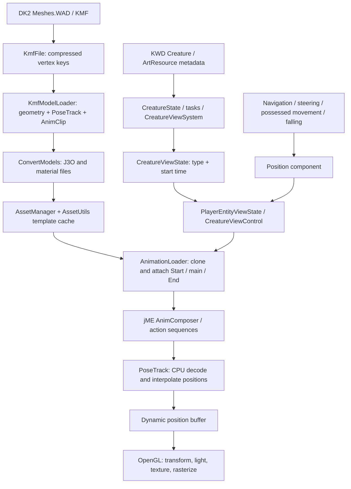

# Character and creature animation architecture assessment

Date: 2026-11-18. Repository: `D:\Project\OpenKeeper`. Source baseline: `a63005ab362a55540b67daeadaf2eeb00a8ba73a`, branch `fix/dungeon-heart-startup`.

## 1. Architectural decision

Keep the DK2 vertex-animation representation and improve its timing, validation, playback ownership, and resource lifecycle incrementally. A conversion to skeletal animation would require inventing rigs and weights that the imported assets do not contain, with substantial compatibility and fidelity risk.

Fix invalid endpoint poses first. Then establish one animation timing contract shared by gameplay and presentation, preserve request identity through the view bridge, and give each creature explicit playback state. Correct bounds and loop handling before optimizing visibility. Measure representative crowds before selecting a GPU implementation.

The existing continuous pose interpolation, sparse-frame decoding, separation of simulation from scene-graph operations, and instance-local sample caches are useful foundations. They should be retained.

The highest-value findings are:

1. **Confirmed conversion defect:** zero-length keyframe spans create NaN pose weights, including in fresh conversions of installed DK2 assets.
2. **Confirmed timing mismatch:** model tracks are fixed at 30 Hz, while the inspected creature catalog contains animation metadata at 15, 18, 20, 38, 40, and 50 FPS as well as 30 FPS.
3. **Confirmed loss of playback identity:** the view drops `stateStartTime` and compares only an animation enum, ignoring same-animation restarts.
4. **Confirmed bounds defect:** sampled animated vertices exceed stored model bounds, which are not refreshed by the pose sampler.
5. **Confirmed cycle implementation defect:** reversing composer speed at the end callback does not implement sustained ping-pong playback in the pinned jME version.
6. **Confirmed scalability costs, unmeasured severity:** clip transitions clone and replace model subtrees; hidden active models still sample poses; every active pose sample rewrites position buffers.

## 2. Evidence, scope, and limitations

This is an investigation, not an implementation. No production source, shaders, installed DK2 files, or converted assets were changed. The two pre-existing untracked assessment documents were preserved. Temporary Java/PowerShell probes and their output are under ignored `build/animation-audit/`; this Markdown document is the durable deliverable.

Evidence labels used below:

- **C — confirmed:** directly established by current source or a headless execution probe. A confirmed numerical or lifecycle defect is not automatically a captured visual defect.
- **H — hypothesis:** plausible visual, timing, or performance consequence that needs a specified experiment.
- **D — DK2 comparison:** supported by original shipped data or an original manual; exact original executable behavior requires additional evidence.

The declared dependencies are Java 25, jME `3.9.0-stable`, gdx-ai `1.8.2`, Zay-ES/Zay-ES Net `1.6.0`, SiO2 `1.8.0`, and SimEthereal `1.8.0`: [build configuration](../build.gradle#L10). Recommendations concern this pinned engine version, not an assumed latest jME implementation.

The probes read the installed `C:\GOG Games\Dungeon Keeper 2\Data\Meshes.WAD`, the creature catalog loaded through `Data\Editor\Maps\Alcatraz.kwd`, and existing `assets/Converted/Models`. Conversion probes used `KmfModelLoader` in memory with material-file generation disabled. They did not invoke the destructive full reconversion task. These are three sampled models and one catalog, not a complete asset/version compatibility certification.

No OpenGL game session, original DK2 executable comparison, gameplay capture, JFR crowd recording, or GPU timing was performed for this assessment. Therefore no FPS gain, whole-game bottleneck ranking, original transition parity, or visually accepted fix is claimed.

### Verification performed

The following existing tests passed: **41 tests, 0 failures, 0 errors, 0 skipped**.

```powershell
rtk proxy .\gradlew.bat test --tests '*PoseTrackTest' --tests '*CreatureViewSystemTest' --tests '*GamblerAnimationTest' --tests '*CreatureViewControlTest' --tests '*MovementSystemTest' --tests '*FootstepSoundsTest' --tests '*CreatureStateTest' --console=plain
```

| Suite | Tests | What this establishes |
|---|---:|---|
| `PoseTrackTest` | 4 | Continuous interpolation, time-origin normalization, sparse preservation, clone/import sampling |
| `CreatureViewSystemTest` | 8 | Selected torture and manufacturing policies |
| `GamblerAnimationTest` | 5 | Simulation-side selection and repeat timing |
| `CreatureViewControlTest` | 2 | Tooltip and removed-owner behavior, not playback correctness |
| `MovementSystemTest` | 7 | Selected steering behavior |
| `FootstepSoundsTest` | 3 | Marker crossing and sound limit helpers |
| `CreatureStateTest` | 12 | Selected state-machine rules |

These tests do not cover real converted clip endpoints, the full view request bridge, start/main/end interruptions, paused scene controls, or rendered motion. In particular, passing gambler selection tests does not prove that the view restarts a repeated chosen animation.

## 3. Current pipeline and ownership



### Assets and conversion

`KmfFile` parses little-endian KMSH containers: `MESH`, `ANIM`, and `GROP`. An animated model has sprite/material partitions, triangle LOD lists, UVs and static normals, an `ITAB` per 128-frame block, frame offsets in `VGEO`, and packed geometry coordinates in `GEOM`. Each coordinate uses 10 bits and is scaled by the animation scale. `CTRL` entries are parsed as unknown fields; their behavior is not implemented. See [KMF reader](../src/main/java/toniarts/openkeeper/tools/convert/kmf/KmfFile.java#L386), [animation data](../src/main/java/toniarts/openkeeper/tools/convert/kmf/Anim.java#L35), and [animation vertex parsing](../src/main/java/toniarts/openkeeper/tools/convert/kmf/KmfFile.java#L566).

`KmfModelLoader.handleAnim()` transforms coordinates from DK2 into jME axes `(x, -z, y)`, groups sparse vertex transitions into pose pairs, and constructs a `PoseFrame` for each authored frame. Despite the names `Pose.offsets`, these values are absolute vertex positions. It creates one `Geometry` and `PoseTrack` per retained sprite partition, plus one dummy-named `AnimClip` and `AnimComposer` on the animation node. Only LOD 0 is retained. The position buffer is mutable; bind positions, UVs, indices, and normals are retained separately. See [conversion](../src/main/java/toniarts/openkeeper/tools/convert/KmfModelLoader.java#L252) and [mesh setup](../src/main/java/toniarts/openkeeper/tools/convert/KmfModelLoader.java#L437).

`ConvertModels` reads `Meshes.WAD`, builds non-group models before groups, and submits binary serialization to an existing executor. Export concurrency already exists; it is not a missing optimization. J3O serialization preserves the custom `PoseTrack`/`PoseFrame`/`Pose` types, making their serialized layout a compatibility boundary. The conversion process version is currently `MODELS(14, ...)`. See [converter](../src/main/java/toniarts/openkeeper/tools/convert/conversion/task/ConvertModels.java#L85), [export](../src/main/java/toniarts/openkeeper/tools/convert/conversion/task/ConvertModels.java#L183), and [process versions](../src/main/java/toniarts/openkeeper/tools/convert/AssetsConverter.java#L64).

`KwdFile` independently parses each creature's animation resources, including frame count, FPS, start/end flags and auxiliary fields. The `Creature.AnimationType` enum is the current shared semantic vocabulary. Assets for distinct activities can be assigned to surprising enum slots: the inspected Imp's `SLEEPING` slot is `Imp_Claim1(Land)`. Therefore task mappings to `EATING` or `SLEEPING` are not evidence by themselves that the wrong animation is used. See [resource parser](../src/main/java/toniarts/openkeeper/tools/convert/map/KwdFile.java#L759), [creature resource assignments](../src/main/java/toniarts/openkeeper/tools/convert/map/KwdFile.java#L1286), and [animation types](../src/main/java/toniarts/openkeeper/tools/convert/map/Creature.java#L36).

### Loading, selection, and playback lifecycle

`CreatureLoader` creates an empty creature root. `PlayerEntityViewState` adds `CreatureViewControl` and the unit flower; attaching the view control immediately loads the initial animation. `AssetUtils` adds a process-wide strong or weak template cache around jME asset loading and returns clones. Loading may also assign additional maps and animated-texture materials. See [creature root](../src/main/java/toniarts/openkeeper/view/loader/CreatureLoader.java#L44), [view creation](../src/main/java/toniarts/openkeeper/view/PlayerEntityViewState.java#L486), and [cache/load policy](../src/main/java/toniarts/openkeeper/utils/AssetUtils.java#L107).

Simulation selection has this priority: `CreatureFall`, `Navigation`, `Death`, `Unconscious`, possession, tasks, then AI state. `CreatureViewSystem` scans creature IDs each logic tick, publishes a new `CreatureViewState` when the selected enum changes or a gambler restart is due, and records its own elapsed time. The component carries creature ID, state, and start time. See [selection](../src/main/java/toniarts/openkeeper/game/logic/CreatureViewSystem.java#L90) and [component](../src/main/java/toniarts/openkeeper/game/component/CreatureViewState.java#L29).

The render-side entity container watches both `Position` and `CreatureViewState`. Every reported change applies the latest transform and passes the selected enum to `CreatureViewControl.setTargetState()`. A different enum immediately invokes `AnimationLoader.playAnimation()`. The loader removes removable visual children, clones the requested main model and optional `NameStart`/`NameEnd` models, installs reflective tween callbacks, hides all clip nodes, and enables the initial composer. Start completion switches to main; main completion either stops, switches to end, or continues according to the control and loop mode. See [view bridge](../src/main/java/toniarts/openkeeper/view/PlayerEntityViewState.java#L650), [container](../src/main/java/toniarts/openkeeper/view/PlayerEntityViewState.java#L953), [creature control](../src/main/java/toniarts/openkeeper/view/control/CreatureViewControl.java#L262), and [loader](../src/main/java/toniarts/openkeeper/view/animation/AnimationLoader.java#L125).

Current behavior coverage:

| Gameplay activity | Current selection/playback behavior |
|---|---|
| Navigation, including approach to work/combat | `WALK`, selected by the presence of `Navigation` |
| Possessed movement | `WALK` for nonzero movement intent; `STAND_STILL` otherwise; run/creep change movement speed but not selected gait |
| Idle | `IDLE_1`; gameplay does not use the decorative front-end idle randomizer |
| Work | Task mappings for digging, training, research, prayer, claiming/repair; manufacturing has a creature-resource fallback |
| Melee/casting | `MELEE_ATTACK`/`CAST_SPELL`; simulation state timers and shot-delay logic operate independently of composer time |
| Death/unconsciousness | `DEATH_POSE`/`DIE`; death effect and charred overlay are applied by the view bridge |
| Falling/getting up/entrance | `FALLBACK`, `GET_UP`, `ENTRANCE` plus independently updated world position |
| Sleep/recuperation, prison | `SLEEPING`, `ANGRY` |
| Torture | Device-aware chair/skeleton or wheel selection; skeleton fallback assets exist; wheel/victim share a spin clock |
| Casino | Research/happy/idle selection; dance/happy celebration sequence |
| Held in hand | A separate `CreatureViewControl` plays `IN_HAND`; the GUI hand node has its own logical update |
| Retreat, recoil, drag, extra idle variants, alternate forms | Resources or AI concepts exist, but the generic selector does not provide complete corresponding visual policies |

Sources: [task/state mappings](../src/main/java/toniarts/openkeeper/game/logic/CreatureViewSystem.java#L245), [special policies](../src/main/java/toniarts/openkeeper/game/logic/CreatureViewSystem.java#L201), [hand lifecycle](../src/main/java/toniarts/openkeeper/view/KeeperHandState.java#L349), and [decorative idle control](../src/main/java/toniarts/openkeeper/view/map/construction/CreatureRandomAnimationControl.java#L31).

### Movement, threading, and rendering

The logic loop runs at the level's configured tick rate. The separately named 60 Hz **Animation** loop updates `CreatureFallSystem`, not vertex poses. A separate nominal 60 Hz **Steering** loop updates navigation and possessed movement. These loops receive elapsed `tpf`; they are not a shared, immutable fixed-step animation timeline. jME composers and vertex sampling run through scene logical updates on the application thread. See [loop setup](../src/main/java/toniarts/openkeeper/game/state/loop/GameLoopManager.java#L174) and [loop execution](../src/main/java/toniarts/openkeeper/utils/GameLoop.java#L116).

Navigation uses gdx-ai steering in the map plane. Possessed movement implements map passability and wall approach, and falling changes height directly. This character path does not use Bullet rigid bodies, skeletal root motion, or physical foot contacts. The view copies the latest position/yaw directly into the model, without a previous/current transform interpolation pair. See [steering](../src/main/java/toniarts/openkeeper/game/logic/MovementSystem.java#L198), [possessed movement](../src/main/java/toniarts/openkeeper/game/logic/PossessedMovementSystem.java#L78), [falling](../src/main/java/toniarts/openkeeper/game/logic/CreatureFallSystem.java#L55), and [transform application](../src/main/java/toniarts/openkeeper/view/PlayerEntityViewState.java#L879).

`PoseTrack` subclasses jME `MorphTrack` as a playback adapter. Its override ignores the morph-weight destination and directly writes the target mesh's position buffer. It decodes sparse pose pairs over bind positions, caches lower and upper decoded frames per track, binary-searches frame times, interpolates between decoded vertex arrays, and marks the position buffer updated. Old 1/30-second time origins are normalized. This is already continuous interpolation between authored frames, not a 30 FPS pose-step implementation. See [sampler](../src/main/java/toniarts/openkeeper/animation/PoseTrack.java#L132) and [existing sampler tests](../src/test/java/toniarts/openkeeper/animation/PoseTrackTest.java#L31).

There is no imported armature, bone palette, `SkinningControl`, or GPU vertex-pose evaluation in this path. OpenGL receives CPU-deformed positions, then performs transforms, lighting, texturing, and rasterization. The DK vertex-lighting shader consumes `inPosition`/`inNormal`; it contains no pose interpolation or skinning stage. Animated texture UV selection is a separate shader feature. See [vertex shader](../assets/Shaders/DkLighting/Vertex.vert#L44) and [material definition](../assets/MatDefs/DkLighting/Vertex.j3md#L73).

## 4. Significant findings and recommended fixes

### F01 — Invalid endpoint weights produce non-finite vertex positions

**C; P0; high visual/robustness impact.** [KMF parsing](../src/main/java/toniarts/openkeeper/tools/convert/kmf/KmfFile.java#L461) duplicates the final geometry entry as a sentinel. [Conversion](../src/main/java/toniarts/openkeeper/tools/convert/KmfModelLoader.java#L311) calculates `(frameInBlock - frameBase) / (nextFrameBase - frameBase)` without handling equal frame bases. A zero span can generate `0/0`. [Pose decoding](../src/main/java/toniarts/openkeeper/animation/PoseTrack.java#L142) applies the resulting NaN weight, and interpolation propagates it into the live position buffer.

Installed-asset probes found NaN weights in the final decoded frame. Fresh in-memory conversion from the original WAD reproduced non-finite vertices **1 ms before the endpoint**, demonstrating that the issue is present in current conversion and affects interpolation into the last frame, not just an exact-endpoint seek.

| Sample | Final-frame vertices with equal key bases in source data | Tracks producing non-finite positions near the endpoint |
|---|---:|---:|
| `Arc-Walk` | 10 | 2 |
| `BIL-Walkback` | 2 | 1 |
| `Electrocute1` | 1 | 1 |

**Impact:** invalid geometry is confirmed; disappearing triangles, spikes, loop-boundary flicker, and invalid bounds are possible visual consequences requiring capture. Persistent final poses are especially sensitive.

**Recommendation:** define terminal and zero-span sampling semantics explicitly. Use the valid endpoint coordinate for a degenerate interval, with finite weights and validated matching vertex indices. Reject malformed indices/counts and unexpected non-finite source values with resource/frame context. Add finite-output validation to conversion. Provide a compatible policy for already converted caches containing NaN weights; fixing conversion alone leaves those files affected. Prefer reconversion with a version bump plus a carefully scoped import/sampling safeguard, rather than silently replacing arbitrary invalid coordinates with zero.

**Validation:** exhaustively sample every converted clip at authored frames, subframe intervals, endpoints, reverse traversal, wrap, and 127/128-frame block boundaries; require finite vertices. Add original-WAD fixtures or small legally distributable synthetic equivalents for repeated terminal key bases. Preserve original terminal poses using original executable captures before changing endpoint interpretation globally.

### F02 — Gameplay duration and rendered duration use incompatible timing

**C + D; P1; high impact.** [Conversion](../src/main/java/toniarts/openkeeper/tools/convert/KmfModelLoader.java#L261) assigns times `(i + 1) / 30f`. The [loader](../src/main/java/toniarts/openkeeper/view/animation/AnimationLoader.java#L50) does not apply mesh `ArtResource` FPS. Meanwhile [AI state duration](../src/main/java/toniarts/openkeeper/game/controller/creature/CreatureController.java#L2384) and [casino timing](../src/main/java/toniarts/openkeeper/game/logic/CreatureViewSystem.java#L336) use `frames / fps`.

The inspected installed catalog contains **996 animation-slot entries**, including duplicates and unique variants: `{15: 9, 18: 1, 20: 12, 30: 969, 38: 2, 40: 1, 50: 2}`. Examples include `Mis_Walk` at 20 FPS, `Knight-Melee` at 18 FPS, `BileDemon-bed(sleeping)` at 15 FPS, and `DarkAngel-Happy` at 38 FPS. These values were read from shipped resource metadata; they are not inferred from animation names.

Even at 30 FPS, jME track length is last key time minus first key time: the current N-frame track spans `(N - 1) / 30`, while gameplay uses `N / fps`. Whether the final frame should be held for an extra interval must be decided explicitly. Start/end segment durations are also absent from `getAnimationTime()`, and null/zero FPS are not safely normalized there.

**Impact:** rendered actions can finish before or after simulation state expiry; walk cadence, sleep motion, get-up timing, and cast release can disagree. Original exact duration semantics remain a comparison task.

**Recommendation:** resolve per-resource timing into one immutable metadata record available without loading meshes on the server: frame count, authored FPS, endpoint convention, start/main/end durations, loop behavior, and event times. Keep converted key coordinates shareable; apply resource-specific time mapping per playback instance. Cache normalized metadata, not per-tick calculations. Do not bake one caller's FPS into a model cache keyed only by filename.

**Validation:** compare measured rendered clip phase against that record for 15/18/20/30/38/40/50 FPS; test single-frame/empty clips and invalid FPS. Use original DK2 captures to settle N versus N-1 intervals and start/end accounting. Re-time footstep markers with the same contract.

### F03 — Start time, restart requests, and creature identity are lost at the view bridge

**C; P1; high impact, relatively contained fix.** `CreatureViewState` carries `creatureId` and `stateStartTime`, but [view updates](../src/main/java/toniarts/openkeeper/view/PlayerEntityViewState.java#L650) forward only `state`. [Creature control](../src/main/java/toniarts/openkeeper/view/control/CreatureViewControl.java#L262) only restarts when the enum differs. A headless same-`WALK` request left composer time and model revision unchanged. This is the same condition reached when the [gambler explicitly republishes a same-enum restart](../src/main/java/toniarts/openkeeper/game/logic/CreatureViewSystem.java#L118) or [possessed attacks publish repeated melee state](../src/main/java/toniarts/openkeeper/game/controller/creature/CreatureController.java#L2696).

Initial creation also starts the clip from zero regardless of its published start time. A changed `creatureId` is looked up by the bridge for lighting, but the existing control's data object is not updated there. The latter is an architectural limitation for future transformations; a current in-place ID-change gameplay trigger was not established.

**Impact:** requested restarts can be invisible; late presentation or network delivery shifts phase; different clients can display different phases. Exact lost intermediate actions under network coalescing remain unmeasured.

**Recommendation:** pass a complete playback request containing creature/resource identity, animation enum, authoritative start time, and an explicit generation or sequence number. Compare identity and generation, not all component updates or enum alone. Seek to an appropriate phase on creation/re-entry, using a client mapping of server game time. Repeated Position updates must not restart animation. Decide whether short one-shot actions need a small event stream in addition to current-state replication.

**Validation:** drive the real `EntityContainer -> control -> composer` bridge for same-enum attacks, same-enum gambling, delayed creation, network delay, creature ID changes, and 60 Hz Position updates. Verify exactly one restart per new generation.

### F04 — Model bounds do not cover the animated volume

**C; P1; high correctness impact.** [Geometry creation](../src/main/java/toniarts/openkeeper/tools/convert/KmfModelLoader.java#L561) computes bounds from the initial position buffer. [Pose sampling](../src/main/java/toniarts/openkeeper/animation/PoseTrack.java#L188) updates positions without refreshing mesh bounds or installing an animation envelope. `Anim.cubeScale` is parsed but not used here.

The probe sampled all authored times on six tracks across three installed models. With a `1e-4` model-space tolerance, **158 of 169 frame/track samples** had at least one finite vertex outside the stored model bound. Maximum finite excess was `0.107260` for `Arc-Walk`, `0.156982` for `BIL-Walkback`, and `0.087008` for `Electrocute1`. Four endpoint samples also contained non-finite data; finite excess was measured separately. These counts describe the sampled tracks, not all creatures.

**Impact:** culling/pop at screen edges and inaccurate bound-based picking/light centers are plausible. Actual triangle picking also needs collision-data lifecycle review; this probe did not establish accurate animated collision or a rendered disappearance.

**Recommendation:** after F01, compute a conservative local-space union bound over all valid poses during conversion. Linear interpolation stays within the coordinate extrema of its endpoint poses. Include each clip's node offset and segment hierarchy at the appropriate level. Validate whether DK2 `cubeScale` can safely provide or check this envelope. Avoid recalculating every vertex bound every render frame by default.

**Validation:** every sampled vertex must lie inside its clip envelope; test frustum-edge motion, shadow-camera edges, selection, and all start/end segments. Define whether picking should use an approximate creature volume or updated mesh collision data.

### F05 — Speed reversal at an end callback is not sustained cycle playback

**C; P1 for the shared playback contract.** [Loop mapping](../src/main/java/toniarts/openkeeper/view/animation/AnimationLoader.java#L96) maps KMF `CLAMP` to `LoopMode.Cycle`; [cycle completion](../src/main/java/toniarts/openkeeper/view/animation/AnimationLoader.java#L316) negates composer speed. In pinned jME, `AnimLayer` resets completed forward actions to time zero and wraps negative time; reverse traversal does not provide the assumed second endpoint callback. See [jME AnimLayer update](https://github.com/jMonkeyEngine/jmonkeyengine/blob/v3.9.0-stable/jme3-core/src/main/java/com/jme3/anim/AnimLayer.java#L243).

A synthetic sequence using this mechanism reversed only once over one second. An actual `Electrocute1` resource (`CLAMP`) with a continue-playing callback policy produced **one cycle callback over five simulated seconds**, ending with speed `-1`. This confirms a failure of the intended repeated-cycle mechanism. It does not establish that all gameplay consumers allow that clip to continue, or that DK2 `CLAMP` should itself mean ping-pong.

**Recommendation:** establish original `CLAMP` semantics independently, then implement a bounded clip clock with explicit direction/loop policy, or use a tested jME cycle tween as the Model Viewer already does. Do not implement direction changes through a completion callback that the reverse path cannot generate.

**Validation:** deterministic phase traces for multiple forward/reverse boundaries, large deltas, pause/resume, non-looping clips, and both resource flags and control stop policies. Require original DK2 comparison before changing the meaning of a format flag.

### F06 — Failed or missing resources remove a valid model before replacement succeeds

**C; P1; high robustness impact.** [Playback replacement](../src/main/java/toniarts/openkeeper/view/animation/AnimationLoader.java#L125) removes existing children before validating the new resource or successfully loading its main/start/end models. Null, `NONE`, or unsupported resources can leave an empty root. Attachment catches exceptions and logs only a message; partial attachments can remain. [Creature playback](../src/main/java/toniarts/openkeeper/view/control/CreatureViewControl.java#L148) still sets `isAnimationPlaying` and the current state unconditionally. Callback assumptions can dereference missing main/end composers later.

A headless request for null animation after valid playback removed the old visual. A resource-loading failure was not needed to demonstrate the destructive ordering.

**Recommendation:** resolve and prepare a complete replacement off the live root, then swap atomically on the application thread. Return a typed success/fallback/failure result; commit current state only after success. Use a documented creature-specific fallback chain and deduplicate diagnostics by resource. Preserve the last valid visual if no valid replacement exists. Queue completion effects or guard them by playback generation so an interrupted sequence cannot act on a replacement.

**Validation:** missing main/start/end files, `NONE` resources, failed material loading, no composer, immediate interruption, detach/reattach, entity removal during completion, and retained flower/effects. Check watcher and audio cleanup as well as node count.

### F07 — Stop and transition policy is spread across gameplay state and callbacks

**C for mechanics; H/D for desired individual behavior; P1/P2.** [Creature stop policy](../src/main/java/toniarts/openkeeper/view/control/CreatureViewControl.java#L144) continues `WALK`, `IN_HAND`, or AI `WORK`/`DANCING`/`CELEBRATING`; other animations stop after a main cycle. `onAnimationStop()` only clears a flag in [EntityViewControl](../src/main/java/toniarts/openkeeper/view/control/EntityViewControl.java#L249). There is no general idle reselection/restart after it stops. Sleep and recuperation therefore do not automatically keep looping just because their simulation state persists.

Conversely, changing the enum [replaces the whole subtree immediately](../src/main/java/toniarts/openkeeper/view/control/CreatureViewControl.java#L266). It does not ask the outgoing animation to reach its authored end segment first. End segments are used on natural completion/stop decisions, not a general transition protocol.

**Impact:** frozen idle/sleep motion and skipped entry/exit segments are testable fidelity concerns. Exact desired behavior varies: a death pose should hold; a get-up should complete; a looping work cycle may need an interruptible authored exit. Universal looping or universal crossfading would introduce new errors.

**Recommendation:** express a small policy per resolved action: loop, once-and-hold, once-and-finish, interrupt immediately, or finish/exit at an allowed boundary. Retain death/urgent interruption precedence. Prefer authored start/end segments. Only blend coordinates across clips after verifying identical vertex correspondence, partitioning, UV/material assignments, and model offsets. Different clip filenames are not evidence of compatible topology.

The custom track writes positions directly. Merely adding `AnimComposer` blend actions does not make these meshes blend correctly: pinned jME's [ClipAction morph path](https://github.com/jMonkeyEngine/jmonkeyengine/blob/v3.9.0-stable/jme3-core/src/main/java/com/jme3/anim/tween/action/ClipAction.java#L80) invokes the track directly rather than applying transform blending to its vertex output. Any compatible-pose blend needs explicit output buffers and ownership. Preserve the evaluated outgoing pose if that blend is interrupted.

**Validation:** long idle/sleep, start-to-main-to-end, work-to-walk, walk-to-fight, repeated attacks, death during work, and interrupted transitions; compare phase-aligned videos against DK2. Keep default compatibility behavior until a change is justified.

### F08 — Movement intent, actual displacement, gait, and animation phase are independent

**C; P1/P2; high potential visual impact.** [Selection](../src/main/java/toniarts/openkeeper/game/logic/CreatureViewSystem.java#L106) chooses WALK from `Navigation` existence, including arrival/turning periods. Possessed movement selection tests nonzero input, not actual successful displacement. [Movement speed](../src/main/java/toniarts/openkeeper/game/logic/MovementSystem.java#L116) changes in water/lava without matching playback rate changes. [Possession](../src/main/java/toniarts/openkeeper/game/controller/creature/CreatureController.java#L2625) supports different run/creep speeds, but `PossessedMovement` retains only the resulting speed, direction and rotation; its speed-mode identity is lost. The selector still chooses WALK.

The [view applies transforms directly](../src/main/java/toniarts/openkeeper/view/PlayerEntityViewState.java#L879) while poses advance with render `tpf`. **H:** foot sliding, walking against blocked walls, stepped world motion at high refresh rates, and phase inconsistency are likely test targets, not captured observations here.

**Recommendation:** publish a compact movement presentation snapshot with previous/current transform timestamps, actual planar velocity/displacement, gait mode, and discontinuity flags. Interpolate position and shortest-arc yaw for rendering; snap teleports, pickup/drop, and other discontinuities. Use verified DK2 gait/rate rules. If distance-driven phase is adopted, distinguish ground locomotion from flyers and authored stationary motions; do not apply a generic modern stride rule to every asset. Let gameplay continue to own navigation and collisions.

**Validation:** 30/60/120/144 Hz rendering, stalled movement, water/lava transitions, arrival deceleration, sharp turns, level-scaled speed, run/creep, flying, falling, network delay, and camera close-ups. Measure foot contact drift over distance and world-transform frame pacing separately from pose smoothness.

### F09 — Mutable Position vectors cross independently scheduled systems

**C for shared mutation; H for a particular visible race; P1/P2.** [Steering](../src/main/java/toniarts/openkeeper/game/logic/MovementSystem.java#L238) mutates the old component's `Vector3f` before publishing a new component that reuses it. [Falling](../src/main/java/toniarts/openkeeper/game/logic/CreatureFallSystem.java#L61) also constructs a new component around an existing vector and mutates its height. [Position](../src/main/java/toniarts/openkeeper/game/component/Position.java#L29) stores the supplied reference. The loop setup proves separate producer threads; it does not establish that all paths write the same creature concurrently in normal gameplay.

**Impact:** old snapshots can change after publication, undermining reliable interpolation and concurrency reasoning. A specific torn render update or lost movement write needs a stress trace.

**Recommendation:** copy or use immutable position values at publication boundaries and assign clear ownership for movement/fall updates. Serialize conflicting writes or combine them at a simulation boundary. Do not parallelize more animation/steering work until snapshot ownership is explicit. `NavigationService` owns a mutable shared pathfinder; it should not be reused concurrently by new worker jobs without isolation. See [navigation state](../src/main/java/toniarts/openkeeper/game/navigation/NavigationService.java#L42).

**Validation:** retained snapshots must remain unchanged after future ticks; stress simultaneous navigation cancellation, falling, possession, pickup/drop, and removal. Compare deterministic trajectories before/after any ownership change.

### F10 — Repeated subtree cloning and cache policy need explicit budgets

**C for lifecycle/cost; H for hitch magnitude; P2.** Each different animation [loads/clones and reattaches](../src/main/java/toniarts/openkeeper/view/animation/AnimationLoader.java#L125) main/start/end subtrees instead of reusing a prepared playback instance. A template cache avoids repeated disk parsing, but not clone, material, vertex-buffer, action, and hierarchy setup costs. The [strong cache](../src/main/java/toniarts/openkeeper/utils/AssetUtils.java#L79) is static and keyed by model path, with no scoped eviction visible in this utility. Resource-specific animated-texture setup occurs before caching, so differently configured users of one model can inherit the first template policy.

Important counterevidence: do not assume all pose data are copied per creature. The jME Cloner path and explicit `clone()` path differ. `PoseTrack.jmeClone()/cloneFields()` retain shared frame data while clearing mutable sample caches; explicit `PoseTrack.clone()` deep-copies frames and poses. Pinned jME [Geometry cloning](https://github.com/jMonkeyEngine/jmonkeyengine/blob/v3.9.0-stable/jme3-core/src/main/java/com/jme3/scene/Geometry.java#L549) isolates animated meshes when bind positions exist. Probes verified distinct mutable position buffers on clones of all three sampled models. Shared immutable clip data are an existing benefit.

**Recommendation:** start with bounded per-creature reuse of common clips or a small reusable output mesh for topology-compatible clips, plus explicit catalog/level lifetime for immutable definitions. Keep composer time, target geometry, audio handles, callbacks and sample buffers instance-local. Key prepared variants by all material/texture policy inputs. Preload actual animation-map entries and their segments rather than relying solely on [reflection over zero-argument getters](../src/main/java/toniarts/openkeeper/utils/AssetUtils.java#L687), which does not comprehensively enumerate `getAnimation(type)` entries.

**Validation:** JFR allocation samples during mass walk/work/fight changes; count clone operations, native buffer bytes, cache hits/misses, retained templates, and residency after level exit. Test cloned actions for references to the original creature, particularly if pooling is introduced.

### F11 — Hidden active poses still update, and every sample rewrites positions

**C for work performed; H for bottleneck severity; P2.** Fog uses [CullHint](../src/main/java/toniarts/openkeeper/view/PlayerEntityViewState.java#L826), while active composers continue logical updates. A hidden-root headless probe advanced composer time by `0.10000000149` seconds during a 0.1-second logical update. Frustum culling likewise does not supply an animation scheduling policy. [PoseTrack](../src/main/java/toniarts/openkeeper/animation/PoseTrack.java#L156) rewrites every coordinate and marks the buffer updated even if the requested sample time is unchanged. Its two decoded-frame caches already avoid repeated sparse decoding within an interval and allocate only on first use/size change, not per vertex per frame.

**Recommendation:** keep an authoritative logical phase, but skip deformation and uploads for hidden models, unchanged samples, and completed held poses. On visibility re-entry, evaluate the current correct phase once. Use conservative bounds and account for shadow/other camera visibility before suppressing offscreen work. Distant update-rate reduction should be configurable and tested visually; close/possessed creatures should retain full-quality sampling. Preserve necessary logical events even when pose evaluation is skipped.

The [view also traverses creature materials every frame](../src/main/java/toniarts/openkeeper/view/PlayerEntityViewState.java#L314). Profile that cost separately from animation math. Reusing prepared materials and updating only genuinely dynamic uniforms can be valuable, but this report does not assume other material-lifecycle work has landed in the inspected branch.

**Validation:** all-visible versus fog-hidden versus offscreen versus shadow-visible populations, with logical state outcomes held equal. Verify re-entry phase, audio policy, frozen pose behavior, and no missed state transitions.

### F12 — Animation events and pause use several clocks and policies

**C for separation; H for specific desynchronization; P2.** [Melee damage](../src/main/java/toniarts/openkeeper/game/controller/creature/CreatureController.java#L1190) is applied when the simulation enters its attack; casting has a separately scheduled [shot release](../src/main/java/toniarts/openkeeper/game/controller/creature/CreatureController.java#L1223). [Footsteps](../src/main/java/toniarts/openkeeper/view/control/CreatureViewControl.java#L200) inspect composer time, while [marker conversion](../src/main/java/toniarts/openkeeper/game/sound/FootstepSounds.java#L34) assumes 1/30 seconds and returns at most one step per update. Marker lookup allocates a new two-element array each time it succeeds. Sound throttling/in-hand chatter use wall time. Hidden state changes can skip research-sound cleanup until another eligible state change, although entity cleanup explicitly stops that handle.

[Game-loop pause](../src/main/java/toniarts/openkeeper/game/state/loop/GameLoopManager.java#L187) pauses simulation loops. [Client pause](../src/main/java/toniarts/openkeeper/game/state/PlayerState.java#L444) disables pause-aware app states; it does not itself stop scene-graph composers. `PlayerEntityViewState` is a plain `AbstractAppState`, and its [setEnabled](../src/main/java/toniarts/openkeeper/view/PlayerEntityViewState.java#L275) only forwards enablement to portal effects. The generic pause/resume animation helpers have no call sites outside their definitions in the inspected tree and resume all composers at positive speed 1. **Source evidence therefore shows no unified creature playback pause contract; a game pause capture remains required.**

**Recommendation:** keep gameplay damage, projectiles and work authoritative in simulation. Align their presentation with verified metadata event times; never make combat depend on whether a creature was rendered. Drive visual phase from pause-aware game time, retain playback rate/direction across pause, and cache normalized footstep marks. Dispatch marker crossings with explicit seek/reverse/wrap semantics; keep deliberate audio limits separate from missed-marker bugs. Consolidate state-exit and removal cleanup for looping sounds.

**Validation:** pause midway through forward/reverse/start/end segments and combat; assert stable phase and no duplicate events on resume. Test low frame rates, multi-loop jumps, delayed state delivery, fog changes during research, and removing held creatures. Changing melee impact timing requires DK2 evidence, not merely an assumption that damage belongs on a visually chosen contact frame.

### F13 — Imported resources exceed implemented gameplay presentation policies

**C for coverage; D/H for exact missing behavior; P2.** The data model includes RUN, STEALTH_WALK, BACK_OFF, recoil, dragged, additional idles, and special animations. The [central selector](../src/main/java/toniarts/openkeeper/game/logic/CreatureViewSystem.java#L245) implements only a subset. BACK_OFF falls through unless navigation has already selected WALK; hauled/unconscious creatures have no explicit dragged override in this selector. The CHICKEN AI state has no alternate model selection here. First-person presentation has a separate [camera walk cycle](../src/main/java/toniarts/openkeeper/view/PossessionWalkCycle.java#L30); its comments explicitly mark bob amplitude as unverified, and the inspected possession interaction path is melee-focused. Resource presence alone does not establish which of these should play in every situation.

**Recommendation:** build a creature/action availability matrix from the actual catalog, with verified selection and fallback rules. Keep the current small policy structure; inject catalog/clock/random choice where necessary for deterministic testing. Add missing policies one behavior at a time with original evidence. Do not rename or remove legacy enum slots until their actual resource assignments are understood.

**Validation:** representative worker, biped melee, caster, flyer, large creature, unique variant, hero and skeleton fallback; include rescue/capture/drag, retreat, possession run/creep, idle variation and transformations. Separate a missing gameplay capability from a missing animation response to an already implemented capability.

## 5. DK2 fidelity: what is and is not established

| Behavior/format question | Verifiable evidence | Assessment |
|---|---|---|
| Vertex-animated KMF representation | Shipped WAD data, current reader, and the author-published [KMF structure template](https://gist.github.com/Trass3r/914222adb44941e8013d1aa77bc7deba) | Preserve sparse vertex keys and coordinate conversion; there is no imported skeleton to accelerate |
| Per-resource animation rates differ | Installed catalog inventory in F02 | Fixed-30 timing disagrees with shipped metadata; exact executable playback semantics still need comparison |
| Run/creep are distinct creature movement behaviors | Original [manual, section 15.2, printed p. 71](https://retrogamer.biz/wp-content/uploads/2016/06/Dungeon-Keeper-2-Manual.pdf), plus resource slots and possession speed code | Speed support exists, but gait selection is incomplete; the manual does not specify exact clip rate or transition rules |
| Hero walk/run destination behavior is controllable | Original [official editor manual, Creature Actions / Alter Speed](https://keeper.lubiki.pl/dk2_docs/dk2_editor_manual.htm) | Navigation presence alone cannot represent the full original movement-mode contract |
| Gambling/torture/manufacturing special cases | Current code comments cite original executable addresses; focused tests exercise intended rules | Existing implementation evidence, not independently verified original-executable parity in this assessment |
| Static vertex normals | KMF per-vertex normal storage and no animated normal stream in inspected reader | Recomputing normals each frame may alter original lighting; retain static normals in the compatibility path |
| CLAMP, endpoint dwell, transition cancellation, damage contact timing | Current interpretation and numerical probes only | Open questions; do not label current mappings as proven original behavior |

The original manual supports gameplay-level distinctions, not a complete animation timing specification. Future DK2 comparisons should record executable version/hash, asset version/hash, creature/action, speed/level, camera, timeline, and frame-stepping method. Repository comments and third-party projects that reuse OpenKeeper's decoder are not independent ground truth for that decoder.

## 6. Performance model and acceleration choices

Let `N` be actively evaluated creatures, `V` their average sum of vertices across active material partitions, and `R` render updates per second. Position-buffer writes alone are approximately `12 * N * V * R` bytes/second. Two decoded sample arrays occupy approximately `24 * N * V` bytes, excluding meshes, native buffers, templates, poses, materials, and driver storage.

For an **illustrative**, unmeasured `N=500`, `V=400`, `R=60`, this is about **144 MB/s of position writes** and **4.8 MB of decoded sample arrays**. This does not prove bandwidth saturation: scalar interpolation, sparse decode, buffer updates, draw submission, lights, transparency, or unrelated game logic may dominate. The measured sample models have two or three sprite partitions, so creature count is not equivalent to draw count.

| Approach | Benefit and fit | Costs/risks | Decision |
|---|---|---|---|
| Skip unchanged/hidden deformation; correct phase on re-entry | Avoids CPU math and dirty VBO work without changing asset format | Visibility/event correctness, shadow cameras | First optimization after correctness and measurement |
| Reuse prepared clips/output buffers | Reduces transition allocations and setup | Residency budget, callback reset, topology compatibility | Incremental, bounded, profile transition-heavy scenes |
| Share immutable decoded frames or compressed key tables | Reuse work across instances | Dense storage grows as `12 * frames * vertices` bytes per clip; synchronization/cache lifetime | Optional bounded cache after memory measurements |
| Phase buckets for crowds | Reuse sampled poses across similar distant creatures | Visible synchronization and quantization; gameplay event phase must stay independent | Optional distant-LOD experiment, not default |
| GPU vertex interpolation using pose textures/buffers | Shared static pose data plus per-instance time; avoids CPU position writes | Upload/residency, all material and shadow passes, bounds/picking, precision and compatibility testing | Best GPU direction if profiling justifies it |
| jME generic morph targets / MorphControl | Existing engine infrastructure | Current track is not an ordinary morph-weight track; many full-frame targets are costly; shader integration still required | Prototype and measure rather than assume a drop-in replacement |
| Instanced animated creatures | Reduces draw submissions for same geometry/material | Needs shared GPU animation data and per-instance phase/tint; transparency and light policy complicate grouping | Later extension, not ordinary BatchNode batching |
| CPU workers | Parallelize pure pose decode for large visible sets | Scheduling, memory bandwidth, snapshots, barriers; mutable Mesh/Spatial operations must stay on owner thread | Only if CPU profiles justify jobs large enough to amortize overhead |
| Compute-shader deformation | Reusable output for several passes | Higher GL requirements, synchronization and extra buffers | Defer; vertex-shader sampling is a simpler first prototype |
| Invent skeletons/retarget clips | Potentially compact animation data | No source rig; deformation/fidelity changes and extensive authoring | Reject as a compatibility optimization |

A GPU prototype should preserve the current absolute-position interpolation mathematically. One option is predecoded frame positions in a texture/buffer, indexed by vertex ID and two frame indices with a blend factor. Keep original static normals and material partitions initially. Use the same deformation function for depth/shadow/selection passes that need geometry. Compute conservative bounds on CPU. Preserve a tested CPU fallback and explicit feature/capability selection.

Do not assume instancing removes vertex-light cost: the current [lighting shader](../assets/Shaders/DkLighting/Vertex.vert#L96) loops over camera light data per vertex. Measure that work independently. Do not merge animated creatures into static terrain `BatchNode` pages; independent deformation and clip replacement invalidate that model.

## 7. Recommended target architecture

Use a few focused owners, not a generic animation graph framework:

1. **Immutable animation catalog:** resolve creature slots, resource availability, semantic fallback, segment references, timing, loop policy, bounds and markers. Preserve KWD semantics and conversion provenance. Simulation reads timing/policy data without loading jME meshes.
2. **Gameplay presentation request:** publish animation identity, generation, start time, gait/rate intent and relevant discontinuities. Keep combat/task results in simulation. Use a shared game-time domain rather than unrelated accumulated clocks.
3. **Per-creature playback owner:** track selected request, active segment, local phase, direction, rate, completion/hold state and prepared visual resources. Only this owner changes creature clip visibility or swaps animation geometry. Keep `AnimationLoader` as a facade during migration.
4. **Pose evaluator:** expose deterministic `sample(definition, phase, output)` behavior with no gameplay decisions or scene-graph mutation during pure decode. Initially wrap the proven CPU algorithm; a GPU evaluator can be added only if needed. Avoid introducing a broad backend interface until there are two measured implementations.
5. **Application-thread presenter:** applies interpolated transforms, commits evaluated positions/material changes, maintains visibility/bounds, and dispatches presentation events. Workers may prepare immutable data or private arrays, never shared scene objects or OpenGL calls.

Keep small policies data-driven where they vary by creature/action. Inject the clock, catalog, loader and deterministic random source at existing seams. Unit tests should construct requests and catalogs without an OpenGL context. End-to-end animation acceptance still requires real rendering.

Migration should retain the current J3O import path, old time-origin support, and legacy resource-slot mappings. Version any on-disk layout changes and test old and new fixtures. Prepared scene instances must never be shared between creatures; only immutable definitions and appropriate read-only buffers can be shared.

## 8. Prioritized implementation checklist

Impact is expected benefit, not measured speedup. Complexity and risk are relative to this codebase. Each item should be a narrow, independently reviewable change.

| Order | Priority / findings | Action | Impact | Complexity | Regression risk | Acceptance gate |
|---:|---|---|---|---|---|---|
| 1 | P0 / F01 | Define degenerate-key semantics; reject non-finite conversion output; handle old affected caches | Critical numerical/visual correctness | Medium | Medium | Finite corpus sampling, endpoint golden cases, cache compatibility |
| 2 | P1 / F03 | Carry request generation/start time through the view bridge | High action correctness | Low–medium | Medium | Same-enum restart and delayed creation through real view controls |
| 3 | P1 / F02 | Centralize FPS/duration/segment timing and marker conversion | High pacing/fidelity | Medium | High | Metadata-rate matrix plus DK2 duration comparisons |
| 4 | P1 / F04 | Store conservative animation bounds | High culling correctness | Low–medium | Low–medium | All poses contained, camera/shadow edge checks |
| 5 | P1 / F05 | Replace callback speed-negation cycle logic after confirming format semantics | High for affected cycles | Low–medium | Medium | Repeated forward/reverse traces and original comparison |
| 6 | P1 / F06 | Validate/prepare before swapping; return playback result; fallback safely | High robustness | Medium | Medium | Missing/partial-resource and interruption matrix |
| 7 | P1/P2 / F07, F12 | Explicit segment/hold/interrupt and pause/event policies | High visual consistency | Medium | High | Sleep/work/death/paused transition captures and event tests |
| 8 | P1/P2 / F09 | Immutable transform publication and clear producer ownership | High foundation value | Medium | Medium–high | Snapshot immutability and concurrent lifecycle stress |
| 9 | P2 / F08, F13 | Expose actual movement and gait; interpolate presentation; add verified gait selection | High locomotion quality | Medium | High | Multi-refresh movement captures and DK2 gait comparison |
| 10 | P2 / F10, F11 | Establish crowd telemetry, then skip redundant/hidden pose work | Potentially high scaling | Low–medium | Medium | Equal behavior, measured P95/P99 and allocation improvement |
| 11 | P2 / F10 | Bounded clip reuse, cache lifetime/variant keys, comprehensive prewarm enumeration | Potentially high transition smoothness | Medium | Medium | Transition allocation reduction without residency regression |
| 12 | P2 / F12, F13 | Cache marker arrays and fill verified action/fallback gaps | Moderate quality/maintenance | Low–medium per behavior | Medium | Creature/action availability matrix and targeted captures |
| 13 | P3 / rendering | Prototype GPU pose interpolation and later instancing only after a CPU/GPU bottleneck decision | Potentially high large-crowd throughput | High | High | CPU-reference parity, GL capability fallback, measured total-frame win |

Action tracking:

- [x] Preserve a deterministic sample corpus and asset hashes; promote the useful headless probes into maintained regressions when implementing fixes. See implementation record 11.1.
- [x] Fix and validate finite terminal poses, including old converted files. See 11.2; original executable visual parity remains unclaimed.
- [x] Preserve same-animation request identity and authoritative phase. Review R2 now drives world poses and markers continuously from one presentation timeline; original behavior acceptance remains separately scoped.
- [ ] Establish shared timing metadata and resolve original endpoint/segment conventions. **Partial / blocked B1a**; implementation in 11.6, acceptance prerequisite in 11.23.
- [x] Bake conservative clip bounds and decide animated picking semantics. See 11.4.
- [ ] Validate and correct CLAMP/cycle behavior. **Partial / blocked B1b**; mechanism fixed in 11.8, original interpretation unverified.
- [x] Make replacement transactional and fallbacks explicit. Review R3/R5 covers logical exits, staged segment evaluation, cache admission and publication rollback.
- [x] Define once/loop/hold/exit/interrupt policies; cover interrupted playback and cleanup. Review R1/R2 covers paused segment changes, remainder, silent initial seeks and reentrant replacement; new original behavior rules remain blocked.
- [x] Freeze playback correctly on pause and align presentation markers with shared phase. Review R1/R2/R3 covers pause, sustained phase and activity exit on failed art; audible full-game contact acceptance remains separate.
- [x] Remove shared mutable transform publication before adding interpolation or workers. See 11.10; whole-session lifecycle stress remains open before interpolation/workers.
- [ ] Implement and validate actual-motion/gait presentation, preserving authored DK2 cadence. **Partial B2 / separate engineering follow-up**; selection in 11.11, protocol/interpolation and controlled lifecycle acceptance are not implemented. Original cadence references are a separate prerequisite; see section 12 and the current review ledger.
- [x] Measure representative crowds and transition bursts before optimizing. CPU-only baseline in 11.13; whole-game/GPU profiling remains an acceptance limitation.
- [x] Skip redundant/hidden deformation with correct visibility re-entry. See 11.14; frustum-only scheduling is deliberately excluded.
- [ ] Introduce bounded reuse/cache ownership only where measurements support it. **Partial B3 / separate engineering follow-up**; opt-in owner reuse is validated at the documented scope, while global manager/root ownership, level lifecycle and total residency remain unimplemented/unvalidated. Default retention stays zero.
- [ ] Complete individually verified retreat/drag/recoil/idle/alternate-form policies. **Blocked B4**; catalog evidence and missing references in 11.17.
- [x] Evaluate GPU vertex interpolation/instancing only if the measured gain justifies compatibility cost. Decision in 11.22: condition not established; retain measured CPU path.

## 9. Validation and profiling plan

### Correctness and compatibility

- Decode original KMF independently at selected frames or compare with original executable output; comparing J3O against the same converter alone cannot prove decoder correctness.
- Cover finite values, UV/material stability, normals, vertex correspondence, endpoint dwell, sparse keys, empty/single-frame tracks, repeated key bases, 128-frame boundaries and large/reverse seeks.
- Round-trip J3O export/import and clone complete creature trees; sample clones at different phases and require independent mutable position/sample buffers. Include an old-cache fixture with its historical time origin.
- Exercise request generation, same-state repeats, action interruption, late entity creation, missing segments, death/removal during callbacks, and pickup/hand/drop lifecycles.
- Do not run full `ConvertModels` against live converted assets for a diagnostic test: it deletes its destination and material folders before rebuilding. Use a temporary destination or in-memory conversion.

### Rendered fidelity

Capture the same creature/action from fixed cameras in DK2 and OpenKeeper. Record version/hash and timeline; compare contact poses, cycle period, start/end behavior, turn/arrival transitions, death/hold pose, footstep timing and lighting. Test top-down crowd views and possession-distance close-ups. Use video/frame sequences, not a single screenshot, to assess smoothness and frame pacing.

Use at least Imp, Mistress, Knight, Warlock, Bile Demon, a flyer, a unique variant, and a skeleton fallback. Explicitly include the non-30 FPS resources identified in F02 and corrupted-endpoint samples in F01. Check animated creature lighting with the original static normals before proposing normal recomputation.

### Performance and scale

Use repeatable scenarios with 1, 50, 200, 500 and, where practical, 1,000 creatures; distinguish all visible, fog-hidden, offscreen, shadow-visible and transition-heavy cases. Keep camera, map, creature mix, resolution, lights and graphics settings constant. Warm assets before steady-state runs; measure cold transitions separately.

Record median/P95/P99 frame time, application update time, simulation/steering time, pose sample/decode time, clone/setup counts and duration, allocation rate/GC pauses, heap/native buffer residency, active evaluated vertices, position-buffer dirty bytes, geometry/draw counts, and GPU pass time. Use JFR/async CPU profiling and jME profiler/statistics for attribution; use asynchronous OpenGL timer queries or a supported GPU capture for GPU work. Do not treat CPU submission duration as GPU duration.

Compare one change at a time. A successful optimization must improve the relevant frame-time tail or capacity under the same workload, preserve reference pose output and gameplay outcomes, and stay within an explicit memory budget. Set numerical performance targets after collecting the baseline; the audit's arithmetic examples are not baseline measurements.

## 10. Supporting execution evidence

The final local probe output is retained in `build/animation-audit/probe-output.txt`, with its source and invocation alongside it. It is ignored diagnostic evidence and may be removed by a build cleanup; the material results are reproduced here so this document remains useful independently.

```text
synthetic: sampled vertex outside unchanged model bound=true
synthetic cycle by negating composer speed: simulated=1s reversals=1 finalSpeed=-1.0
installed Alcatraz creature catalog fps counts={15=9, 18=1, 20=12, 30=969, 38=2, 40=1, 50=2}
fresh in-memory conversion Arc-Walk: zeroSpanFinalVertices=10 nonFiniteTracksBeforeEndpoint=2
fresh in-memory conversion BIL-Walkback: zeroSpanFinalVertices=2 nonFiniteTracksBeforeEndpoint=1
fresh in-memory conversion Electrocute1: zeroSpanFinalVertices=1 nonFiniteTracksBeforeEndpoint=1
Arc-Walk: tracks=2 vertices=410 samples=74 outsideBound=70 maxFiniteExcess=0.107260
BIL-Walkback: tracks=3 vertices=350 samples=81 outsideBound=75 maxFiniteExcess=0.156982
Electrocute1: tracks=1 vertices=253 samples=14 outsideBound=13 maxFiniteExcess=0.087008
clone position buffers isolated=true for all three sampled models
CullHint.Always composer advance=0.10000000149011612 for a 0.1s update
null animation removes previous visual=true
actual CLAMP Electrocute1: simulated=5s cycleCallbacks=1 finalSpeed=-1.0
same enum request ignored: modelRevision=1 composerTime=0.10000000149011612
```

The probe ran without an OpenGL context. Optional logging binding warnings appeared from the broad diagnostic classpath, and the final process exited successfully. No production fixes or performance optimizations are included with this assessment.

## 11. Implementation record

Implementation branch: `feat/character-animation`, isolated worktree `D:\Project\OpenKeeper-character-animation`, based on freshly fetched upstream `master` at `cd78e5654`. The original checkout and its unrelated documents remain untouched. Sections 1–10 describe the original assessment snapshot; this record supersedes their implementation status.

### 11.1 Reproducible asset baseline

Added the opt-in `auditAnimationAssets` task. It reads existing converted models and converts original KMF bytes in memory, samples exact/intermediate/reverse/clamped phases, checks finite positions and bounds, and reports source SHA-256. No proprietary assets are committed or reconverted on disk. Use:

```powershell
rtk proxy .\gradlew.bat auditAnimationAssets '-Pdk2Root=C:\GOG Games\Dungeon Keeper 2' -PconvertedAssets=D:\Project\OpenKeeper\assets\Converted -PanimationWorkingDir=D:\Project\OpenKeeper --console=plain
```

The optional working directory accommodates the existing engine's canonical texture path resolver; the validation task never writes converted assets. Mainline differs from the original assessment: its older sampler snaps to keys and uses jME interpolation, whereas the assessment branch already interpolated decoded frames. The first baseline reproduced 1,246 out-of-bound frame/track samples across 1,340 evaluations, without non-finite sampled positions on that older sampler. This does not disprove the NaN weight defect or the original assessment's different sampler result.

| Resource | SHA-256 of installed KMF bytes |
|---|---|
| Arc-Walk | `79703a1c186f855d9fbd8e8216b8d366018d4b384431bebd3c739847a26a6030` |
| BIL-Walkback | `26827467c73dcd0a200e15b3c2d460d1f3f20aced30ff7c52a1bd700e14a5c9a` |
| Electrocute1 | `5dd27db422336681a28430c430313da1d22be7ada67faa9123d9f08753142ff1` |

Validation: full upstream `gradlew test --no-daemon --console=plain` passed; the audit compiled and executed successfully. Numerical sample outcomes are headless evidence, not original DK2 visual acceptance. Subsequent changes add focused synthetic regressions without redistributing DK2 data.

### 11.2 Finite decoding and continuous pose sampling

Zero-length source intervals now use their defined endpoint coordinate. Model conversion version is 15. The sampler validates frame layouts, finite coordinates, matching vertex indices and increasing key times; malformed data fail with context at import/conversion. Historical NaN weights are accepted only when both endpoints are identical, where the resulting coordinate is unambiguous. Distinct invalid endpoints are rejected. J3O field names remain compatible.

Ported the assessment branch's continuous decoded-frame interpolation into the latest-mainline implementation, without importing its unrelated Dungeon Heart changes. Per-instance sample arrays are cleared on cloning/import, sparse vertices retain bind positions, old time origins normalize correctly, and no per-sample vectors are allocated. Added terminal conversion, corrupt-pair, time validation, clone and serialization regressions.

Validation: focused pose and synthetic conversion tests plus the installed corpus pass. The three source hashes in 11.1 are unchanged; 1,340 cached/fresh samples contain zero non-finite output. Bounds remain deficient (1,284 samples outside after continuous sampling) and are deliberately handled as a separate item. Exact DK2 terminal dwell behavior still needs original executable comparison; no authored coordinates or static normals were changed.

### 11.3 Transactional replacement (dependency moved before request identity)

All main/start/end models and actions are prepared before the live subtree changes. `PlaybackResult` distinguishes started, unavailable and failed requests; creature current state is committed only on success. The compatibility fallback is explicitly **retain the last valid visual**, rather than substituting a standing pose for missing death or combat art. Non-removable flowers/effects survive replacement. Failed-resource diagnostics are deduplicated per owner; detached callbacks check ownership before operating, including after callbacks that themselves replace the model. Static resources remain supported.

Validation: `AnimationLoaderTest` covers unavailable resources, loading failure after main preparation, missing composers and successful replacement retaining decorations, using an injected model source and no OpenGL context. Creature-view regressions also pass. This work precedes F03 because request identity must only be accepted after playback has successfully prepared.

### 11.4 Clip bounds and animated picking

`PoseTrack` builds one conservative local envelope over decoded frames during construction/import, including sparse bind vertices. All subframe positions are convex combinations of those frames. No per-render bound scan is needed; node hierarchy applies clip offsets normally. Historical caches receive corrected bounds when imported. Model conversion version is 16. Geometry picking retains precise triangle semantics: vertex updates clear the mesh collision cache so the next pick rebuilds from current positions, rather than using a stale BIH tree. No collision rebuild occurs unless requested.

Validation: synthetic subframe and import containment regression; installed cached/fresh corpus checks include clamped endpoints and both traversal directions. The original 1,284 out-of-bound samples are eliminated after this change. Frustum/shadow screenshots remain part of runtime validation, not inferred from bounds arithmetic.

### 11.5 Playback request identity (F03, identity portion)

Replicated creature state now carries a sequence number, incremented by every existing restart producer, including same-tick requests. The view bridge passes creature identity, start time, state and sequence; the control copies them into an immutable request and accepts it once. Position-only updates cannot restart playback. Changed creature data are used for loading; failed requests preserve previous data and visuals. Failed request identities are not retried on every Position notification; a new request can retry. Newly created world controls wait for the complete request instead of loading twice. Hidden state exits also release the research audio loop.

Validation: real control/loader integration test exercises repeated notifications, same-enum same-time sequence increments and creature identity changes; selection, gambling and possessed-attack regressions pass. **Not yet complete:** initial/delayed phase synchronization needs a pause-aware replicated simulation clock. NetworkClient's existing wall-time clock has a different origin and keeps running through pauses, so it is not substituted for simulation time. The checklist remains open until that clock integration or a documented acceptance blocker is resolved.

### 11.6 Shared authored timing (F02, implementation complete; original duration comparison open)

`AnimationTiming` centralizes metadata validation without mesh loading or per-tick metadata object allocations. Simulation retains its existing `N / FPS` main-action duration contract. `TimedClip` maps elapsed authored time to historical 30 Hz keys and holds the final key for the remaining interval, aligning main playback with that simulation contract. Start/end segments use their own key counts and the resource FPS; their durations are not added to combat recharge/state timing without original evidence. Missing/nonpositive FPS falls back to 30; missing frame counts retain each caller's explicit fallback. Models and pose definitions stay shareable across per-resource rates. Footstep frame markers use the same authored FPS.

Validation: seven-rate matrix (15/18/20/30/38/40/50), fractional key sampling, final-key hold, missing/invalid metadata, marker crossing, state and gambling regressions. **Blocked comparison:** the repository has no independent original-executable frame trace establishing endpoint dwell or `startAf/endAf` interpretation. The selected dwell preserves simulation timing; it is not claimed as newly verified DK2 parity. This prevents expanding gameplay durations or changing unknown format fields speculatively.

### 11.7 Simulation clock, initial seek and playback pause

One lightweight `SimulationTime` entity is published per logic tick and removed with the view system. Creature selection now uses the same injected simulation timer as gameplay producers. The view owns a monotonic `PresentationClock`, predicts at most two ticks (capped at 250 ms), freezes on pause, and closes its subscription on cleanup. Newly created/delayed requests seek through authored segments or into loop phase using this clock; initial seeks reset marker history rather than replaying past sound events. Skeleton fallback selection is retained per playback rather than re-randomized when looking up its active composer.

Client pause now freezes nested world composers, including replacements created while paused, and restores their prior enabled state without destroying direction or rate. Zero-duration/empty and static resources remain supported. The obsolete Integer.MAX_VALUE modulo seek is replaced by segment-aware seeking.

Validation: monotonic delayed-clock/prediction/pause tests, registered-component network serialization round trip (including request sequence), late-request seek, nested pause/resume and replacement-while-paused regressions, plus selection and gameplay tests. Snapshot replication still incurs transport delay; this is not an arbitrary wall-time latency correction or a promise to display every coalesced short action. Network peers need matching component schemas, as with other ECS protocol changes. Original gameplay event timing is unchanged. In-game pause/transition video remains a runtime acceptance item.

### 11.8 Repeating CLAMP traversal (F05 mechanism fixed; source-policy comparison open)

PlaybackAction owns the direction of TimedClip; composer time always advances forward. Each completed traversal changes source sampling direction, so CLAMP resources continue oscillating instead of becoming stuck on the first negative-time wrap. Late seeks choose the correct traversal and phase; pause preserves direction. Existing CLAMP-to-Cycle mapping and per-traversal completion notification are retained. This is a repair of that existing policy, not evidence that the mapping itself matches DK2.

Validation: a synthetic animated vertex is advanced for twenty traversals, with repeated ascending and descending positions, backward-phase seeking and pause/resume assertions. Loader, timing and request tests pass. Original-executable CLAMP semantics remain an explicit parity blocker; no source flag is reinterpreted speculatively.

### 11.9 Explicit playback and interruption contract (F07)

`AnimationControl.PlaybackPolicy` defines LOOP, ONCE and HOLD. Compatibility defaults adapt existing controls; loader completion and late seeking consume the same contract. Policy can be supplied by a control without changing the loader. ONCE runs start/main/end and sends one stop notification; HOLD disables sampling while retaining the final visible main pose. Reentrant completion that replaces a visual cannot activate the old end segment. Existing creature state policy is preserved.

Validation: actual composer updates exercise start/main/end, exactly one completion/stop, held visibility and interruption from inside a completion callback; 29 focused loader, request, creature selection and gambling tests pass. Expanding idle/sleep loops or deriving policy from animation names remains blocked on independent original-DK2 behavior evidence. The contract is implemented; the checklist's original-comparison requirement remains open.

### 11.10 Transform snapshot ownership (F09)

`Position` defensively copies constructor input, with a coordinate constructor to allocate exactly one owned vector. Steering publishes a new value without changing retained snapshots. Falling computes a fresh value. Falling now runs before navigation/possession in the same 60 Hz loop; navigation is cancelled when falling, possessed, hauled, dead or unconscious. Possessed motion skips falling/dead/unconscious entities. These owners no longer independently integrate the same active creature. Position fields remain public for existing ECS serialization, with an explicit read-only publication contract.

Validation: retained steering/falling snapshots and constructor inputs stay unchanged; a fall with stale navigation descends without planar integration and cancels that navigation. Movement speed, facing, position lookup, hauling and network serialization tests pass. Broader commands (pickup/removal/teleport from the logic loop) still use the existing ECS lifecycle. A whole-session concurrent command stress trace is not established by these tests; no transform interpolation or parallel workers are enabled on the strength of this local ownership repair alone.

### 11.11 Actual locomotion and possession gait (F08, selection implemented)

The selector compares retained planar position snapshots between logic ticks instead of treating navigation or nonzero input as proof of walking. Stationary turning and blocked possession stand still. Death/unconscious override stale navigation. `PossessedMovement` retains the validated speed-mode byte, with its existing constructor defaulting to WALK. RUN and STEALTH_WALK are selected when their art exists, otherwise WALK; these locomotion states repeat. Their authored FPS remains authoritative. The original [manual, possession controls and section 15.2](https://retrogamer.biz/wp-content/uploads/2016/06/Dungeon-Keeper-2-Manual.pdf) independently establishes run/creep input modes, but does not specify precise playback scaling or blending.

Validation: walking/running/creeping, absent-art fallback, stationary input, motion followed by a blocked tick, death priority and stationary navigation regressions; existing possession attacks, creature selection, gambling and movement tests pass. Detection has the existing logic-tick latency and is not continuous velocity estimation. Interpolated transforms, terrain/level stride-rate adaptation, discontinuity tagging and 30/60/120/144 Hz contact-drift acceptance remain open pending lifecycle stress and original-reference captures. They are not silently approximated with a distance-driven rule.

### 11.12 Presentation markers and audio cleanup (F12)

Footstep frames and normalized marker times are cached once per accepted playback. World footsteps count crossings on the unwrapped simulation request age after the start segment, with explicit once/loop/ping-pong handling; initial seeks, hiding and pause reset the cursor. Multi-loop gaps are detected without iterating every missed cycle. A deliberate maximum of one audible catch-up per render update precedes the existing global three-per-200-ms audio budget. Legacy controls without a replicated clock retain composer-time fallback. Damage, projectiles and work remain simulation-owned.

Paused controls do not schedule digging, chatter or footsteps. Hidden controls release research loops; state exit/removal also releases them. Validation: normalized FPS, exact-boundary exclusion, multi-wrap, reverse traversal, one-shot and duplicate-marker tests, plus clock, pause, loader and request tests pass. Simulation transport latency and composer overshoot during severe render hitches can still separate the audible timeline from the deformed pose; full game pause/audio and contact video acceptance remains open. No contact-time gameplay event changes are inferred from these sound tests.

### 11.13 Measured CPU crowd and transition baseline

Added opt-in `benchmarkCharacterAnimation` over the unchanged installed corpus in 11.1, mixed round-robin. It warms 180 logical updates, measures 600 at 60 Hz, reports median/P95/P99, allocated bytes on the calling thread, and actual dirty position-buffer bytes. Populations are 1/50/200/500/1000; visible, explicitly hidden and zero-delta unchanged sampling are separate. Transition bursts prepare/clone/replace complete playback instances through the production loader. No GL context, material lighting loop, navigation, shadows, draw calls or GPU work is included.

```powershell
rtk proxy .\gradlew.bat benchmarkCharacterAnimation -PconvertedAssets=D:/Project/OpenKeeper/assets/Converted -PanimationWorkingDir=D:/Project/OpenKeeper -PanimationJfr=D:/Project/OpenKeeper-character-animation/build/animation-before.jfr --console=plain
```

Java 25.0.4.1, this Windows workstation, baseline at `f659d69` production code. Selected measurements (milliseconds per CPU logical update):

| Count / mode | Median | P95 | P99 | Dirty position bytes/update |
|---|---:|---:|---:|---:|
| 200 visible | 0.5713 | 0.9462 | 1.0866 | 811416 |
| 500 visible | 1.4669 | 2.4422 | 2.7646 | 2027016 |
| 500 hidden | 1.4581 | 2.4270 | 2.7017 | 2027016 |
| 500 unchanged | 0.4753 | 0.5363 | 0.6236 | 2027016 |
| 1000 visible | 3.8386 | 5.7475 | 6.1764 | 4052868 |

Steady-state measured calling-thread allocation is zero at 200/500/1000. The 500-creature transition run made 3000 replacements in 85.783 ms and allocated 44,329,968 bytes (about 14.8 KB/replacement). This supports skipping hidden/unchanged writes and investigating transition reuse; it does not establish a whole-game bottleneck or GPU acceleration benefit. Raw output/JFR are local ignored `build/animation-before.*` evidence; rerun the task to reproduce. Small-population results include warm-up/JIT noise and are not used for optimization claims.

### 11.14 Hidden and redundant deformation (F11)

`PoseTrack` skips explicitly `CullHint.Always` subtrees while composers and completion callbacks continue logically. A visible sample rewrites the current phase once. Unchanged normalized/clamped sample times do not dirty position buffers or invalidate picking data; held terminal coordinates therefore remain idle. Clone/import and changed mesh/output-buffer identity invalidate per-instance sample caches. Animated position buffers remain owned by their tracks. Frustum-only culling is not used, so other cameras and shadows retain full sampling. No distance quality reduction or worker threads are added.

Validation: composer time advances under a hidden owner without modifying/dirtying vertices; re-entry evaluates the current phase, repeated/clamped samples stay clean, and existing clone/import/picking/timing tests pass. Installed cached/fresh corpus remains finite and contained. Same benchmark and JFR settings as 11.13, selected after measurements:

| Count / mode | Before median / P95 ms | After median / P95 ms | Dirty bytes after |
|---|---:|---:|---:|
| 500 visible | 1.4669 / 2.4422 | 1.3792 / 2.3438 | 2027016 |
| 500 hidden | 1.4581 / 2.4270 | 0.0452 / 0.0628 | 0 |
| 500 unchanged | 0.4753 / 0.5363 | 0.0816 / 0.0849 | 0 |
| 1000 hidden | 3.9396 / 5.8480 | 0.0983 / 0.1085 | 0 |

The hidden median reduction is approximately 97% at 500 in this CPU workload; visible differences are too small/noisy for a broad improvement claim. These dirty bytes are CPU update flags, not measured PCIe/GPU traffic. Raw results/JFR: ignored `build/animation-after.*`. No whole-game FPS, GPU duration or frustum/shadow visual acceptance is claimed by this benchmark.

### 11.15 Template policy isolation and complete prewarming (F10)

Raw model templates no longer receive the first request's texture-animation policy. Resource-specific texture setup is applied to each returned instance. Animated-material cache keys include frame names, FPS and alpha policy, so a shared model/material name cannot silently inherit a different caller's rate. `CreatureAnimationCatalog` enumerates actual map slots and flagged start/end segments; prewarming includes map-only actions, deduplicates names and honors PRELOAD. Empty catalogs are valid.

Validation: a shared synthetic model is loaded with 15 FPS, 50 FPS and static texture policies in sequence; each retains its requested material. Catalog enumeration covers duplicate slots, map-only RUN, start/end, absent PRELOAD and empty input; existing sprite/particle/water and creature request tests pass. The existing process-global template cache is unchanged in lifetime; level-exit residency and multiple asset-root coexistence remain separate unresolved ownership requirements. Per-owner prepared playback reuse follows only after its own allocation/budget tests.

### 11.16 Bounded per-owner prepared reuse (F10, opt-in)

`PreparedAnimationCache` retains only one owner's prepared main/start/end nodes and callbacks. LRU entry count and mutable-position budget are both enforced. Keys copy resource name/type/flags/all metadata, including rates and segment policy. Reuse resets actions, direction, pause bookkeeping and initial pose. Eviction releases references without changing the current visual. Creature cleanup/catalog replacement clears retained instances; cloning imports an empty cache. There is no cross-creature pool or topology assumption.

Settings: `ANIMATION_CACHE_CLIPS` (default 0, clamped 0..32) and `ANIMATION_CACHE_KIB` (default 256, clamped 0..4096 per creature). Zero disables retention. Counted bytes are owned native output positions plus two decoded float arrays; material/control/other Java objects are separately bounded by clip count, not represented as an exact heap budget. The default remains disabled until full-game variant/lifecycle/residency acceptance, allowing measured opt-in use without claiming universal memory savings.

Validation: LRU eviction, byte rejection, key rate changes, playback reset, distinct owners, clone sanitation and cleanup tests pass. Same-process paired warmed runs through the production loader, 500 creatures / 3000 transitions: no reuse 121.381 ms / 68,680,928 allocated bytes; three retained clips 19.364 ms / 1,404,360 allocated bytes, retaining 18,234,000 counted position bytes. This is approximately 84% less transition CPU time and 98% fewer allocations in that workload. Both runs now include immediate initial-pose evaluation, unlike the older 11.13 burst, so comparisons use this paired run only. Raw output: ignored `build/animation-reuse.txt`. Whole-game working-set/GC/variant acceptance and process-global template cache ownership remain open; this item is not represented as complete at all scopes.

### 11.17 Catalog coverage and behavior-policy blocker (F13)

`auditCreatureAnimationCatalog -Pdk2Root=...` compiled and ran against the installed Alcatraz catalog. It writes all 2208 creature/action combinations, including missing/NONE resources, FPS/frame count and start/end flags, to ignored `build/animation-catalog.csv`. There are 46 creature definitions. SHA-256 of the installed `Data/Editor/Creatures.kwd`: `e215c03c7722e89f7736ced7c710406dc10d6cf48e5ad37bed45faf2055c52e2`.

| Slot | Available definitions out of 46 |
|---|---:|
| WALK / RUN / STEALTH_WALK | 46 / 39 / 3 |
| BACK_OFF / DRAGGED | 36 / 38 |
| RECOIL_FORWARDS / RECOIL_BACKWARDS | 44 / 44 |
| IDLE_1 / IDLE_2 / IDLE_3 / IDLE_4 | 45 / 44 / 1 / 1 |
| DEATH_POSE / DIE | 38 / 44 |
| TORTURED_CHAIR_SKELETON | 5 |

The matrix validates the need for per-creature fallbacks, but cannot establish retreat selection, drag entry/exit, recoil direction, idle weights, chicken model identity or their interruption rules. The checklist requires individually verified original behavior. **Blocked:** no independent executable action/frame trace for these rules is available in the assessment or repository; the manual establishes inputs, not exact clip/state/timing semantics. Original source addresses cited by existing gambling/torture comments do not prove these other actions. Run/creep selection with availability fallback is implemented in 11.11. The remaining policies stay unchecked; no invented enum/name-based rules or new random idle behavior are shipped. Acceptance requires versioned original captures of those scenarios, followed by one focused policy/test/commit per behavior.

### 11.18 OpenGL rendering and transition validation

Added opt-in `captureCharacterAnimation`, which creates a real jME application/context and uses production controls, asset loading, prepared reuse and transitions. It renders Imp, Mistress, Knight, Warlock, Bile Demon, Firefly, Skeleton and Unique Firefly at normalized inspection scales with full light. It records walking, melee, idle, death-pose requests, same-state restarts, pause/resume, explicit hiding and re-entry. Proprietary images/assets remain untracked.

```powershell
rtk proxy .\gradlew.bat captureCharacterAnimation '-Pdk2Root=C:/GOG Games/Dungeon Keeper 2' -PconvertedAssets=D:/Project/OpenKeeper/assets/Converted -PanimationWorkingDir=D:/Project/OpenKeeper --console=plain
```

Executed successfully: NVIDIA GeForce RTX 2060 SUPER, OpenGL 3.3.0, NVIDIA 617.42, 1280x720. Thirty-nine PNG frames are generated under ignored `build/animation-capture/`; log is `build/animation-capture.txt`. Inspected walking (060), attacks (150) and death/retained-fallback (330) images: geometry/textures render coherently and unique texture changes survive replacement/reuse. The probe verifies finite current vertex data without changing it. Paused samples at 450/465 retain the same pose hash; hidden 510/525 retain theirs; 555 confirms re-entry updates. No shader/GL exceptions occurred. Optional OGG-loader and SLF4J binding warnings do not affect this audio-disabled probe.

Imp/Skeleton DEATH_POSE requests return unavailable and keep the preceding valid visual, agreeing with the catalog and transactional fallback contract; this is not claimed as the original corpse fallback. The probe is not a full map, navigation, network or audio test. Full light and normalized scale do not establish original lighting/size parity. File capture introduces stalls, so it is not frame-pacing/performance evidence. Original-executable paired videos, contact drift at high refresh, shadows/multiple cameras and gameplay lifecycle acceptance remain unverified. No original gameplay reference is manufactured from these OpenKeeper screenshots.

### 11.19 Final-review corrections

Review found that an unavailable creature request retained its nodes but could change the old playback's stop policy. Both replicated and legacy request paths now restore the prior target on failure, and duplicate active requests stay ignored even after a failed request. Unique texture decoration is prepared through the injected model source before publication, so a failing optional texture load cannot publish a half-decorated creature. Repeating cached variants remain owner-local. The GL probe was rerun successfully after moving that preparation boundary.

A late HOLD request now samples only its final main pose and does not accidentally complete a hidden end segment. Falling retains its prior precedence over unconscious/death selection while those states still precede stale navigation. New failure-policy and late-held-seek regressions pass alongside loader, texture-policy, locomotion and request tests. Full build/test execution had passed before these review changes and is repeated for the final state below.

### 11.20 Texture-atlas pause correction (F12 rendering path)

The catalog audit now includes all flags and identifies 48 slots using animated textures (Firefly, Fairy and Unique Firefly). GL captures proved a separate bug: paused vertex hashes matched while paused PNG hashes differed. Those materials still selected frames with `g_Time`, outside composer pause.

`TextureAnimationControl` now chooses each owned material's atlas frame from the same presentation clock, with a local pause-aware fallback for held/viewer creatures. It updates only when the integer frame changes; shipped small atlas indices use cached boxed integers, with no per-frame arrays or graph discovery. Controlled frames are optional shader uniforms; existing terrain/effect callers retain their global-time path. Color, custom shadow and vertex-light shader paths share the frame selector. Material conversion preserves texture-animation parameters, and cloned/imported controls do not retain another owner's clock. FPS and frame selection remain metadata-driven; the absolute phase origin is now session presentation time for world creatures, not application uptime.

Validation: shared-time, pause/resume, material replacement and clone-isolation unit test; full real-GL capture passed with **pixel-identical** paused frames 450/465 after the correction. Repeated with `-PanimationShadows=true`, exercising custom shadow shader variants; pause pixel equality and hide/re-entry checks pass. Inspected the shadow capture, including alpha-cutout Firefly wings. Generated frames are under `build/animation-capture/shadows/`, log `build/animation-capture-shadows.txt`. This closes the observed texture-pause defect; absolute original texture phase, audio and full-map acceptance remain unverified.

### 11.21 Completed hidden one-shots on re-entry (F11 review correction)

Hidden tracks retain their latest requested time without deforming. On a hidden-to-visible edge, the shared entity view flushes pending samples, including one-shots/held poses whose composers have already disabled themselves. Inactive start/end nodes remain hidden and do not upload. Subsequent unchanged visible samples stay clean. This closes an edge case that a looping-only re-entry test did not cover.

Validation: a hidden terminal sample is flushed correctly without another composer update and only dirties once. Existing loop, clone, import, bounds and picking regressions pass. The GL probe now also hides during idle/death transitions and returns while one-shot composers may be stopped; the shadow-enabled probe completed successfully, retaining pixel-identical pause frames and correct later re-entry updates.

### 11.22 GPU and parallelism decision

**Decision: retain the compatible CPU pose backend; do not add a speculative GPU implementation.** After measured hidden/unchanged suppression, those populations produce no dirty position buffers. At 500 visible mixed creatures the final CPU logical-update median/P95 is 1.6533/2.7458 ms; at 1000 it is 4.0397/5.9946 ms. This is a pose/composer workload, not a full-game GPU bottleneck trace. Visible-run variation versus earlier samples is not evidence of an improvement; other engine work may dominate.

There is no imported skeleton to move to skeletal skinning. GPU vertex interpolation would require a separate representation of sparse source frames, per-instance phase/material/clip metadata, correct picking/bounds, and parity in every color/shadow/debug path. Instancing cannot simply share independently CPU-deformed output meshes. These are implementable future options, but the condition in the checklist (a measured benefit justifying compatibility cost) is not established. The real GL probe proves basic execution, not asynchronous GPU timings or crowd draw-submission attribution.

For the same reason, do not dispatch composer callbacks, scene replacements, material writes or shared navigation services to workers. Owned position snapshots are a prerequisite, not proof that the remaining scene graph is thread-safe. If a representative full-game profile shows pose work constraining the target frame budget, first isolate immutable decode jobs and render-thread publication; benchmark synchronization overhead before adopting parallelism. A GPU prototype should follow only with measured GPU/CPU attribution and reference captures. This closes the conditional evaluation, without claiming an accelerated backend was implemented or proven unnecessary for every future workload.

### 11.23 Complete checklist disposition and precise blockers

Every original checklist entry has been investigated. Eleven are checked complete at their documented validation scope; five remain unchecked with the following explicit blockers. Partial implementations are retained because their independently verified repairs are useful, but these rows are **not** claimed complete.

| ID / original item | Implemented and verified | Blocker, evidence and next acceptance step |
|---|---|---|
| B1a: shared timing and original endpoints/segments | Validated FPS, common N/FPS duration, fractional interpolation, terminal dwell, authored marker rates | No independent original-executable timeline establishes N versus N-1 dwell or `startAf/endAf` semantics. The corpus establishes coordinates/metadata only. Capture versioned DK2 start/main/end timelines at the seven observed rates; then change only conventions supported by those traces. Do not expand combat/work durations speculatively. |
| B1b: CLAMP interpretation | Repeating forward/reverse traversal, late seek and pause tests | Existing CLAMP-to-Cycle mapping is still an interpretation. Synthetic and real-data decoding cannot prove the original flag semantics. Obtain original CLAMP clips such as Electrocute1 over multiple traversals before changing that mapping. |
| B2: actual-motion/gait fidelity | Displacement detection, stationary navigation/blocked possession, run/creep identity and availability fallback; authored FPS retained | No original contact/cadence trace specifies terrain/level scaling, gait transitions or flyer distinctions. `Position` notifications also lack authoritative per-transform timestamps and discontinuity flags; interpolation across pickup/drop/teleport/removal would currently infer that contract. A timestamp/discontinuity protocol and lifecycle stress fixture must precede interpolation, then validate contact drift at 30/60/120/144 Hz against original captures. Interpolation and generic stride scaling are **not implemented or enabled**. |
| B3: complete cache ownership/lifetime acceptance | Resource policy isolation, actual-slot prewarming, owner-local entry/byte limits, key policy, eviction/reset/cleanup/clone tests, measured allocation reduction, GL variant/reuse playback | Existing process-global templates are shared by menu/world users and background loading. The current burst/gallery fixtures do not exercise multi-level unload, GC/native residency or different asset roots. No compatible level-exit residency baseline exists from this run. Global eviction/lifetime changes and default enablement remain blocked on that fixture/profile; prepared reuse defaults to zero clips. Do not claim the measured position budget is a total Java/native working-set bound. |
| B4: individually verified additional behavior policies | Complete installed availability matrix; existing gambling/torture/manufacture behavior retained; supported possession gaits added | Resource names/presence and the manual do not establish retreat, drag entry/exit, recoil direction, idle weighting or alternate-model selection. No independent action/frame traces for these behaviors are supplied. Obtain representative original scenarios, then implement/test each policy separately with explicit missing-art fallback. These behavior changes are **not implemented**. |

Full-game network delay, audio, pickup/drop/removal stress, level residency and original paired-video acceptance remain limitations across these rows. The GL gallery is a real renderer/integration smoke test, not a substitute for those scenarios. The installed original data are available; the missing evidence is controlled original behavior and full-game lifecycle measurements, not an assertion that DK2 binaries/assets are absent.

### 11.24 Final validation and review record

Final production state includes the animated-material failure guard in 11.25. `gradlew build --no-daemon --console=plain` passed, including compile, packaging/distributions and the full applicable JUnit suite: **1449 tests, zero failures/errors, four skipped**, across 268 suites. The four skips are existing `MinimapAssetsTest` assumptions requiring generated `assets/Converted` inside this isolated checkout; they are not new animation exclusions. Installed animation tests explicitly use the existing converted assets via the opt-in tools instead.

Final installed audit: **1340 cached/fresh evaluations, zero non-finite samples, zero out-of-bound samples**, with unchanged hashes in 11.1. Final CPU benchmark/JFR (`build/animation-final-audit.txt`, `build/animation-final.jfr`) confirms 500 hidden median 0.0444 ms, unchanged median 0.0823 ms and zero dirty bytes in both modes. Measured calling-thread steady-state allocation is zero at 500/1000; smaller runs include JIT/library noise. Final paired 500-creature transition burst: **126.149 ms / 69,379,816 allocated bytes without reuse; 16.028 ms / 1,404,360 bytes with three clips**, retaining 18,234,000 counted position bytes. These remain CPU-only workload measurements; no whole-game FPS or GPU timing claim is made.

Real OpenGL capture and shadow-enabled rerun pass finite-pose, pixel-identical pause and visibility re-entry checks; selected walk/attack/death/fallback/shadow frames were inspected. Source review additionally repaired failed-request policy rollback, pre-publication variant preparation, late HOLD seeking, texture-atlas pause and completed hidden one-shots. Diff/whitespace checks pass. No proprietary assets, captures, build outputs, unrelated documents or original-checkout changes are staged. Model conversion version is 16; the standard reconversion path itself was not run against existing asset directories. Network component schema changes require matching client/server builds.

Implementation source map (links refer to the final implementation, unlike historical line anchors above):

| Responsibility | Sources |
|---|---|
| Conversion, finite frames, conservative bounds, CPU deformation and lazy picking invalidation | [KmfModelLoader](../src/main/java/toniarts/openkeeper/tools/convert/KmfModelLoader.java), [PoseTrack](../src/main/java/toniarts/openkeeper/animation/PoseTrack.java) |
| Shared timing and playback policy/direction | [AnimationTiming](../src/main/java/toniarts/openkeeper/animation/AnimationTiming.java), [TimedClip](../src/main/java/toniarts/openkeeper/view/animation/TimedClip.java), [PlaybackAction](../src/main/java/toniarts/openkeeper/view/animation/PlaybackAction.java), [AnimationControl](../src/main/java/toniarts/openkeeper/view/animation/AnimationControl.java) |
| Transaction, seeking, pause, retained reuse | [AnimationLoader](../src/main/java/toniarts/openkeeper/view/animation/AnimationLoader.java), [PreparedAnimationCache](../src/main/java/toniarts/openkeeper/view/animation/PreparedAnimationCache.java) |
| Replicated identity/clock and view ownership | [CreatureViewState](../src/main/java/toniarts/openkeeper/game/component/CreatureViewState.java), [SimulationTime](../src/main/java/toniarts/openkeeper/game/component/SimulationTime.java), [PresentationClock](../src/main/java/toniarts/openkeeper/view/animation/PresentationClock.java), [CreatureViewControl](../src/main/java/toniarts/openkeeper/view/control/CreatureViewControl.java), [EntityViewControl](../src/main/java/toniarts/openkeeper/view/control/EntityViewControl.java) |
| Motion selection and snapshot publication | [CreatureViewSystem](../src/main/java/toniarts/openkeeper/game/logic/CreatureViewSystem.java), [MovementSystem](../src/main/java/toniarts/openkeeper/game/logic/MovementSystem.java), [CreatureFallSystem](../src/main/java/toniarts/openkeeper/game/logic/CreatureFallSystem.java), [Position](../src/main/java/toniarts/openkeeper/game/component/Position.java) |
| Markers and texture frame clocks | [FootstepMarkers](../src/main/java/toniarts/openkeeper/view/animation/FootstepMarkers.java), [TextureAnimationControl](../src/main/java/toniarts/openkeeper/view/animation/TextureAnimationControl.java), [shared shader selector](../assets/Shaders/AnimationFrame.glsllib) |
| Templates, variants and preload enumeration | [AssetUtils](../src/main/java/toniarts/openkeeper/utils/AssetUtils.java), [CreatureAnimationCatalog](../src/main/java/toniarts/openkeeper/animation/CreatureAnimationCatalog.java) |
| Reproducible installed-data, crowd, catalog and GL tools | [AnimationAssetAudit](../src/test/java/toniarts/openkeeper/animation/AnimationAssetAudit.java), [AnimationCrowdBenchmark](../src/test/java/toniarts/openkeeper/animation/AnimationCrowdBenchmark.java), [CreatureCatalogAudit](../src/test/java/toniarts/openkeeper/animation/CreatureCatalogAudit.java), [CharacterAnimationCapture](../src/test/java/toniarts/openkeeper/animation/CharacterAnimationCapture.java) |

Focused local commit ledger (no push or PR):

| Commit | Verified scope |
|---|---|
| `42acfb7` | Reproducible installed-asset baseline and preserved assessment |
| `dabbc6c` | Finite endpoints and continuous decoded-frame interpolation |
| `dcd3f77` | Transactional model preparation/replacement |
| `2e0e290` | Clip envelopes and current-pose picking |
| `d97ec0c` | Complete playback request identity |
| `fd84c13` | Shared authored timing |
| `e91de76` | Replicated simulation clock, initial phase and pause |
| `b560724` | Repeating CLAMP traversal mechanism |
| `999697a` | Explicit playback completion policies |
| `dcabe70` | Owned positions and serialized falling |
| `87e1abd` | Actual locomotion and possession gaits |
| `f659d69` | Cached normalized markers and sound catch-up policy |
| `6dd3552` | Crowd/transition benchmark and JFR baseline |
| `02de746` | Hidden/unchanged pose suppression |
| `f54ed1a` | Texture policy isolation and complete preload enumeration |
| `dc5d5da` | Budgeted, configurable owner-local reuse |
| `5300e16` | Catalog coverage and explicit original-policy gaps |
| `6809a9f` | Real OpenGL capture harness and executed scenarios |
| `1d19047` | Failure/held-request review corrections |
| `8de291f` | Pause-aware texture atlases and shadow-path validation |
| `c70b1a8` | Completed hidden one-shot re-entry |
| `8a4c779` | Evidence-based GPU/parallelism decision |

The final verification commit records this validation/blocker ledger and the last asset-failure regression below. The original checkout remains on its original branch with its three pre-existing untracked assessment documents; implementation is entirely on `feat/character-animation` in the isolated worktree named above.

### 11.25 Incomplete animated material rejection (F06 final asset check)

An animated-texture helper previously logged a failed atlas creation and then cached/returned the incomplete material. It now propagates an `AssetLoadException` before caching, allowing transactional callers to preserve their valid visuals and deduplicate the diagnostic. Missing optional later atlas frames retain the existing previous-image fallback; failure to create a usable atlas does not publish a black/invalid material.

Validation: a missing animated texture fails twice without changing the live model/revision or poisoning the material cache. Loader, sprite/particle, texture-policy and atlas-clock tests pass; the full build/test suite and shadow-enabled installed-creature capture are repeated for this final revision. The commit containing this section is the last production correction; the ledger above records the preceding focused changes.

## 12. Independent review remediation

The [2026-11-19 review](character-animation-code-review-2026-11-19.md) supersedes section 11's completion claims where it identifies regressions. Work remains on the existing feature branch; fixes are committed individually and are not pushed.

R1: paused segment changes now update desired resume state without enabling composers. The start/main/end/complete matrix across LOOP/ONCE/HOLD and paused ancestors passes with the request/atlas suites (16 tests; `build/fix-r1-tests.txt`). Items 3/7/8/9 are reopened until the combined phase, lifecycle and transaction findings are resolved.

R2: one `AnimationPlayback` owner now carries elapsed time across all segments/traversals and consumes the world presentation clock continuously; markers use the same age. Initial seeks suppress historical notifications; paused and stalled clocks cannot advance samplers. Generic hidden completion and actual deep-clone pose isolation are covered. Full build passes 1456 tests (zero failures/errors, four existing asset-dependent minimap skips); real shadow GL gallery passes execution/pause/re-entry (`build/fix-r2-build.txt`, `build/fix-r2-gl.txt`). See the review's R2 resolution for scope and remaining original-reference limits. R1 commit: `77866cc`.

R3: requested activity and successful visual state are separate. Missing art holds the last valid pose, stops owned activity sounds and disables old activity scheduling; no corpse art is invented. Death effects are deduplicated by logical transition even when art is unavailable. Eleven focused world-view, recording-backend audio, request/control and timeline tests pass (`build/fix-r3-tests.txt`). R2 commit: `c89268e`.

R4: fresh and retained attachments reapply owner hover policy, restore any previous charred diffuse source and retain tint through lighting-material conversion. Eighteen focused regressions and the hover/transition/shadow GL sequence pass (`build/fix-r4-tests.txt`, `build/fix-r4-gl.txt`). No per-frame scan or blanket clone-on-hit is introduced. Default retention stays zero; global cache lifetime/residency is still B3. R3 commit: `d31f844`.

R5: segment initial/terminal poses and requested initial phase are preflighted detached; position/bind layouts are validated. Successful cache/revision publication follows initialization; owner-hook failure restores previous children, timeline and metadata. Active same-clip restarts use isolated replacements to preserve live buffers; inactive reuse remains available. Thirty-four focused regressions, the 1340-sample installed audit and GL transition sequence pass (`build/fix-r5-*`). R4 commit: `a6dfb1d`.

R6: the review's shadow acceptance claim was too broad. DK Flat/Vertex lacked custom shadow passes; explicit techniques now preserve authored alpha coverage, while atlas color/depth/shadow sampling shares a coverage predicate and frame selector. RGB-source legacy black-key sprites retain that policy. Eighteen focused tests, four synthetic GL coverage cases and the installed shadow gallery pass (`build/fix-r6-*`). Inspected Firefly wing shadows are silhouettes; exact original DK2 shadow appearance is not claimed. R5 commit: `a5fdb9d`.

R7: strict installed auditing fails on nonfinite or out-of-bound output, with explicit historical report-only mode. The maintained all-creature option replaces the review-only prototype: `-PanimationAuditAllCreatures=true` passes 1,745,788 samples across 944 main/segment resources (zero invalid/outside). Twelve focused pose/audit tests include deliberately undersized bounds (`build/fix-r7-*`). R6 commit: `5600329`.

R8: one policy-aware typed preload pass replaces the overlapping reflective/typed creature passes. Static/procedural/collection meshes and all previous extra accessors remain covered; resource-policy variants remain distinct. Three focused tests pass. Installed paired warmed clone/setup workload is 13 -> 7 requests, median 2.906 -> 0.967 ms and 260628 -> 126536 allocated bytes/pass (`build/fix-r8-*`); GPU/full startup is excluded. R7 commit: `3ed6b52`.

Final self-review: completion-policy decisions refresh the owned AI watcher before initial seek or owner-timeline callbacks. This prevents a delayed WORK request from using a previous IDLE snapshot and stopping after one period. Nine focused request/timeline/audio tests pass, including a late research-loop regression (`build/remediation-policy-tests.txt`). R8 commit: `9ad9464`.

Terminal-frame self-review: `endFrame` is now an explicit held endpoint with a bounded age, replacing `Double.MAX_VALUE` modulo arithmetic. The actual-vertex regression fails before the fix and passes for LOOP/ONCE/HOLD with optional segments afterward. Loader/transaction/playback/door tests pass (`build/remediation-terminal-tests.txt`). Activity-snapshot fix: `dd8f8d3`.

Production-driver telemetry: the maintained crowd benchmark adds separate owner-visible/hidden/unchanged modes through `AnimationLoader`; preparation failures fail the run. At 500 creatures, median/P95/P99 are 1.5035/3.3541/4.2309 ms visible and 0.0715/0.0986/0.1860 ms explicitly hidden, with zero measured calling-thread allocation. Paired 3000-transition bursts are 116.772 ms / 72,590,864 allocated bytes without reuse versus 46.363 ms / 6,312,360 bytes with three clips, retaining 18,234,000 counted position bytes. This includes R5 preflight/rollback overhead; full world/render/native costs remain excluded. See the review's complete results and JFR limits (`build/remediation-final-benchmark.txt`, `build/remediation-final.jfr`). Terminal-frame fix: `931c583`.
