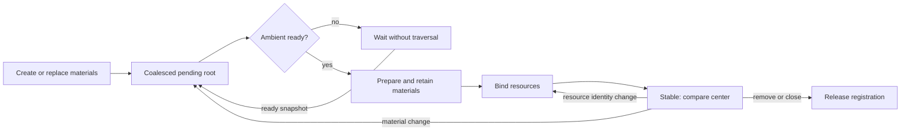

# Entity material lifecycle (O1)

Consolidation proposal for [#1306, O1](https://github.com/tonihele/OpenKeeper/issues/1306), reviewed against upstream master `16f1df4617042db56e99ead51dcfc96e7325351f` on 18 November 2026. Maintainer agreement on the integration path is pending.

## Decision and contribution history

Use one event-driven lifecycle, following #1133's scheduling direction, with #1131's injection boundary, #1081's readiness contract, and #1012's useful material retention and mutation coverage. The older branches are alternatives to reconcile, rather than dependencies to merge wholesale. All four PRs were opened by adrian-andrzjewski; their original discussions and commits remain available.

| Source / reviewed head | Retained | Replaced or kept separate |
| --- | --- | --- |
| [#1081](https://github.com/tonihele/OpenKeeper/pull/1081), `180e874dd90032a59f1e3825694ae8affb2eec74` | Pending setup until ambient readiness; coherent resource publication | Separate configured/pending maps and state-comparison invalidation |
| [#1131](https://github.com/tonihele/OpenKeeper/pull/1131), `03450d8310a336e5f39f23cf845ff3fada3d9c6e` | Injectable provider, resource identity, diagnostic configuration, focused tests | Synchronized weak cache, recurring cache probes and broad factory plumbing |
| [#1133](https://github.com/tonihele/OpenKeeper/pull/1133), `d233fc812cdeda3c37a27fb83c6f8f8fc790875e` | Creation/replacement notifications and removal of four entity material sweeps | Callback plumbing and incomplete effect context shortcut |
| [#1012](https://github.com/tonihele/OpenKeeper/pull/1012), `296c25fc845448dae9219a1fd3c9cf080a22e71a` | Retained materials, animation/variant/charred invalidation, allocation-free light following adapted to current semantics | Spatial user-data cache and recurring effect-element sweeps. Page lighting, SMAA and other independent optimizations stay separate |

### Why a literal merge is insufficient

- A context identity alone does not detect an effect's replacement target on infinite restart.
- Non-null `LightRules` does not guarantee ambient-map readiness. An idle entity must become ready without another ECS event.
- Filling only null texture parameters leaves stale textures and dimensions after context/resource recreation.
- A cache stored in Spatial user data can propagate invalid ownership through cloning. An injected provider does not itself establish thread ownership or cleanup.
- Current master requires `MeshCenter`, blueprint restoration, effect generation and newer light semantics that older patches predate.
- #1081's reported 480-model microbenchmark (0.42–0.51 ms/frame and roughly 126 KiB/frame saved) isolates setup. #1131/#1133's gameplay evidence has variable AI workloads. Neither settles renderer-wide performance or visual parity.

## Architecture and contracts

| Component | Authority |
| --- | --- |
| [`EntityMaterialSetup`](../src/main/java/toniarts/openkeeper/view/material/EntityMaterialSetup.java) | Registrations, pending/waiting queues, retained materials, center storage, binding identity and cleanup |
| [`MaterialProvider`](../src/main/java/toniarts/openkeeper/view/material/MaterialProvider.java) | Injectable `prepare(root, policy, previous)` boundary; no independent cache |
| [`JmeMaterialProvider`](../src/main/java/toniarts/openkeeper/view/material/JmeMaterialProvider.java) | Supported material conversion, isolation and identity deduplication |
| [`MaterialSetupPolicy`](../src/main/java/toniarts/openkeeper/view/material/MaterialSetupPolicy.java) | Immutable WORLD, CREATURE and FULL_BRIGHT behavior |
| [`SceneLights.MaterialBinding`](../src/main/java/toniarts/openkeeper/view/lighting/SceneLights.java) | One immutable publication of light/ambient textures and matching dimensions |

Each view owns its registrations: entity state, effect manager, hand and menu MPD creature. Entity/effect owners accept an injected lifecycle. Tests explicitly inject a fake provider where rendering is absent; a missing production AssetManager fails fast.



1. Register canonical roots once. Requests coalesce by entry; nested registrations delimit ownership even across different view owners.
2. World-lit roots wait without geometry traversal until ambient resources exist. Full-bright roots do not wait.
3. Preparation visits changed geometry only, prunes nested owners, skips unsupported/batched geometry and retains distinct instance-owned materials. Shared source materials are not mutated. Previously owned materials can be reused on invalidation.
4. Replacing resources rebinds retained materials without recollection. An uninitialized replacement context clears the old ambient binding; a missing context clears all old light bindings. Changing image contents does not invalidate setup.
5. `update()` preserves the former `MeshCenter` sampling phase. Stable roots compare centers with reusable vectors; changed centers update retained materials. jME copies the vector when uploading a uniform.
6. `render()` calls `flush()` after logical controls, before submission, so replacement geometry is prepared for its first draw.
7. `unregister()` cancels queued/waiting work and detaches routing. `close()` releases the owner's registrations and retained resources. Child registration/removal queues the nearest parent to recollect its own portion.

Private, unattached loader construction may occur before publication. The first update/flush claims the render thread; subsequent access from another thread fails. There are no locks on the render hot path. Owners are closed on disposal and are not reusable after close.

### Mutation inventory

`EntityMaterialSetup.materialsChanged(spatial)` walks ancestors to the nearest registered root. Its disabled `InvalidationControl` performs no frame work. The entry is transient and cloning creates an inert observer, preventing registration/cache/context transfer to cloned or exported models.

| Event | Integration |
| --- | --- |
| Entity creation/removal | `PlayerEntityViewState.create*Model()` / `removeModel()` |
| Animation geometry replacement | `AnimationLoader.playAnimation()` after resource attachment |
| Blueprint material application/restoration | `AssetUtils.setBlueprint()` / `removeBlueprint()` |
| Variant/charred material replacement | `CreatureVariantTextures.apply()` / `CharredOverlay.apply()` |
| Door lock attachment/removal | `DoorViewControl` lock methods |
| Hand content changes, including empty | `KeeperHandState.updateHand()` and animation notification |
| Menu MPD root replacement | `MainMenuState.update()` tracks actual root identity |
| Effect creation, delayed context, infinite restart | `VisualEffect.load()` / `registerLightTarget()` |
| Mesh particles and self-respawn | `EffectEmitter` spawn, death, respawn and `killAllParticles()` |
| Effect/state removal | `VisualEffect.removeEffect()` / `EffectManagerState.cleanup()` |

Future material/hierarchy replacements must use this notification. Ordinary parameter edits to a retained material need no recollection. This small dependency in mutation helpers avoids parallel callback, provider-cache and ready-flag systems.

Preparation still allocates on actual geometry changes. A bulk readiness/creation event can cause a preparation burst; work is not spread over frames because the first submitted draw must already be correct. The steady-state benchmarks below do not establish initial-load latency. Missing notifications in future mutation paths remain the main maintenance risk; the uncached diagnostic mode helps isolate them.

Explicit effect removal is terminal: subsequent updates return false without recreating lighting or registrations, including a context that became ready during removal. The manager no longer performs a synthetic negative-time update after destruction. Map cleanup also rejects late publication from its background loader.

### Material correctness and dynamic lighting

Conversion uses existing `AssetUtils.createDkSurfaceMaterial()` and preserves diffuse/animated tile parameters, alpha, transparency, blend, cull and depth state. Preserving authored animation/depth state corrects information lost by the old entity-only conversion; uncommon assets using those flags still warrant maintainer visual review.

Full-bright policy is reversible and clears inherited world resources. `AssetUtils.applyVertexLight()` / `applyFullLight()` remain uncached compatibility facades over the same provider; recurring runtime callers have been removed. The model viewer retains its deliberate one-time full-bright call.

Moving/flickering/pulsing lights continue updating through existing `LightRules`/`SceneLights` and GPU lighting textures. Position updates reuse owned storage and retain owner/color/possession behavior. Content uploads are independent of material preparation. No GLSL or renderer backend is changed. GPU offloading of material ownership/invalidation is unwarranted: those responsibilities are CPU object lifecycle work, while lighting evaluation is already on the GPU. Batching, pose evaluation and partial light uploads require separate profiles and designs.

Diagnostic fallback, read when an owner is constructed:

```text
-Dopenkeeper.material.cacheVertexLightingSetup=false
```

It schedules all registered roots every update using the same provider/binder. It is a diagnostic reference, not old master or a live graphics setting.

## Independent #1012 work

Page lighting and SMAA are not on this master baseline and are not imported by O1. No terrain builder, shader, material definition or postprocess file changes in this consolidation.

- The shared binder preserves page-index parameters. Entity preparation clears supported page-only `LightIndexData`, `LightIndexRow`, `LightIndexCount` on its owned copy, never the source material. An additive regression test covers that boundary.
- When reconciling #1012, retain `setTerrainPage`, page slots, index packing/order, atlas ownership, overflow fallback and shader reach. Merge its index path into today's `MeshCenter`-aware shader; copying its older material definition wholesale loses current semantics.
- Preserve SMAA's independent final neighborhood-output wiring and removal of the redundant overlay copy.
- #1012's page report includes a +13.3% comparison against an older baseline but only about +1.3% incremental improvement over its preceding candidate. Its reported SMAA GPU improvement (10.73 to 10.20 ms) is a separate workload. Neither number is O1 evidence.
- A combined page/SMAA renderer has not been built or certified here. Maintainers should reconcile those portions separately after agreeing the canonical O1 lifecycle.

## Validation

### Automated checks

Final `gradlew --no-daemon build --rerun-tasks` passed: **1,404 tests in 253 suites, zero failures, errors or skips**. The 22 focused lifecycle tests include the final removal regression. That regression was also run with frozen pre-fix production classes and failed with one retained registration; it passes with the terminal-removal fix. Whitespace validation uses `git -c core.whitespace=cr-at-eol diff --check` to respect existing mixed line endings.

[`EntityMaterialSetupTest`](../src/test/java/toniarts/openkeeper/view/material/EntityMaterialSetupTest.java) covers stable reuse, late readiness, context/resource/size replacement, absent/loading contexts, coalescing and late flush, actual blueprint restore, moving bounds, shared policy isolation/reversal, nested ownership transfer, clone/binary roundtrip, cleanup, uncached configuration, thread ownership, render-state preservation, batching, real effect restart/respawn/removal, additive page parameters and reusable light positions. Four existing non-rendering effect suites explicitly inject their fake provider.

### Asset-backed visual and gameplay checks

- Real converted Level20 Imp IDLE_1/WALK/IDLE_2, dungeon-heart arch, moving roots/lights, blueprint apply/restore, charred materials, delayed ambient readiness and texture/dimension recreation were rendered at fixed 30 Hz into paired 640×640 framebuffers.
- Six checkpoints in each of two variants (ordinary lights and the actual object-light/MeshCenter shader branch) had **zero differing pixels**, zero RGB mean absolute error and zero maximum channel delta. Nonblank captures were inspected.
- Reference preparation loads frozen master `AssetUtils` in a child-first classloader. Both sides share the current binder/rendering pipeline: these are finite setup-parity tests, not independent old/new renderer certification. Binder transitions also have focused unit tests.
- A final-code Level20 gameplay inspection covered 1,000 measured frames after 600 warmup: 2,889,447 geometry checks, including 2,877,889 Vertex checks, found no missing LightData/AmbientMap. Actual dungeon/unit/torch screenshots were inspected; shutdown completed without a Java exception. The existing steering-loop timing diagnostic reported one 33 ms tick. Inspection is excluded from performance samples.
- No campaign-wide, all-assets or multi-vendor visual acceptance is claimed. Combined #1012 rendering remains untested.

### Performance evidence and limits

Environment: Windows, Ryzen 5 3600, RTX 2060 SUPER, NVIDIA driver 617.42, Java 25.0.4.1, jME 3.9.0-stable, OpenGL 3.2, 1280×720. Same licensed DK2/converted assets and runtime dependencies for baseline and candidate. Baseline uses frozen classes from the master commit above. No production profiling code, benchmark harnesses, assets or raw captures are submitted.

Gameplay protocol: real Level20, normal AI/sound/UI, revealed fog, fixed heart camera, 40 imps plus 100 creatures in a sorted roster, flicker seed 42, separate JVMs, 600 warmup + 3,000 measured frames/run. AI is not deterministic. Summaries are medians of three per-run statistics; P95/P99 use nearest rank. CPU frame is framework BeginFrame→EndFrame wall duration, including driver submission; it excludes some later Main sound work. Allocations cover the render thread only. GPU is an asynchronous GL_TIME_ELAPSED render interval, including submission gaps/scheduling, not shader self-time. Sampler overhead is matched.

| Gameplay capture group | CPU mean / P95 / P99, baseline → candidate (ms) | Allocation, baseline → candidate | GPU mean, baseline → candidate (ms) |
| --- | --- | --- | --- |
| Initial instrumented, uncapped | 8.628 / 11.494 / 17.051 → 7.454 / 9.626 / 16.270 | 298.914 → 170.996 KiB/frame | 1.432 → 1.439 |
| Monitored alternating, uncapped | 8.628 / 11.507 / 15.908 → 9.199 / 14.510 / 21.774 | 299.621 → 198.029 KiB/frame | 1.399 → 1.487 |
| Final phase captures, uncapped | 8.977 / 11.762 / 18.203 → 6.994 / 8.719 / 14.542 | 312.319 → 171.693 KiB/frame | 1.434 → 1.566 |
| Final 60 FPS paced captures | 8.959 / 14.944 / 17.801 → 7.805 / 13.857 / 16.637 | 409.286 → 291.573 KiB/frame | 1.362 → 1.348 |

In the instrumented group, combined entity update+late flush mean fell **1.839→0.406 ms (77.9%)**, P95 2.427→0.965, P99 2.879→1.509. This includes ECS/light following, not material setup alone. Different instrumentation variants must not be pooled. Capped wall interval was approximately 16.67 ms and is not CPU execution cost.

The contrary groups are retained deliberately: visible triangles/lights and GPU clocks varied, a concurrent torus renderer was observed later without recorded overlap, and quiet-start GPU checks cannot exclude subsequent contention. Those facts do not prove the cause of any slow run. Entity/update allocation savings are established for these samples; uniform whole-game/GPU improvement is not.

#### Final fixed-work asset replay

To separate workload variation from setup cost, a separate external SimpleApplication replay rendered 160 real animated Level20 imps and 64 object lights. It used a fixed 60 Hz simulation and frame cap, one scripted animation replacement every third frame, a moving light, ambient initialization at frame 20 and recreation at frame 1,800. Flicker was disabled. Each JVM ran 300 warmup + 1,800 measured frames. The declared schedule was baseline/candidate, candidate/baseline, baseline/candidate (pairs 30–32). No build ran concurrently.

| Fixed replay metric | Baseline | Candidate | Change |
| --- | ---: | ---: | ---: |
| CPU frame mean / P95 / P99 (ms) | 3.457 / 4.253 / 4.832 | 3.167 / 3.909 / 4.795 | Mean −8.4% |
| Material update + late flush mean / P95 / P99 (ms) | 0.492 / 0.600 / 0.684 | 0.043 / 0.081 / 0.117 | Mean −91.4% |
| Render-thread allocation (B/frame) | 55,406 | 19,672 | −64.5% |
| GPU mean / P95 / P99 (ms) | 0.935 / 1.706 / 2.108 | 0.937 / 1.695 / 2.242 | Mean +0.3%; P99 +6.4% |
| Wall interval mean (ms), capped | 16.672 | 16.673 | Approximately unchanged |

| Pair | CPU mean baseline / candidate (ms) | GPU mean baseline / candidate (ms) |
| --- | ---: | ---: |
| 30 | 3.478 / 3.167 | 0.935 / 0.937 |
| 31 | 3.445 / 3.165 | 0.940 / 0.937 |
| 32 | 3.457 / 3.259 | 0.933 / 0.996 |

All 10,800 measured frames had matching per-frame vertex, triangle and jME object-submission counts between paired modes: 480 submissions and 29,920 triangles/frame; mean 53,612.917 vertices/frame. These counters are not an API-level draw-call trace. Texture/shader/framebuffer counters matched too. Uniform counts differed on 145 replacement frames (mean 1,051.955→1,055.729), reflecting changed instance setup rather than identical command streams. Each run had 1,799 available asynchronous GPU samples. Graphics clocks stayed at 1,470 MHz throughout all six captures; sampled device load peaked at 18%.

All six final PNGs were byte-identical, SHA-256 `e9dd2114547322109c5b141d5d311d7e010296fdeaeabc94a215ee4feed596f3`; the nonblank image was inspected. This replay also shares the current binder, loaders and rendering pipeline with reference master preparation, so it isolates O1 and is not full old/new gameplay certification. Material timing includes the baseline MethodHandle call boundary and candidate late flush.

The fixed replay supports lower CPU cost with equivalent submitted geometry and output. It does not establish a GPU improvement: candidate pair 32 has higher GPU tails despite identical geometry, output and clocks. Timer-query intervals include driver submission gaps, and no shader or geometry change explains additional GPU computation; attributing the tail to scheduling remains a hypothesis. GPU-tail variability remains a reviewer follow-up, not a resolved hardware-wide guarantee. CPU mean improved in every fixed pair and CPU P99 improved in the median; the end-to-end result is not inferred from a material-only microbenchmark.

Counter-disabled pilot captures (1, 2, 10, 11), a rejected busy start (20), and the 30-frame smoke (99) were preserved and excluded. The pilot bug was deferred StatsAppState initialization overriding the external harness's initial statistics setting; the corrected harness enables counters after initialization and rejects zero-counter samples. No production fix was needed for that instrumentation issue.

### Reproduction and evidence custody

Run the full suite with JDK 25:

```powershell
.\gradlew.bat --no-daemon build --rerun-tasks
```

For renderer comparisons, use separate JVMs and clean class directories for the pinned master and candidate, identical dependencies/assets/settings, no concurrent build or renderer, and at least three alternating pairs. Record individual runs, rejected starts, work counts, GPU clocks/load, sample counts and all contrary results. Do not compare the diagnostic fallback to master as if they were equivalent baselines.

The external evidence set retains scripts, sources, raw CSV, logs, PNGs, class/source snapshots, hashes and summary formulas. It requires local paths and licensed assets; it is not an in-repository benchmark command. The fixed replay protocol above is intentionally narrower than gameplay. Deterministic full-game replay and a second GPU/vendor remain reviewer follow-ups; no statistical confidence interval or universal FPS claim is inferred from three pairs.

## Review and integration checklist

- [x] One setup/binding/invalidation authority; explicit owner disposal.
- [x] Deferred readiness, replacement geometry, shared sources and dynamic lighting covered.
- [x] No terrain/SMAA rewrites, benchmark code or licensed/local artifacts in production diff.
- [ ] Maintainer agrees this consolidation replaces #1081/#1131/#1133's competing setup implementations.
- [ ] Reconcile #1012's independent page/SMAA work with current MeshCenter and binder contracts; validate the combined renderer.
- [ ] Review unusual authored animated/alpha/depth materials and broader campaign behavior.
- [ ] Repeat on another GPU/driver; use deterministic gameplay replay before general renderer-wide performance acceptance.

Recommended disposition: review one consolidated O1 PR against master; mark #1081/#1131/#1133 superseded only after agreement, retaining attribution/history. Keep #1012 open for independent work and remove/reconcile only its competing entity cache. O1 coordination remains pending until that agreement and required rendering validation are complete.
