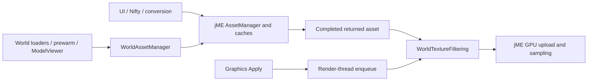

# World texture filtering

The Graphics pages in the main menu and the in-game pause menu offer **Bilinear
(mipmapped)**, **Trilinear**, and **Anisotropic 2× / 4× / 8× / 16×**. Apply changes
filtering immediately, including textures already loaded and textures loaded later.
A filtering-only change does not restart the renderer or rebuild postprocessing.
Display/renderer changes saved during gameplay remain pending until a restart.
Main-menu Apply compares them with the running context, so it also applies those
pending changes even when the displayed preferences were already saved.

Trilinear is the default. Bilinear uses the closest mip level; Trilinear blends
adjacent levels. Anisotropic filtering adds detail on surfaces viewed at an angle.
All modes use mipmaps for eligible world surfaces to reduce distant shimmering.
Higher anisotropy can cost GPU sampling time. The saved choice is retained when
the renderer supports a lower level; the effective value is capped at the device
limit. A renderer without anisotropy falls back to Trilinear for anisotropic modes.

Terrain, rooms, creatures, objects, doors, ceilings, ordinary liquid textures and
other world surfaces follow this choice. Interface artwork, fonts, cursors,
minimaps, shader data, render targets and animation atlases retain their own
sampling rules. Small world textures receive mipmaps too. Atlas frames need
separate, padded mip chains before they can safely use world filtering.

Existing `Anisotropy` preferences migrate without reconverting assets. Values
0 or 1 select Trilinear; larger values select the next supported menu level, capped
at 16×. An explicit `TextureFiltering` choice takes precedence. Applying the
setting saves its stable enum name (`BILINEAR`, `TRILINEAR`, `ANISOTROPIC_2`,
`ANISOTROPIC_4`, `ANISOTROPIC_8`, or `ANISOTROPIC_16`). Unknown names fall back
to the legacy preference. The old property is retained for older versions.

## Architecture and extension contract

`view/texture/WorldTextureFiltering` owns the policy and weak identity registry.
`view/texture/WorldAssetManager` is an injected view of the existing jME asset
manager. It delegates all loading, locator and cache operations and prepares
returned textures, materials and models after loading/deserialization, on both
misses and hits. It does not create a second asset manager or cache.

`Main.simpleInitApp()` creates both objects before menu/game loading and prewarm.
`GameClientState`, `MainMenuState`, `KeeperHandState` and ModelViewer inject the
world manager into their existing loaders. This covers the direct load sites
identified by PR #1083 (ceiling, water, decay, variants, hero gates, highlights and
optional maps) through their existing `AssetManager` parameter. There are no
per-site Trilinear overrides. UI and conversion retain the original manager.

For new world consumers, pass `Main.getWorldAssetManager()` into the loader.
Load ordinary standalone textures through that manager. Models/materials loaded
through it are inspected once at the loading boundary, never scanned per frame.
Material and spatial clones normally share their texture samplers, so registered
samplers stay current even when detached or held in `AssetUtils` template caches.

For manually constructed materials with keyed world textures, use the injected
`WorldTextureFiltering.prepare(material)` after construction and before publication.
For an explicit new sampler clone, call `prepare(texture)`. Pixel updates belong
to the render thread: update the image attached to the managed world texture and
call jME's usual `Image.setUpdateNeeded()`. The renderer regenerates mipmaps on the
next upload. After `Texture.setImage(replacement)`, call `prepare(texture)` again
on the render thread before drawing; the image identity is checked independently
of sampler registration. This also applies to `prepareDerived()` results. An
unchanged sampler/image pair takes the no-write cache path. Do not change managed
sampler filters independently.

`prepareDerived(result, source)` enrolls a generated surface only when its source
is already managed. `CharredOverlay` uses this for baked diffuse textures. Generic
keyless generated images are excluded during material traversal, preventing
accidental enrollment of atlases, minimaps and shader data. A standalone stream
loaded explicitly through the world manager may be keyless and is eligible.

### Eligibility

| Texture use | Policy |
| --- | --- |
| Ordinary keyed world 2D surface map | Selected minification, Bilinear magnification, capped anisotropy; mip chain |
| Normal/specular/parallax/glow/alpha/light/AO/PBR surface maps | Same sampling policy; preserve format, pixels and color space |
| Single-frame world billboard or particle loaded explicitly | Same world policy |
| Animation strips (`NumberOfTiles > 1`), keyless generated atlases, `Sprites/` sheets | Existing sampler; no automatic mip generation |
| `Interface/`, `Textures/GUI/`, loading/title artwork, InGameDigit, MapBack/MapRock/MapOver | Existing sampler |
| LightData, AmbientMap, exploration/minimap rasters, LUTs and other non-surface parameters | Existing sampler |
| Depth, multisampled, GPU-only targets, cube/array/3D textures | Existing sampler |
| Safe charred diffuse derivative of a managed surface | Inherit managed role and live settings |

Material traversal has a small explicit surface-parameter allowlist. Add a new
surface parameter there with a focused test when introducing a new material
definition. Do not enroll data maps just because their dimensions are large.
The 128×128 threshold from PR #1083 is deliberately removed: screen-space
minification and texture purpose determine benefit, not source size alone.

### Cache and threading rules

The facade does not mutate `TextureKey`, restore keys on cached originals, clear
caches, or re-key assets when settings change. jME's weak clone cache intentionally
keeps original keys null. Returned standalone samplers can differ while sharing
one `Image`. Materials/models can share the very same sampler. The registry uses
weak identity keys because `Texture.equals/hashCode` depend on mutable filters;
an equality-based weak map loses entries and merges distinct equal samplers.

`prepare(texture)` and `refresh(mode)` synchronize publication with the current
settings snapshot. A newly returned, unpublished texture can be prepared on a
loader thread. Already registered samplers are not rewritten on cache hits.
`Main.applyTextureFiltering()` queues changes on the render thread, and refresh
updates registered samplers, including detached ones. Equal selection/capability
snapshots return immediately. `Main.reshape()` refreshes hardware limits after
renderer recreation. ModelViewer creates an independent instance with the same
policy. Closing either application clears its weak bookkeeping; jME continues
to own GPU objects and its native-object cleanup.

Sharing one sampler between a world surface and deliberately different UI use
is invalid: use separate sampler clones sharing the image, or load UI through
the raw manager. New material replacements must carry already managed texture
values or pass through preparation before publication. This is an explicit
ownership boundary, not a global interceptor of arbitrary `Material.setTexture()`.

### Mipmap lifecycle and the jME 3.9 late-upload case

Normal world loads request mipmaps before first GPU upload. All six modes need
the same chain, so live switching only changes sampler state; it neither copies
pixels nor uploads/regenerates mip levels. Supplied mip chains are preserved.

An image first uploaded without mipmaps needs special treatment in jME 3.9:
`GLRenderer` leaves `GL_TEXTURE_MAX_LEVEL` at zero on a later mip request. Merely
setting a mipmapped min filter can report generated mipmaps without allocating
usable lower levels. The native GPU regression test checks actual level widths,
not just Java flags.

On first adoption of such an image, the policy creates one fresh world `Image`
sharing the original CPU buffer, and subsequent samplers reuse it. The original
GPU image remains usable by UI; no immediate disposal invalidates shared users.
Use a fresh constructor, not `Image.clone()`: jME 3.9 cloning also copies a cached
weak binding reference. This exceptional path may temporarily allocate another
base level plus mip chain on the GPU. Normal world-first loads have one shared
GPU image. Once managed, dirty images regenerate in place through jME.

This replaces the investigation's tentative deferred-disposal approach: the
facade makes roles explicit, and fresh image adoption avoids a render-queue
maintenance task and destruction of resources the service does not own.

### Cost and visual behavior

There is no per-frame scene walk or texture registry pass. Load boundaries
inspect returned world assets; refresh visits live registered samplers only
after a real selection/capability change. `AssetUtils` retains its current strong
and weak template caches. A filtering service does not extend texture lifetimes.

Mipmaps cost generation time on first upload and extra GPU storage. A complete
square uncompressed chain is approximately 4/3 of the base level; long one-pixel
textures can approach 2×. Bilinear, Trilinear and anisotropic modes share that
storage. Mipmaps can improve cache locality and reduce aliasing during
minification; Trilinear softens transitions between levels; anisotropy can improve
oblique detail at additional sampling cost. These are rendering characteristics,
not guaranteed gameplay FPS gains. No custom alpha-coverage or normal-map mip
reduction is introduced, and existing wrap, UV, alpha/blend and color-space rules
remain unchanged.

## Contribution reconciliation

This implements [O3 in #1306](https://github.com/tonihele/OpenKeeper/issues/1306)
as one policy, combining these contributions:

- **[PR #885](https://github.com/tonihele/OpenKeeper/pull/885), belgianguy:** retain
  six stable choices, persisted preference/migration, both menu controls, live
  application and requested-versus-effective anisotropy. Replace its global
  listener, cached-original key restoration and mutable-hash weak registry.
- **[PR #1083](https://github.com/tonihele/OpenKeeper/pull/1083),
  adrian-andrzjewski:** retain the world mipmap objective, coverage of direct and
  serialized loading paths, atlas caution and measurement discipline. Consolidate
  the helper calls into the world boundary; remove the dimension threshold and
  hardcoded Trilinear overwrite. Experimental benchmarks remain outside production.

Carry one consolidation change based on current master, crediting both authors
in its description and commit attribution. Supersede the overlapping
implementations after maintainer and contributor agreement; do not merge their
listeners/helpers side by side. O3's coordination checkbox remains open until
that agreement is recorded. Issue #49 is the original user-facing request;
#1307's broader task splitting is separate from this rendering change.

## Independent review follow-up

The independent review requested changes for two Medium findings; it identified
no Critical or High findings. Both are fixed:

- Main-menu restart detection now compares requested settings with jME's running
  context copy, rather than the mutable saved preferences. Unit tests cover every
  compared renderer option, pending pause-menu preferences and filtering-only
  changes. An actual pause-to-main-menu gamma change exercises context recreation.
- Texture registration tracks the last prepared image weakly. Replacing an image
  and explicitly preparing the sampler again now applies late-upload adoption;
  unchanged cache hits still avoid writes. Unit and native GPU tests cover this
  lifecycle for existing samplers and safe generated derivatives.

The Low test-coverage finding is also addressed: the native test changes base
pixels to solid red and reads every mip-level-one texel to verify regeneration.
It queries effective GL anisotropy when the extension is available, alongside
all six minification modes, stable image IDs and exact framebuffer restoration.

## Implementation and acceptance checklist

- [x] Start from current master in an isolated feature worktree.
- [x] One injected policy and shared-cache world manager; remove key-mutating listener.
- [x] Six modes, migration, hardware caps, both menus and live render-thread updates.
- [x] Prepare complete J3M/J3O results and cache hits; preserve clone-cache contracts.
- [x] Weak identity tracking, detached templates, generated charred surfaces and cleanup.
- [x] Purpose-based eligibility; preserve animation strips, UI, minimaps and data maps.
- [x] Handle pre-upload, supplied mips, exceptional late adoption and dirty-image uploads.
- [x] Focused policy, serialization/cache, concurrency and native GPU regression tests.
- [x] Resolve the independent review's pending-context and replacement-image findings.
- [x] Verify changed mip texels and effective GL anisotropy in the native regression.
- [x] Fix the shared cursor-buffer/cache initialization race found during gameplay validation.
- [x] Keep benchmarks, diagnostic code, captures and temporary game assets outside this change.
- [x] Complete final build, gameplay comparison and menu validation record in
  [the validation report](validation/world-texture-filtering-2026-11-18.md).
- [ ] Maintainer review of the deliberate mipmapped default and atlas exclusions.
- [ ] Broaden hardware qualification to AMD/Intel and lower-memory devices when available.

Engine behavior is pinned to jME 3.9.0-stable:
[DesktopAssetManager](https://github.com/jMonkeyEngine/jmonkeyengine/blob/v3.9.0-stable/jme3-core/src/main/java/com/jme3/asset/DesktopAssetManager.java),
[Texture](https://github.com/jMonkeyEngine/jmonkeyengine/blob/v3.9.0-stable/jme3-core/src/main/java/com/jme3/texture/Texture.java),
[WeakRefCloneAssetCache](https://github.com/jMonkeyEngine/jmonkeyengine/blob/v3.9.0-stable/jme3-core/src/main/java/com/jme3/asset/cache/WeakRefCloneAssetCache.java),
[Image](https://github.com/jMonkeyEngine/jmonkeyengine/blob/v3.9.0-stable/jme3-core/src/main/java/com/jme3/texture/Image.java),
[GLRenderer](https://github.com/jMonkeyEngine/jmonkeyengine/blob/v3.9.0-stable/jme3-core/src/main/java/com/jme3/renderer/opengl/GLRenderer.java).
